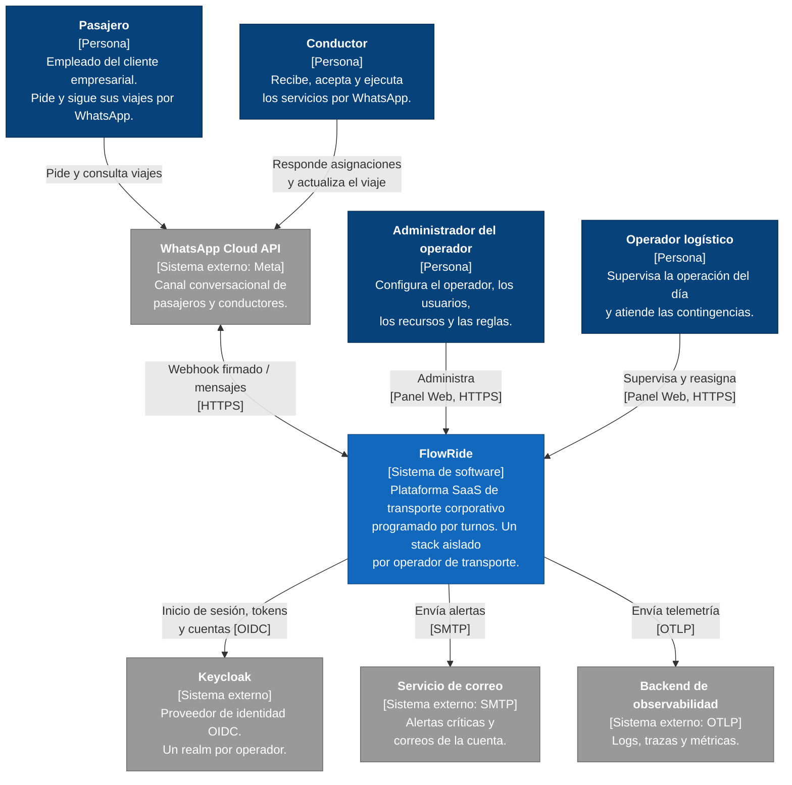
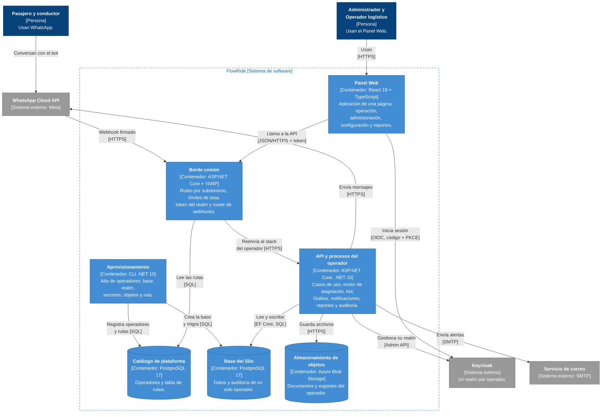
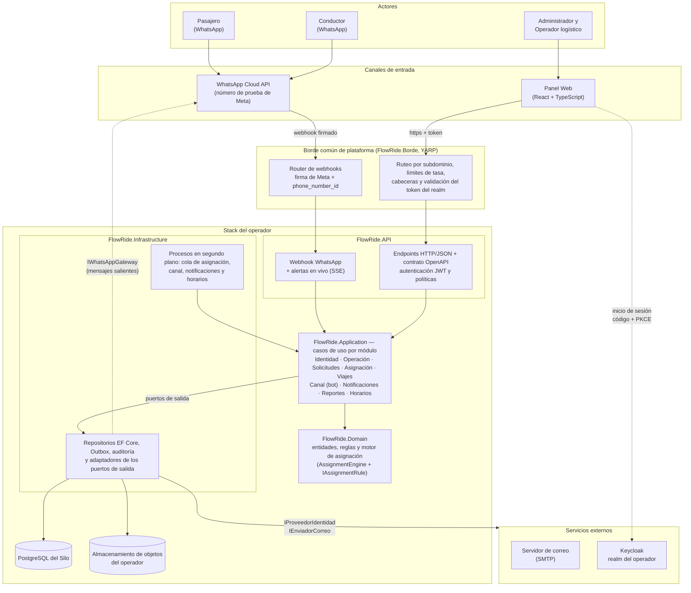
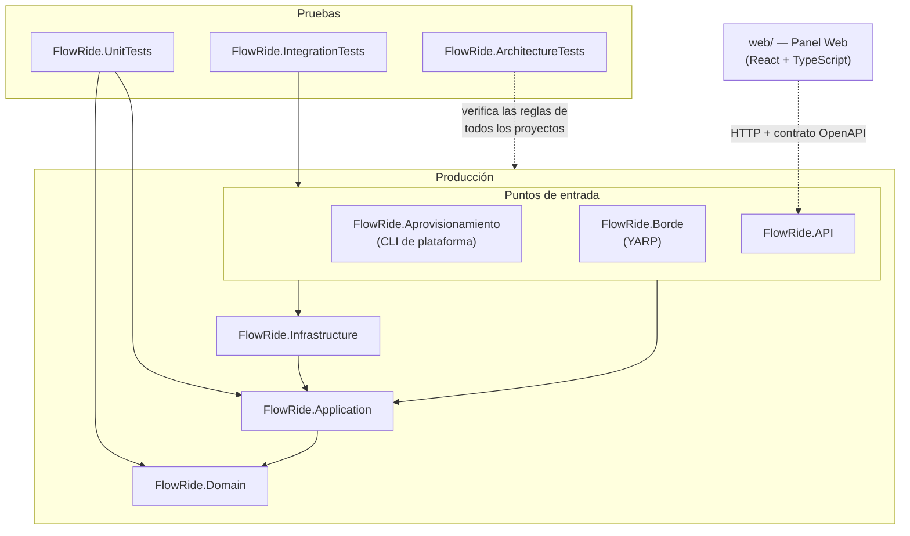
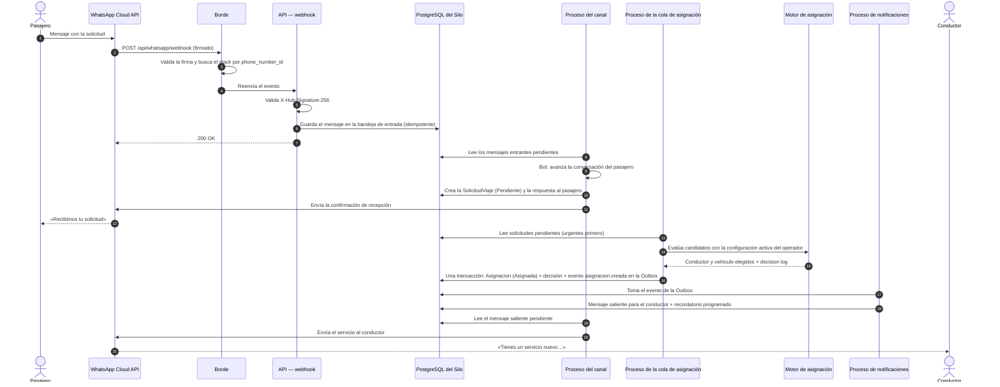
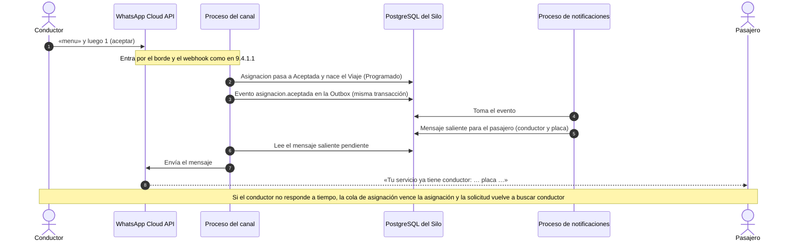
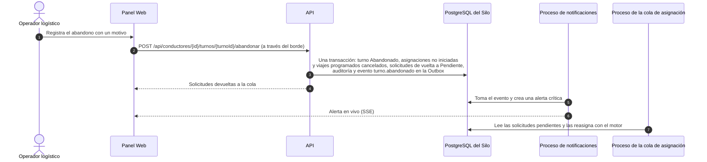
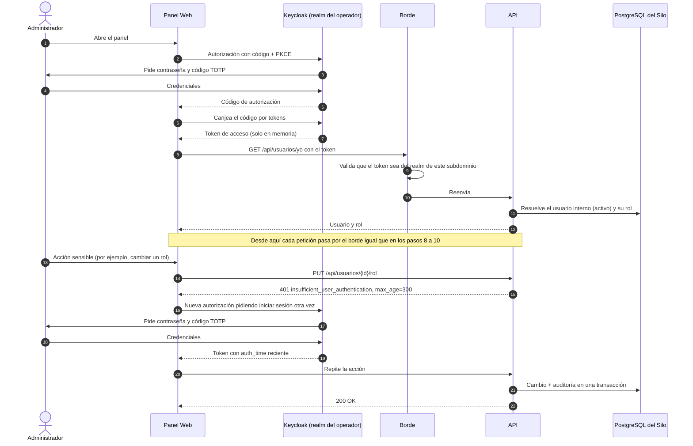
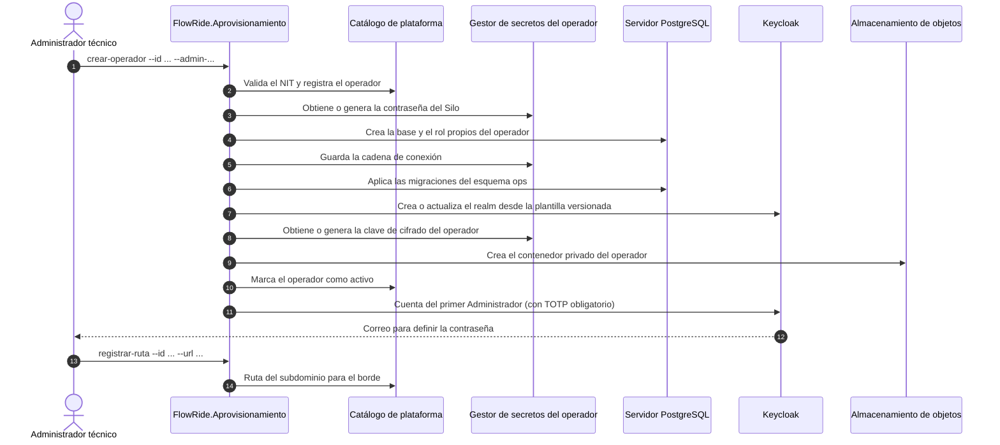
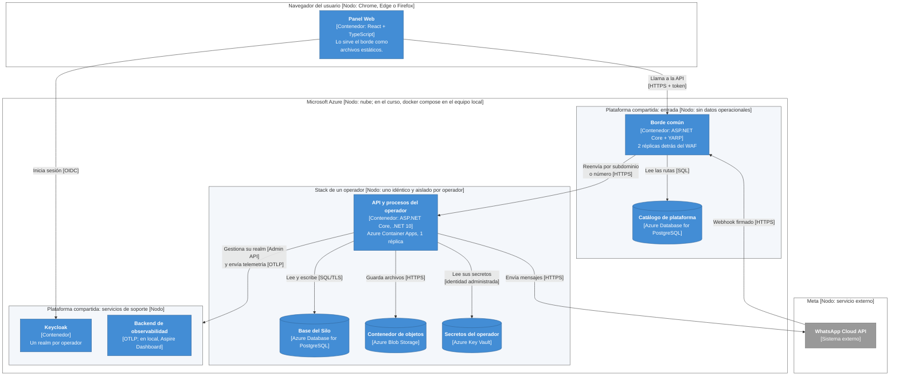

> Documento de Arquitectura de Software (DAS)

> Proyecto

> FlowRide

> Arquitectos

> Sebastián Zapata

> Jhonny Benitez

# Control de cambios y revisiones

| Versión | Fecha | Tipo | Descripción | Autor |
| --- | --- | --- | --- | --- |
| 1.0 | 04/08/2026 | Creación | Versión inicial del documento de arquitectura de software de FlowRide | Sebastián Zapata, Jhonny Benitez |
| 2.0 | 07/10/2026 | Revisión | Actualización con el contexto maestro v10, los drivers arquitectónicos vigentes, los ADR-0001 a ADR-0017 y la línea base del repositorio (alcance RF-10) | Sebastián Zapata, Jhonny Benitez |
| 3.0 | 22/10/2026 | Revisión | Conversión a Markdown para la entrega. Alineación con los ADR revisados (ADR-0003, ADR-0004, ADR-0008, ADR-0010) y los nuevos ADR-0018, ADR-0019 y ADR-0020 (fechas con zona horaria); disponibilidad del canal WhatsApp en 99,5 %; telemetría GPS y ETA (RF-55, RF-56, ADR-0005) fuera del alcance de V1; línea base actualizada con lo implementado (Fases 0 a 11b-1); diagramas de componentes, paquetes, secuencia y despliegue en Mermaid. Las secciones marcadas «(NO)» en la plantilla del curso se dejan indicadas como no aplicables. | Jhonny Benitez |
| 3.1 | 28/10/2026 | Revisión | Diseño de alto nivel con el modelo C4: diagrama de contexto (nivel 1, sección 4.1) y de contenedores (nivel 2, sección 6.1); diagrama de despliegue en notación C4 (sección 9.5.1); figuras renumeradas. | Jhonny Benitez |

# 1. Propósito del proyecto

> No aplica en esta entrega: la plantilla del curso marca esta sección como «(NO)». El contexto del producto se resume al inicio de la sección 2.

# 2. Motivadores de la arquitectura

Los motivadores de la arquitectura (drivers arquitectónicos) son los elementos que condicionan de manera significativa las decisiones de diseño de FlowRide. Se agrupan en cuatro categorías: restricciones técnicas, restricciones de negocio, atributos de calidad priorizados y funcionalidades arquitectónicamente significativas. Toda decisión arquitectónica (ADR), táctica, building block o PoC debe poder relacionarse con al menos uno de estos motivadores.

FlowRide es una plataforma SaaS de gestión de transporte corporativo interno con modelo B2B2B: se vende al operador de transporte (un tenant = un operador), que presta el servicio a un cliente empresarial más grande (por ejemplo, una aerolínea). Reemplaza un sistema real pero frágil, en el que un administrador coordina la operación desde su celular con WhatsApp y Excel. El caso ancla, validado con un cliente informal que atiende tripulaciones aéreas, coordina alrededor de 40 servicios diarios con 4 o 5 conductores; estas cifras son validación real de ese cliente y no estadística de mercado.

Las fuentes de esta sección son el documento de Drivers Arquitectónicos actualizado y las hojas RestriccionesTecnicas, RestriccionesNegocio, FuncionalidadesSignificativas y tradeoff_FlowRide (en esta entrega, `drivers-arquitectonicos.md`, `restricciones-tecnicas.md`, `restricciones-negocio.md`, `funcionalidades-significativas.md` y `tradeoff-atributos-calidad.md`).

**Ajustes de alcance de la versión 3.0.** Desde la versión 2.0 cambiaron tres hechos que esta sección refleja: (1) la telemetría GPS y la detección de desviación de ETA (RF-55, RF-56) quedaron fuera del alcance de V1, porque ADR-0005 sigue en estado *Proposed*; sus restricciones, trade-offs y escenarios se conservan por trazabilidad, marcados como fuera de alcance; (2) ADR-0010 fijó la disponibilidad del canal WhatsApp en 99,5 % (antes 99,9 %); (3) el proveedor de WhatsApp quedó definido en ADR-0008: el número de prueba de Meta (WhatsApp Cloud API) detrás de `IWhatsAppGateway`.

## 2.1 Restricciones técnicas

Las restricciones técnicas son límites o decisiones tecnológicas que el diseño debe respetar. Pueden ser propias del producto o impuestas por el negocio, por la operación o por un proveedor externo, y acotan el espacio de alternativas que se evalúa en cada ADR. FlowRide tiene las siguientes:

| # | Tipo | Categoría | Restricción técnica | Justificación |
| --- | --- | --- | --- | --- |
| 1 | Propia del producto | Prácticas de diseño | El diseño y la implementación deben aplicar principios SOLID y mantener bajo acoplamiento y alta cohesión entre componentes. | La mantenibilidad es un atributo crítico de FlowRide. Las reglas de negocio, integraciones y persistencia deben poder evolucionar con impacto localizado. SOLID sirve como restricción de diseño para evitar clases con responsabilidades mezcladas, dependencias rígidas y extensiones que obliguen a modificar código estable. |
| 2 | Propia del producto | Estructura de software | La solución debe preservar separación explícita entre dominio, aplicación, infraestructura y mecanismos de entrada, con dependencias dirigidas hacia el núcleo de negocio. | La lógica de transporte no debe depender de Entity Framework, proveedores de identidad, WhatsApp ni detalles de despliegue. La estructura actual Domain / Application / Infrastructure / API se conserva como base porque permite sustituir implementaciones externas sin contaminar el dominio, independientemente de la arquitectura general que se documente en su ADR. |
| 3 | Propia del producto | Modelado de dominio | El dominio debe modelarse con DDD, lenguaje ubicuo y límites claros entre responsabilidades operativas; se mantienen modelos anémico y enriquecido como representaciones complementarias del mismo dominio. | FlowRide contiene reglas específicas sobre solicitudes, asignaciones, viajes, conductores, vehículos, telemetría, calificaciones y restricciones regulatorias. El modelado debe reflejar esas reglas de negocio y no reducirse a estructuras CRUD o tablas sin comportamiento ni contexto. |
| 4 | Propia del producto | Plataforma tecnológica | El backend de FlowRide se desarrolla en C# sobre .NET 10. | .NET 10 cubre las necesidades actuales de API, asincronía, seguridad, observabilidad y ejecución multiplataforma. Mantener un único stack backend evita introducir complejidad tecnológica sin un driver que la justifique. |
| 5 | Propia del producto | Interoperabilidad | Las interfaces síncronas del backend deben exponerse mediante HTTP/HTTPS y JSON; las integraciones orientadas a eventos externos, como WhatsApp, deben ingresar mediante webhooks autenticados y validados. | El Panel Web consume la API directamente y WhatsApp funciona como integración externa. Esta restricción mantiene contratos tecnológicos simples y estándar, permite desacoplar proveedores concretos y facilita pruebas de integración y observabilidad. |
| 6 | Propia del producto | Persistencia | PostgreSQL es el motor relacional principal para los datos transaccionales de cada instancia de FlowRide. | El núcleo operativo requiere integridad referencial, transacciones y consultas relacionales sobre usuarios, solicitudes, asignaciones y viajes. PostgreSQL se mantiene como base transaccional vigente; necesidades especializadas como series temporales de telemetría pueden utilizar mecanismos adicionales siempre que no alteren el contrato transaccional del núcleo. |
| 7 | Impuesta por negocio | Multi-tenancy | Cada operador de transporte debe estar físicamente aislado de los demás tenants mediante un modelo Silo; el aislamiento entre operadores no puede depender únicamente de filtros lógicos por empresaId. | Un tenant de FlowRide es un operador de transporte. La confidencialidad entre operadores y la contención de fallos son requisitos de negocio. empresaId se conserva únicamente para identificar al cliente empresarial atendido dentro de la base del operador, por ejemplo una aerolínea, minera u hospital. |
| 8 | Propia del producto | Autenticación y autorización | La solución de identidad debe estar desacoplada del dominio, utilizar tokens firmados para las sesiones del API, soportar autorización por roles y permitir revocación efectiva de acceso en un máximo de 60 segundos. | La autenticación debe permitir RBAC para Pasajero, Conductor, Administrador del operador y Operador logístico, revocación rápida y validación segura de sesión. El aislamiento entre tenants se resuelve por Silo y no puede depender de un claim empresaId. |
| 9 | Impuesta por proveedor externo | Integración WhatsApp | La integración debe utilizar la API oficial de WhatsApp Business y quedar encapsulada detrás de un adaptador que evite acoplar la lógica de negocio a Twilio, Meta Cloud API u otro proveedor concreto. | WhatsApp es el único canal funcional para pasajeros y conductores. El proveedor quedó definido en ADR-0008: el número de prueba de Meta (WhatsApp Cloud API) para el alcance académico, detrás de `IWhatsAppGateway`, con evolución a un número propio sin cambiar el dominio. El webhook debe validar autenticidad, manejar reintentos e idempotencia y respetar las políticas de plantillas y ventanas conversacionales de Meta. |
| 10 | Impuesta por operación | Telemetría GPS | **Fuera del alcance de V1** (RF-55, RF-56; ADR-0005 en estado *Proposed*). Se conserva por trazabilidad: la plataforma debe soportar una ingesta sostenida de al menos 100 eventos de ubicación por minuto por instancia y conservar la telemetría GPS durante 6 meses. | El dimensionamiento vigente considera hasta 50 conductores/vehículos reportando ubicación aproximadamente cada 30 segundos. La telemetría se utiliza para monitoreo y detección de desviaciones de ETA; no puede convertir el motor de asignación en un esquema de reasignación dinámica por cercanía. |
| 11 | Impuesta por operación | Rendimiento | Las operaciones CRUD críticas deben cumplir P95 < 500 ms y P99 < 1,5 s; las consultas de estado P95 < 300 ms y P99 < 1 s; los reportes operacionales P95 < 2 s y P99 < 5 s. | El dimensionamiento vigente es de hasta 200 usuarios simultáneos por instancia. Las metas se expresan por percentiles y tipo de operación para que sean medibles y representen el comportamiento real del sistema bajo carga. |
| 12 | Impuesta por operación | Disponibilidad | La solución debe diseñarse para objetivos de disponibilidad diferenciados: 99,5 % para el canal WhatsApp (revisado desde 99,9 % en ADR-0010), 99,5 % para el motor de asignación y operaciones críticas, y 99 % para el Panel Web Administrativo. | No todos los componentes tienen el mismo impacto operacional. La disponibilidad, recuperación, monitoreo y alertamiento deben priorizarse según estos tiers y no mediante un único porcentaje general para toda la plataforma. |
| 13 | Propia del producto | Consistencia | Las operaciones que cambian simultáneamente solicitud, asignación, conductor, vehículo o viaje deben preservar atomicidad y no dejar estados parciales o contradictorios ante fallos o concurrencia. | La asignación es el núcleo operativo de FlowRide. Si falla una conexión o dos procesos compiten por el mismo conductor, el sistema debe mantener una única verdad transaccional. El patrón concreto de consistencia y publicación de eventos se documentará en la decisión arquitectónica correspondiente. |
| 14 | Propia del producto | Caché | La caché solo puede utilizarse para datos de consulta frecuente y baja volatilidad; nunca puede convertirse en fuente de verdad para solicitudes, asignaciones, viajes en curso o telemetría. | Cualquier tecnología de caché debe respetar el aislamiento Silo, utilizar invalidación explícita y evitar información obsoleta en datos operacionales críticos. La implementación concreta puede variar sin cambiar esta restricción. |
| 15 | Propia del producto | Observabilidad | Los eventos técnicos y operativos críticos deben registrarse de forma estructurada e incluir como mínimo traceId, identificador del tenant, timestamp, componente y resultado de la operación. | FlowRide necesita reconstruir flujos completos desde la recepción de una solicitud hasta la asignación, notificación y viaje. La observabilidad debe permitir correlación entre API, motor, integraciones y telemetría sin mezclar datos de operadores distintos. |
| 16 | Impuesta por negocio | Seguridad de datos | Toda comunicación externa debe utilizar cifrado en tránsito y los datos sensibles deben protegerse en almacenamiento según su riesgo; el acceso a información personal y ubicación debe estar limitado por rol y contexto operacional. | La plataforma procesa datos personales y telemetría GPS. La seguridad no puede depender únicamente de autenticación: debe existir defensa en profundidad sobre transporte, persistencia, autorización, auditoría y exposición mínima de datos. |
| 17 | Impuesta por negocio | Costo operacional | La plataforma tecnológica debe poder operar dentro de un objetivo aproximado de 20 a 40 USD mensuales de infraestructura básica por tenant, sin contar costos variables razonables del canal WhatsApp. | El pricing previsto de 150 a 500 USD mensuales por instancia obliga a que autenticación, persistencia, observabilidad, almacenamiento y despliegue mantengan una relación costo/beneficio sostenible. Una alternativa técnicamente superior puede descartarse si vuelve inviable el modelo por tenant. |
| 18 | Propia del producto | Control de versiones y calidad | El código fuente debe gestionarse con Git/GitHub, trabajo por ramas, revisión mediante Pull Request y análisis estático automatizado antes de integrar cambios a develop y a main (ADR-0018). | La trazabilidad del código y la detección temprana de defectos son parte de la línea base técnica. Se implementó con GitHub Actions: compilación sin advertencias, formato, pruebas con cobertura, verificación del frontend y escaneo de secretos con gitleaks (también como hook antes de cada push); SonarCloud queda como complemento opcional. |
| 19 | Propia del producto | Código y pruebas | La implementación debe aplicar prácticas de Clean Code y mantener pruebas automatizadas sobre las reglas de negocio y los flujos críticos. | Nombres claros, funciones acotadas, ausencia de código muerto y pruebas repetibles reducen el costo de cambio. Las abstracciones de repositorios e integraciones deben permitir sustituir infraestructura real por dobles de prueba sin modificar la lógica del dominio. |

Nota de trazabilidad: el objetivo original del canal WhatsApp era 99,9 %. ADR-0010 (revisión del 22-09-2026) lo ajustó a 99,5 %, porque el ingreso de mensajes depende del stack del operador; lo que se protege por encima de ese nivel es la pérdida de mensajes (0 mensajes perdidos dentro de la ventana de reintentos de Meta). Desde la versión 3.0 la restricción ya expresa el valor revisado.

## 2.2 Restricciones de negocio

Las restricciones de negocio son condiciones impuestas por el modelo comercial, el mercado objetivo, el marco legal, los proveedores o los procesos de la organización. Aunque no tienen origen tecnológico, la arquitectura debe respetarlas. Cada una se registra con su justificación y el plan de acción que la lleva al diseño:

| # | Tipo | Restricción de negocio | Justificación | Plan de acción |
| --- | --- | --- | --- | --- |
| 1 | Comercial | FlowRide opera bajo un modelo B2B2B: el cliente directo de la plataforma es el operador de transporte corporativo, no el pasajero ni la empresa empresarial atendida por ese operador. | Esta relación define quién compra el servicio, quién administra la operación y qué conceptos pertenecen al dominio. El pasajero es usuario del servicio, pero no paga por viaje; la aerolínea, minera u hospital es cliente del operador, no de FlowRide. | El producto, sus contratos y sus funcionalidades se diseñan alrededor del operador como tenant. Se excluyen del dominio el tarifario al pasajero, el cobro por viaje y las pasarelas de pago. Los reportes entregan información operacional que puede servir al operador para su facturación externa, pero FlowRide no factura. |
| 2 | Comercial | El mercado objetivo exige tres condiciones simultáneas: operación B2B2B, horarios estrictos y flota propia o bajo contrato exclusivo del operador. | El valor del producto depende de que el incumplimiento de un servicio tenga una consecuencia operacional o contractual real. El caso ancla validado es transporte de tripulaciones aéreas; otros sectores solo encajan si reproducen esa misma forma operacional. | Se priorizan operadores con servicios programados y responsabilidad contractual sobre puntualidad. Ride-hailing, turismo/chárter B2C, transporte escolar, delivery y transporte público municipal quedan fuera del producto porque cambian comprador, regulación y modelo de operación. |
| 3 | Comercial | La validación real disponible corresponde a un caso ancla de transporte de tripulaciones aéreas. Minería, salud y otras verticales son posibilidades de expansión, no clientes validados actualmente. | Presentar como hechos de mercado lo que solo es una hipótesis debilitaría las decisiones del producto y podría llevar a incorporar necesidades que nunca fueron verificadas. | Toda afirmación comercial distingue entre dato validado, hipótesis y capacidad futura. El diseño se mantiene neutral donde sea razonable, pero no se incorporan funcionalidades específicas de otra vertical hasta que exista una necesidad real que las justifique. |
| 4 | Operativa | La operación de transporte es programada por turnos, recurrencia y disponibilidad. La telemetría GPS se utiliza para monitorear el viaje y detectar desviaciones de ETA, no para reasignar conductores dinámicamente por cercanía. En V1 la telemetría queda fuera de alcance (ADR-0005): el monitoreo del viaje se hace por estados y horarios, sin ubicación. | Convertir el motor en un esquema tipo ride-hailing cambiaría el problema que FlowRide resuelve. El cliente ancla necesita que la asignación deje de depender de la cabeza del administrador, pero manteniendo la lógica de servicios programados. | El motor aplica reglas configurables por tenant sobre disponibilidad, turnos, balance de carga, restricciones regulatorias y condiciones del servicio. La ubicación se usa como información de monitoreo del viaje en curso, no como criterio de competencia en tiempo real entre conductores. |
| 5 | Operativa | WhatsApp es el único canal funcional para pasajeros y conductores. El Administrador del operador y el Operador logístico utilizan el Panel Web Administrativo. | La propuesta de valor busca eliminar fricción de adopción: pasajeros y conductores ya usan WhatsApp y no deben instalar una aplicación adicional. Añadir chat in-app, app móvil nativa o múltiples canales duplicaría flujos, autenticación y soporte. | Los flujos de solicitud, confirmación, aceptación, rechazo, actualización del viaje y calificación se diseñan para WhatsApp. El panel concentra administración, monitoreo, intervención manual y reportes. El correo se limita a funciones administrativas como recuperación de credenciales cuando aplique. |
| 6 | Proveedor | El canal WhatsApp está sujeto a las políticas comerciales y técnicas de Meta, incluidas reglas de plantillas, ventanas de conversación y restricciones de contenido. | FlowRide no controla estas políticas y una suspensión del número o un cambio en las condiciones del servicio puede afectar el canal principal de pasajeros y conductores. | Se diseñan los mensajes y plantillas conforme a las políticas vigentes y se desacopla la integración del proveedor técnico concreto. La operación debe detectar fallos del canal y alertar al Administrador del operador; cualquier contingencia por fuera de WhatsApp se gestiona como procedimiento operativo del operador, no como un canal adicional del producto. |
| 7 | Legal | FlowRide trata datos personales de pasajeros y conductores, incluyendo identificación, contacto, historial operacional y ubicación asociada a telemetría GPS, por lo que debe cumplir la Ley 1581 de 2012 y el régimen colombiano de protección de datos. | La ubicación y los historiales de movilidad elevan el impacto de una fuga, uso indebido o acceso no autorizado. El operador cliente actúa como responsable del tratamiento y FlowRide como encargado que procesa los datos siguiendo sus instrucciones. | Se aplican controles de acceso por rol, cifrado en tránsito y en reposo cuando corresponda, auditoría de acciones sensibles, mecanismos para atender derechos de acceso, rectificación, actualización, supresión y revocatoria, y medidas específicas para evitar exposición de ubicación en solicitudes personales. |
| 8 | Datos | Los datos operacionales pertenecen al operador cliente y deben permanecer aislados de los demás tenants. FlowRide solo puede utilizar información agregada y anonimizada para métricas de producto. | El modelo SaaS atiende varios operadores y la confidencialidad entre ellos es una condición contractual. Un error de aislamiento sería una violación de privacidad y de confianza comercial. | Cada operador se implementa con aislamiento físico tipo Silo. El identificador empresaId se utiliza dentro de la base del operador para identificar al cliente empresarial atendido, no para separar tenants. El aprovisionamiento, backup y migración deben preservar ese aislamiento. |
| 9 | Datos | La retención de información debe equilibrar trazabilidad, obligaciones legales, sensibilidad y costo de almacenamiento. | Guardar indefinidamente telemetría o auditoría sin criterio aumenta exposición y costo; eliminar demasiado pronto puede impedir responder reclamaciones o reconstruir incidentes. | Se adopta como marco vigente: datos operacionales activos mientras el contrato esté vigente; históricos archivados después de 24 meses; telemetría GPS por 6 meses (no aplica en V1, ADR-0005); auditoría legal por 5 años. Cualquier cambio contractual o normativo debe actualizar estas políticas de forma explícita. |
| 10 | Legal | El operador de transporte debe cumplir la regulación colombiana aplicable al transporte especial, incluyendo habilitación, licencias vigentes y revisión técnico-mecánica de los vehículos. | FlowRide no sustituye ni asume la responsabilidad legal del operador, pero una asignación que ignore una licencia vencida o un vehículo no habilitado puede facilitar una operación inválida. | Las restricciones regulatorias relevantes se modelan como reglas de dominio: bloquear asignaciones cuando la licencia esté vencida, impedir vehículos no habilitados y generar alertas de vencimientos. La responsabilidad jurídica por mantener los documentos vigentes permanece en el operador. |
| 11 | Comercial | El contrato SaaS se celebra entre FlowRide y el operador de transporte e incluye confidencialidad, tratamiento de datos, aislamiento, notificación de incidentes y propiedad de la información. | Sin una delimitación contractual clara se confunden responsabilidades entre FlowRide, el operador y el cliente empresarial atendido por este último. | Los contratos deben establecer que el operador es responsable frente a pasajeros y conductores, FlowRide procesa datos por instrucción del operador, los datos identificables son propiedad del operador y los incidentes de seguridad se notifican conforme a los compromisos pactados. |
| 12 | Presupuesto | La arquitectura debe mantenerse dentro de un sobre operacional aproximado de 20 a 40 USD mensuales de infraestructura básica por tenant, más costos variables razonables del canal WhatsApp. | El modelo comercial estimado de 150 a 500 USD mensuales por instancia no soporta decisiones tecnológicas cuyo costo fijo por tenant consuma una parte desproporcionada del ingreso. | Toda tecnología de infraestructura, autenticación, observabilidad, persistencia o integración se evalúa por costo total de operación y no solo por costo de licencia. Se prefieren alternativas que mantengan el aislamiento y los SLA sin romper la viabilidad económica del tenant. |
| 13 | Operativa | Los niveles de servicio son distintos según la criticidad del componente: WhatsApp 99,5 % (revisado desde 99,9 % en ADR-0010), motor de asignación y operaciones críticas 99,5 %, Panel Web Administrativo 99 %. | No todas las funciones generan el mismo impacto si fallan. Una caída del canal conversacional o del motor durante un cambio de turno tiene más efecto operacional que una indisponibilidad temporal de reportes administrativos. | La estrategia de disponibilidad, monitoreo, recuperación y alertas se prioriza por tier. Las decisiones técnicas deben demostrar que respetan estos objetivos sin sobredimensionar componentes de menor criticidad. |
| 14 | Proceso | La principal fuente de validación del problema es un contacto real del sector, pero la relación es informal y no constituye un contrato ni una muestra representativa del mercado. | Sus aportes son valiosos para validar el caso ancla, pero no deben convertirse automáticamente en requisitos universales ni en estadísticas de mercado. | Cada validación se registra con fecha, contexto y decisión asociada. Cuando una necesidad provenga únicamente del contacto ancla se identifica como tal; cuando una decisión requiera evidencia adicional, se contrasta con benchmark, normativa o investigación antes de generalizarla. |
| 15 | Proceso | Los cambios de alcance deben responder a una necesidad de negocio o a un driver verificable, no a ideas aisladas ni a restricciones académicas. | Aceptar funcionalidades sin justificar altera el dominio, aumenta costo de operación y puede debilitar la propuesta especializada del producto. Del mismo modo, excluir algo solo porque 'no hay tiempo' no constituye una decisión de producto defendible. | Toda incorporación o exclusión se documenta con la lógica decisión → alternativa → razón. Si una nueva necesidad modifica el alcance vigente, se actualizan de forma coherente los documentos afectados antes de considerarla parte de FlowRide. |

## 2.3 Atributos de calidad

Los atributos de calidad son las propiedades no funcionales que debe exhibir el sistema para satisfacer a sus interesados; no describen qué hace FlowRide sino qué tan bien lo hace, y se expresan mediante escenarios medibles de seis partes: fuente, estímulo, artefacto, ambiente, respuesta y medida de la respuesta.

FlowRide trabaja con un conjunto cerrado de 11 atributos de calidad, tomado de las hojas Tradeoff QA y Priorización QA. La prioridad arquitectónica global usa una escala de 11 (mayor prioridad) a 1 (menor). Cada stakeholder asignó los valores de 11 a 1 exactamente una vez, de modo que cada columna suma 66 puntos:

| Prioridad global | Atributo de calidad | Administrador del operador | Conductor | Pasajero | Operador logístico | Ponderador global |
| --- | --- | --- | --- | --- | --- | --- |
| 11 | Disponibilidad | 9 | 11 | 11 | 11 | 15,9 % |
| 10 | Seguridad | 11 | 8 | 9 | 7 | 13,3 % |
| 9 | Rendimiento | 8 | 10 | 10 | 10 | 14,4 % |
| 8 | Confiabilidad | 10 | 9 | 8 | 9 | 13,6 % |
| 7 | Aislamiento | 7 | 3 | 4 | 4 | 6,8 % |
| 6 | Interoperabilidad | 3 | 6 | 5 | 6 | 7,6 % |
| 5 | Capacidad | 4 | 5 | 3 | 5 | 6,4 % |
| 4 | Capacidad para ser auditado | 6 | 2 | 2 | 8 | 6,8 % |
| 3 | Usabilidad - UX | 5 | 7 | 7 | 3 | 8,3 % |
| 2 | Escalabilidad | 2 | 4 | 6 | 2 | 5,3 % |
| 1 | Mantenibilidad | 1 | 1 | 1 | 1 | 1,5 % |

La priorización por stakeholder no sustituye la prioridad arquitectónica global: representa la importancia relativa que cada actor asigna a cada atributo. Los atributos Accesibilidad y Portabilidad no forman parte del conjunto priorizado; sus escenarios seleccionados se documentan al final de esta sección. Despliegue, testabilidad, observabilidad, modificabilidad y reusabilidad se consideran prácticas deseables, no drivers independientes.

Los trade-offs vigentes entre atributos, con la resolución adoptada y la decisión asociada, son:

| ID | Atributo | Tensión arquitectónica | Criterio vigente / resolución | Decisión asociada |
| --- | --- | --- | --- | --- |
| T-01 | Disponibilidad | Aumentar redundancia y capacidad de recuperación mejora la continuidad del servicio, pero incrementa infraestructura, complejidad operativa y costo por tenant. | Se aplican niveles diferenciados de disponibilidad según criticidad: WhatsApp 99,5 %, motor y operaciones críticas 99,5 %, Panel Web 99 %. La recuperación se concentra en los componentes críticos sin sobredimensionar toda la plataforma. | ADR-0010 / ADR-0012 |
| T-02 | Seguridad | Validar identidad, roles, estado de sesión y límites de acceso en cada petición incrementa procesamiento y complejidad frente a accesos más simples. | Se prioriza la protección de acceso: autenticación desacoplada del dominio, autorización por roles y revocación efectiva ≤60 s. El aislamiento entre operadores complementa estos controles. | ADR-0002 / ADR-0003 |
| T-03 | Rendimiento | El uso de caché reduce latencia y lecturas de persistencia, pero introduce riesgo de información obsoleta e invalidación incorrecta. | Solo se cachean datos de baja volatilidad. Solicitudes, asignaciones, viajes en curso y telemetría no dependen del caché como fuente de verdad. La invalidación debe ser explícita. | ADR-0006 |
| T-04 | Confiabilidad | Garantizar consistencia en asignaciones y cambios de estado añade transacciones, control de concurrencia, idempotencia y reintentos. | La fuente de verdad permanece transaccional. Se aplican concurrencia optimista, restricciones de unicidad e intercambio confiable de eventos mediante Transactional Outbox. | ADR-0007 |
| T-05 | Aislamiento | El modelo Silo mejora confidencialidad y contención de fallos, pero multiplica recursos, despliegues, backups, migraciones y tareas operativas por tenant. | Se mantiene Silo como modelo de aislamiento físico por operador. Aprovisionamiento, migraciones y backups deben automatizarse para mantener controlado el costo operativo por tenant. | ADR-0002 / ADR-0010 |
| T-06 | Interoperabilidad | WhatsApp, telemetría e identidad dependen de contratos y proveedores externos que están fuera del control directo de FlowRide. | Las integraciones externas se encapsulan detrás de adaptadores. Para WhatsApp se contemplan validación de webhook, idempotencia, reintentos y recuperación sin acoplar el dominio al proveedor. | ADR-0008 / ADR-0012 |
| T-07 | Capacidad | **Fuera del alcance de V1** (ADR-0005). Aumentar frecuencia de telemetría GPS mejora la frescura del ETA, pero aumenta throughput, almacenamiento, procesamiento y exposición de datos personales. | El dimensionamiento base es 100 eventos/min por instancia y retención GPS de 6 meses. La ubicación se utiliza para monitoreo y desviación de ETA, no para reasignación dinámica por cercanía. | ADR-0005 |
| T-08 | Capacidad para ser auditado | Registrar más información mejora trazabilidad y reconstrucción de incidentes, pero aumenta almacenamiento, tratamiento de datos y exposición de información sensible. | Se conserva la auditoría necesaria para reconstruir acciones sensibles. La información de auditoría se retiene según su necesidad legal/operacional evitando duplicar datos personales innecesarios. | ADR-0011 / ADR-0013 |
| T-09 | Usabilidad - UX | WhatsApp reduce fricción para pasajero y conductor, pero las operaciones sensibles requieren validaciones adicionales que agregan pasos a la interacción. | Se mantiene WhatsApp como canal para pasajero y conductor, validando identidad, permisos y exposición mínima de información. Las acciones sensibles requieren controles adicionales. | ADR-0003 / ADR-0008 |
| T-10 | Escalabilidad | El crecimiento mediante nuevas instancias Silo evita concentrar tenants, pero aumenta infraestructura, aprovisionamiento, despliegues y operación conforme crece el número de operadores. | La plataforma escala incorporando nuevas instancias Silo por operador en lugar de aumentar indefinidamente la carga de una única instancia. El aprovisionamiento debe automatizarse y respetar el dimensionamiento por instancia. | ADR-0002 / ADR-0010 |
| T-11 | Mantenibilidad | Introducir separación modular, interfaces y adaptadores aumenta inicialmente la cantidad de abstracciones y componentes, pero reduce el impacto de cambios futuros. | Se mantiene el monolito modular con responsabilidades separadas y contratos explícitos para infraestructura e integraciones externas. Los cambios de proveedor o reglas deben permanecer localizados. | ADR-0001 / ADR-0017 / ADR-0018 |

A continuación se detalla cada atributo, con su escenario general (QA-01 a QA-11, documento de Drivers) y los escenarios SEI seleccionados que le corresponden (33 en total).

### 2.3.1 Disponibilidad

Prioridad global 11. La operación depende de la continuidad del canal WhatsApp, del motor de asignación y del Panel Web. Se manejan objetivos diferenciados por criticidad: canal WhatsApp, motor de asignación y operaciones críticas, y Panel Web 99 %. El objetivo del canal se fijó inicialmente en 99,9 % y ADR-0010 lo revisó a 99,5 %.

#### 2.3.1.1 QA-01 — Escenario general de disponibilidad

| Fuente | Falla no planeada de un componente de ejecución |
| --- | --- |
| Estímulo | Una instancia deja de responder durante horario operativo |
| Artefacto | Canal WhatsApp, motor/operaciones críticas o Panel Web |
| Ambiente | Producción |
| Respuesta | FlowRide aplica la estrategia de continuidad correspondiente al componente afectado preservando la operación y consistencia de datos |
| Medida de la respuesta | Disponibilidad mensual objetivo: WhatsApp ≥ 99,5 % (revisado desde 99,9 % en ADR-0010); motor y operaciones críticas ≥ 99,5 %; Panel Web ≥ 99 % |

#### 2.3.1.2 COND-DISP-01 — Consulta del servicio asignado en la franja crítica

| Stakeholder | Conductor |
| --- | --- |
| Atributo de calidad | Disponibilidad |
| Prioridad | Alta |
| Fuente del estímulo | Conductor |
| Estímulo | Solicita por WhatsApp el detalle del servicio asignado. |
| Ambiente | Franja crítica de arranque de turnos; sistema en producción y carga operativa alta. |
| Artefacto | Adaptador de WhatsApp Business; API de FlowRide; persistencia transaccional del tenant. |
| Respuesta | El sistema identifica al conductor y responde con el detalle vigente de su servicio. |
| Medida de la respuesta | Respuesta P95 <5 segundos durante la franja crítica; disponibilidad mensual del canal WhatsApp ≥ 99,5 % (revisado desde 99,9 % en ADR-0010). |
| Justificación de negocio | WhatsApp es el único canal funcional del conductor; una indisponibilidad en el arranque de turno impacta directamente la ejecución de servicios. |
| Supuestos y riesgos | La disponibilidad extremo a extremo depende de Meta y del proveedor técnico elegido; el adaptador debe permitir cambiar proveedor sin alterar el dominio. |
| Requisitos relacionados | RF-17, RF-53 |
| Tácticas | Monitorear salud; Gestionar recursos en franja crítica |
| Patrón / building block | Adaptador WhatsApp Business + health checks |
| ADR relacionado | ADR-0008 / ADR-0010 / ADR-0011 |
| Requiere PoC/Spike | No |

#### 2.3.1.3 PAS-DISP-01 — Recepción de una solicitud por WhatsApp sin pérdida

| Stakeholder | Pasajero |
| --- | --- |
| Atributo de calidad | Disponibilidad |
| Prioridad | Alta |
| Fuente del estímulo | Pasajero |
| Estímulo | Envía por WhatsApp una solicitud de transporte con origen, destino y hora requerida. |
| Ambiente | Operación nocturna o madrugada; carga normal o pico de solicitudes programadas. |
| Artefacto | Adaptador de WhatsApp Business; Gestión de Solicitudes; motor de asignación. |
| Respuesta | El sistema valida y registra la solicitud, confirma su recepción y continúa el proceso de asignación sin perderla aunque el motor esté temporalmente ocupado. |
| Medida de la respuesta | Confirmación de recepción P95 <10 segundos; disponibilidad mensual del canal WhatsApp ≥ 99,5 % (revisado desde 99,9 % en ADR-0010); 0 solicitudes confirmadas perdidas. |
| Justificación de negocio | El pasajero debe poder solicitar un servicio en horarios críticos sin instalar otra aplicación ni depender de atención manual del administrador. |
| Supuestos y riesgos | La confirmación de asignación depende de disponibilidad real de recursos; no debe confundirse el SLA del canal con una promesa de conductor en un tiempo fijo. |
| Requisitos relacionados | RF-09, RF-14 |
| Tácticas | Encolar; Aislar trabajo síncrono de procesamiento |
| Patrón / building block | Recepción rápida + cola/estado Pendiente |
| ADR relacionado | ADR-0008 / ADR-0007 |
| Requiere PoC/Spike | Sí — prueba de pérdida/idempotencia |

#### 2.3.1.4 PAS-DISP-03 — Recordatorio ante una falla transitoria del canal

| Stakeholder | Pasajero |
| --- | --- |
| Atributo de calidad | Disponibilidad |
| Prioridad | Alta |
| Fuente del estímulo | Un pasajero con un viaje programado que espera su recordatorio de recogida |
| Estímulo | El envío del recordatorio falla por una interrupción transitoria o timeout de la API oficial/proveedor de WhatsApp Business. |
| Ambiente | Producción; degradación parcial del canal externo durante hasta 5 minutos. |
| Artefacto | Política de reintento con backoff y cola de mensajes pendientes. |
| Respuesta | El sistema reintenta automáticamente y, si el fallo persiste, conserva el mensaje para entrega prioritaria al restablecerse el canal. |
| Medida de la respuesta | ≥99% de los recordatorios afectados por una interrupción de hasta 5 minutos se entregan dentro de los 2 minutos posteriores al restablecimiento, sin duplicados visibles. |
| Justificación de negocio | Los fallos transitorios del canal no deben convertir una notificación pendiente en una pérdida silenciosa. |
| Supuestos y riesgos | Se requiere idempotencia para evitar entregas duplicadas; la disponibilidad del proveedor externo no es controlable por FlowRide. |
| Requisitos relacionados | RF-35 |
| Tácticas | Reintento con backoff; Encolar |
| Patrón / building block | Política de reintentos + dead-letter queue |
| ADR relacionado | ADR-0008 / ADR-0007 |
| Requiere PoC/Spike | Sí — PoC de fallos del proveedor |

#### 2.3.1.5 OPLOG-DISP-02 — Alertas críticas con el mapa degradado

| Stakeholder | Operador logístico |
| --- | --- |
| Atributo de calidad | Disponibilidad |
| Prioridad | Alta |
| Fuente del estímulo | Un Operador logístico cuyo navegador tiene el componente de mapa renderizando con lentitud por una sobrecarga temporal |
| Estímulo | En ese mismo instante necesita enterarse de que una solicitud de servicio quedo sin conductor asignado por mas de 10 minutos (alerta operativa critica) |
| Ambiente | Produccion, horario de operacion regular, con el frontend del operador bajo carga de renderizado elevada pero con conectividad de red estable |
| Artefacto | Servicio de notificaciones AlertaNotificationService (capa Application), desacoplado del componente de renderizado del mapa y con canal de entrega independiente (WebSocket dedicado a alertas). |
| Respuesta | El sistema le entrega la alerta operativa por el canal de notificaciones (WebSocket dedicado) aunque el mapa este momentaneamente lento, para que pueda actuar sin depender de que el mapa cargue |
| Medida de la respuesta | 99.5% de las alertas operativas se entregan al panel del operador dentro de los 30 segundos posteriores a su generación, medido mensualmente, independientemente del estado de renderizado del mapa. |
| Justificación de negocio | Un operador con panel sin alertas es un operador ciego a incidentes. Alertas atrasadas 5 min = reacción tardía = daño operativo (viaje mal ejecutado sin corrección). |
| Supuestos y riesgos | CQRS ligero separa canal de alertas del renderizado del mapa. Requiere WebSocket o long-polling optimizado. |
| Requisitos relacionados | RF-45 |
| Tácticas | Reducir acoplamiento; Priorizar alertas críticas |
| Patrón / building block | Servicio de alertas del Panel Web |
| ADR relacionado | ADR-0010 / ADR-0011 |
| Requiere PoC/Spike | No |
| Estado en V1 | El Panel Web no tiene mapa: la telemetría GPS quedó fuera de alcance (ADR-0005). La parte vigente del escenario es la entrega de alertas, implementada con un canal propio de eventos enviados por el servidor (SSE, `/api/alertas/en-vivo`) independiente de las demás consultas del panel. |

#### 2.3.1.6 ADM-DISP-01 — Falla de infraestructura en la franja 03:00–05:00

| Stakeholder | Administrador del operador |
| --- | --- |
| Atributo de calidad | Disponibilidad |
| Prioridad | Alta |
| Fuente del estímulo | Un administrador (y los conductores y pasajeros de su empresa) que dependen del sistema durante la franja critica de arranque de turnos (03:00-05:00) |
| Estímulo | Justo en esa franja ocurre una falla no planeada de infraestructura (instancia backend o BD) y el sistema deja de responder |
| Ambiente | Produccion, franja critica de arranque de operacion semanal |
| Artefacto | Backend + PostgreSQL; balanceador de carga |
| Respuesta | El balanceador redirige trafico y el sistema se recupera sin que el administrador tenga que intervenir manualmente, restableciendo el servicio para todos los usuarios de la franja critica |
| Medida de la respuesta | Uptime ≥ 99.5% mensual (≤3.65h indisponibilidad/mes); en franja crítica 03:00-05:00 la tolerancia se reduce a ≤5 min de indisponibilidad continua antes de escalamiento automático; failover ≤30s. |
| Justificación de negocio | Franja 03:00-05:00 es la más crítica para clientes de transporte aéreo (arranque de tripulaciones). Caídas ahí = impacto contractual inmediato con el cliente empresarial. |
| Supuestos y riesgos | ADR-0010 permite múltiples réplicas stateless detrás de un balanceador cuando el SLA o la carga del tenant lo requieran. La línea base puede operar con una instancia cuando el nivel de disponibilidad objetivo lo permita. |
| Requisitos relacionados | RF-53 |
| Tácticas | Detectar fallos; Recuperar servicio |
| Patrón / building block | Health checks + estrategia de recuperación de instancia |
| ADR relacionado | ADR-0010 |
| Requiere PoC/Spike | Sí — prueba de recuperación |

### 2.3.2 Seguridad

Prioridad global 10. Protege identidad, autorización, roles, sesiones y acceso a información. La revocación de acceso debe surtir efecto en ≤ 60 s y los accesos no autorizados deben ser rechazados.

#### 2.3.2.1 QA-02 — Escenario general de seguridad

| Fuente | Usuario o actor no autorizado |
| --- | --- |
| Estímulo | Intenta acceder a una operación protegida con credenciales inválidas, expiradas, revocadas o sin el rol requerido |
| Artefacto | Autenticación y autorización de la API |
| Ambiente | Producción |
| Respuesta | El sistema rechaza el acceso y no expone información protegida |
| Medida de la respuesta | 100 % de solicitudes no autorizadas de las pruebas de seguridad son rechazadas; la revocación de acceso surte efecto en ≤ 60 s |

#### 2.3.2.2 ADM-SEG-01 — Revocación de acceso de un usuario desactivado

| Stakeholder | Administrador del operador |
| --- | --- |
| Atributo de calidad | Seguridad |
| Prioridad | Alta |
| Fuente del estímulo | Administrador del operador |
| Estímulo | Desactiva a un usuario que ya no debe acceder a FlowRide. |
| Ambiente | Operación normal; el usuario puede conservar una sesión o token de acceso vigente en Panel Web o WhatsApp. |
| Artefacto | Servicio de identidad y sesiones; autorización por roles; resolución del tenant Silo. |
| Respuesta | El sistema revoca el acceso del usuario en todos los canales y rechaza cualquier petición posterior. La sesión permanece limitada al tenant al que pertenece. |
| Medida de la respuesta | 100% de las peticiones posteriores se rechazan en un máximo de 60 segundos desde la desactivación; 0 accesos cruzados entre tenants en pruebas automatizadas. |
| Justificación de negocio | Un usuario desvinculado no puede conservar acceso a información operacional o personal. La revocación rápida reduce riesgo contractual y de protección de datos. |
| Supuestos y riesgos | La implementación concreta depende del proveedor de identidad; debe soportar revocación efectiva ≤60 s sin usar empresaId como mecanismo de aislamiento. |
| Requisitos relacionados | RF-02, RF-25 |
| Tácticas | Revocar acceso; Autorizar actores; Auditar |
| Patrón / building block | Servicio de identidad/sesiones + autorización por roles |
| ADR relacionado | ADR-0003 |
| Requiere PoC/Spike | Sí — validar revocación con proveedor candidato |

#### 2.3.2.3 OPLOG-SEG-02 — Intento de consultar servicios de otro tenant

| Stakeholder | Operador logístico |
| --- | --- |
| Atributo de calidad | Seguridad |
| Prioridad | Alta |
| Fuente del estímulo | Operador logístico autenticado en el tenant A |
| Estímulo | Manipula una petición o identificador intentando consultar servicios pertenecientes al tenant B. |
| Ambiente | Producción; plataforma con múltiples operadores aprovisionados mediante Silo. |
| Artefacto | Resolución de tenant; autorización; conexión a persistencia Silo. |
| Respuesta | El sistema mantiene la sesión ligada únicamente al Silo del tenant A y rechaza cualquier referencia que intente cruzar el límite físico del operador. |
| Medida de la respuesta | 0 lecturas o escrituras cross-tenant en pruebas automatizadas y de penetración; 100% de intentos cruzados rechazados. |
| Justificación de negocio | La confidencialidad entre operadores es parte del contrato SaaS y un diferenciador explícito del producto. |
| Supuestos y riesgos | Aprovisionamiento, credenciales y routing de tenant deben evitar configuraciones cruzadas; el mayor riesgo es operacional, no un filtro olvidado en una consulta. |
| Requisitos relacionados | RF-19, RF-20 |
| Tácticas | Separar recursos; Limitar acceso |
| Patrón / building block | Resolución de tenant + conexión a Silo |
| ADR relacionado | ADR-0002 |
| Requiere PoC/Spike | Sí — Spike de aislamiento Silo |

#### 2.3.2.4 ADM-SEG-02 — Intento de modificar recursos de otro tenant

| Stakeholder | Administrador del operador |
| --- | --- |
| Atributo de calidad | Seguridad |
| Prioridad | Alta |
| Fuente del estímulo | Administrador del operador del tenant A |
| Estímulo | Intenta modificar un usuario o recurso perteneciente al tenant B mediante manipulación directa de identificadores. |
| Ambiente | Producción; sesión administrativa válida en tenant A. |
| Artefacto | Autorización por roles; resolución de tenant; persistencia Silo. |
| Respuesta | La petición se rechaza antes de ejecutar una operación sobre recursos externos al tenant de la sesión y el intento queda auditado. |
| Medida de la respuesta | 100% de intentos cross-tenant rechazados; 0 escrituras en persistencia de otro tenant; evento de seguridad registrado para cada intento. |
| Justificación de negocio | Un rol administrativo tiene privilegios amplios dentro de su operador, pero nunca sobre otro operador de FlowRide. |
| Supuestos y riesgos | Las herramientas técnicas de soporte/infraestructura requieren controles separados; no deben reutilizar permisos de aplicación. |
| Requisitos relacionados | RF-02, RF-19 |
| Tácticas | Autorizar actores; Limitar acceso; Auditar |
| Patrón / building block | RBAC + resolución de tenant Silo |
| ADR relacionado | ADR-0002 / ADR-0003 |
| Requiere PoC/Spike | Sí — Spike de aislamiento Silo |

#### 2.3.2.5 COND-SEG-01 — Suplantación del número del conductor

| Stakeholder | Conductor |
| --- | --- |
| Atributo de calidad | Seguridad |
| Prioridad | Alta |
| Fuente del estímulo | Tercero no autorizado |
| Estímulo | Intenta interactuar con el bot de WhatsApp usando el número del conductor desde un dispositivo distinto, o responder a una asignación sin ser el número validado |
| Ambiente | Operación normal |
| Artefacto | Módulo de Integración WhatsApp; validación de identidad por número de teléfono asociado al usuarioId |
| Respuesta | El sistema valida que el número de origen del mensaje coincide con el número registrado del conductor antes de procesar cualquier acción sobre una asignación; si no coincide, rechaza la acción |
| Medida de la respuesta | 100% de acciones críticas (aceptar/rechazar servicio, iniciar/finalizar viaje) validadas contra el número registrado; 0 acciones ejecutadas exitosamente desde un número no asociado. |
| Justificación de negocio | Un conductor no puede repudiar acciones ejecutadas desde su sesión: responde por lo que pase en el viaje. La suplantación destruye la trazabilidad de responsabilidad legal. |
| Supuestos y riesgos | La identidad debe permanecer desacoplada del dispositivo físico; el mecanismo de reautenticación/recuperación se define con el proveedor de identidad seleccionado. |
| Requisitos relacionados | RF-01, RF-18 |
| Tácticas | Autenticar actores; Validar origen |
| Patrón / building block | Identidad de WhatsApp + cuenta de usuario |
| ADR relacionado | ADR-0003 / ADR-0008 |
| Requiere PoC/Spike | No |

#### 2.3.2.6 PAS-SEG-01 — Privacidad de solicitudes personales

| Stakeholder | Pasajero |
| --- | --- |
| Atributo de calidad | Seguridad |
| Prioridad | Alta |
| Fuente del estímulo | Administrador u Operador logístico de la empresa del pasajero |
| Estímulo | Intenta consultar el detalle (origen/destino) de una solicitud de transporte marcada como personal/fuera de turno de un pasajero |
| Ambiente | Operación normal |
| Artefacto | Módulo de Gestión de Solicitudes; control de visibilidad por tipo de solicitud y rol |
| Respuesta | El sistema oculta el detalle de origen/destino de solicitudes personales a roles administrativos que no sean el propio pasajero, mostrando solo el estado agregado (activo/completado) |
| Medida de la respuesta | 100% de solicitudes marcadas como personales bloquean el detalle de ubicación a roles Administrador/Operador Logístico, verificado por prueba de autorización automatizada; 0 excepciones registradas en auditoría de accesos. |
| Justificación de negocio | Un pasajero puede pedir servicios personales que su empresa no debe ver (visitas médicas, motivos personales). Sin distinción de tipo de servicio, el sistema expone información sensible al empleador. |
| Supuestos y riesgos | Requiere atributo esPersonal en SolicitudTransporte (no existe hoy en el diagrama de clases §13 — cambio pendiente al modelo). |
| Requisitos relacionados | RF-09, RF-19 |
| Tácticas | Limitar exposición; Autorizar por contexto |
| Patrón / building block | Política de visibilidad para solicitud personal |
| ADR relacionado | ADR-0003 |
| Requiere PoC/Spike | No |

### 2.3.3 Rendimiento

Prioridad global 9. Las operaciones críticas deben responder bajo carga sin degradar la operación. Para operaciones CRUD se adopta P95 < 500 ms y P99 < 1,5 s con hasta 200 usuarios concurrentes por instancia.

#### 2.3.3.1 QA-03 — Escenario general de rendimiento

| Fuente | Usuario autenticado desde Panel Web o flujo operacional |
| --- | --- |
| Estímulo | Ejecuta una operación CRUD sobre la API |
| Artefacto | API REST y persistencia transaccional |
| Ambiente | Pico de operación con hasta 200 usuarios concurrentes por instancia |
| Respuesta | El sistema procesa y retorna la operación solicitada |
| Medida de la respuesta | P95 < 500 ms y P99 < 1,5 s para operaciones CRUD bajo el volumen definido |

#### 2.3.3.2 OPLOG-REND-01 — Reasignación manual con acciones concurrentes

| Stakeholder | Operador logístico |
| --- | --- |
| Atributo de calidad | Rendimiento |
| Prioridad | Alta |
| Fuente del estímulo | Operador logístico |
| Estímulo | Reasigna manualmente un servicio porque el conductor original quedó indisponible. |
| Ambiente | Producción; jornada operativa normal con posibles acciones concurrentes sobre la misma asignación. |
| Artefacto | Panel Web; API; motor de asignación; persistencia transaccional. |
| Respuesta | El sistema valida disponibilidad, aplica una única reasignación válida y confirma el cambio al operador. |
| Medida de la respuesta | Operación CRUD P95 <500 ms y P99 <1,5 s en backend; 0 dobles reasignaciones confirmadas ante concurrencia. |
| Justificación de negocio | La intervención manual es la contingencia directa ante casos como abandono de turno; debe ser rápida y consistente para evitar retrasos adicionales. |
| Supuestos y riesgos | ADR-0007 establece transacciones PostgreSQL, concurrencia optimista mediante token de versión y Transactional Outbox. Un conflicto concurrente puede producir un reintento o una respuesta de conflicto al operado |
| Requisitos relacionados | RF-12, RF-39 |
| Tácticas | Controlar concurrencia; Mantener consistencia |
| Patrón / building block | Control de versión/conflicto transaccional sobre Asignación |
| ADR relacionado | ADR-0007 |
| Requiere PoC/Spike | Sí — Spike de concurrencia |

#### 2.3.3.3 ADM-REND-01 — Dashboard y reportes al inicio de la jornada

| Stakeholder | Administrador del operador |
| --- | --- |
| Atributo de calidad | Rendimiento |
| Prioridad | Alta |
| Fuente del estímulo | Administrador del operador cliente, desde el Panel Web Administrativo |
| Estímulo | Abre el dashboard operativo del día o solicita el reporte histórico de operación al iniciar su jornada |
| Ambiente | Operación normal, inicio de jornada (7-9am), carga concurrente típica del tenant |
| Artefacto | Endpoints de dashboard/reportes; capa de consulta/agregación con caché opcional solo para datos de baja volatilidad. |
| Respuesta | El sistema retorna el dashboard y los reportes operacionales sin consultar datos de otros tenants. |
| Medida de la respuesta | Reportes operacionales P95 <2 s y P99 <5 s; cualquier caché utilizada debe poder invalidarse sin afectar la fuente de verdad. |
| Justificación de negocio | El Administrador del operador usa estos reportes para supervisar cumplimiento y carga operacional dentro de su tenant. |
| Supuestos y riesgos | ADR-0006 establece Cache-Aside local mediante IMemoryCache para información de baja volatilidad. PostgreSQL permanece como fuente de verdad y la caché no se utiliza para solicitudes, asignaciones, viajes en curso ni telemetría |
| Requisitos relacionados | RF-42, RF-46-RF-49 |
| Tácticas | Gestionar recursos; Cachear solo datos de baja volatilidad |
| Patrón / building block | Capa de caché desacoplada para consultas no críticas |
| ADR relacionado | ADR-0006 |
| Requiere PoC/Spike | Sí — benchmark de caché |

#### 2.3.3.4 COND-REND-01 — Confirmación de comandos del conductor

| Stakeholder | Conductor |
| --- | --- |
| Atributo de calidad | Rendimiento |
| Prioridad | Alta |
| Fuente del estímulo | Conductor, vía WhatsApp |
| Estímulo | Envía el comando "LLEGUE" para marcar que arribó al punto de recogida |
| Ambiente | Operación normal, en movimiento, durante un servicio activo |
| Artefacto | Endpoint del bot conversacional de WhatsApp; módulo de actualización de estado del viaje |
| Respuesta | El sistema confirma la recepción y actualiza el estado del viaje |
| Medida de la respuesta | Confirmación entregada al conductor en ≤3 s en el percentil 95. |
| Justificación de negocio | Conductor en movimiento no puede esperar 5s por cada acción; el pasajero ya está subiendo al vehículo. Retrasos en UI = fricción operativa constante. |
| Supuestos y riesgos | Depende de latencia móvil del proveedor de red del conductor. Optimizaciones sobre servidor tienen tope inherente por red. |
| Requisitos relacionados | RF-18 |
| Tácticas | Reducir overhead; Procesamiento asíncrono |
| Patrón / building block | Procesador ligero de comandos WhatsApp |
| ADR relacionado | ADR-0008 |
| Requiere PoC/Spike | No |

#### 2.3.3.5 PAS-REND-02 — Consulta del estado de una solicitud

| Stakeholder | Pasajero |
| --- | --- |
| Atributo de calidad | Rendimiento |
| Prioridad | Alta |
| Fuente del estímulo | Un pasajero que ya solicitó transporte escribe "¿cómo va mi solicitud?" por WhatsApp mientras espera en la recepción de su empresa. |
| Estímulo | El mensaje de consulta de estado llega al adaptador de WhatsApp Business y debe resolverse contra el estado confirmado de la solicitud en curso. |
| Ambiente | Horario pico; producción con otras solicitudes procesándose concurrentemente dentro del mismo tenant. |
| Artefacto | Consulta de estado de solicitud contra la fuente de verdad transaccional. |
| Respuesta | El sistema obtiene el estado vigente sin recalcular la asignación y responde al pasajero por WhatsApp. |
| Medida de la respuesta | Consulta interna P95 <300 ms y P99 <1 s; respuesta end-to-end por WhatsApp P95 <3 s cuando el proveedor externo opera normalmente. |
| Justificación de negocio | Una respuesta tardía provoca reintentos y confusión operacional; separar consulta de comando reduce trabajo innecesario. |
| Supuestos y riesgos | El canal externo puede añadir latencia; se requiere idempotencia y detección de duplicados sin acoplarse al proveedor. |
| Requisitos relacionados | RF-32 (no significativo) / RF-09 |
| Tácticas | Reducir acoplamiento (separar consulta de comando); Reducir overhead |
| Patrón / building block | CQRS ligero — handler de consulta directo a tabla Solicitudes |
| ADR relacionado | ADR-0001 / ADR-0004 |
| Requiere PoC/Spike | No |

### 2.3.4 Confiabilidad

Prioridad global 8. La plataforma debe evitar asignaciones duplicadas, pérdida de eventos y estados incoherentes, manteniendo una fuente de verdad transaccional.

#### 2.3.4.1 QA-04 — Escenario general de confiabilidad

| Fuente | Dos procesos o solicitudes concurrentes |
| --- | --- |
| Estímulo | Intentan producir una asignación o transición de estado incompatible o duplicada |
| Artefacto | Motor de asignación y persistencia transaccional |
| Ambiente | Operación normal o reintento después de una falla transitoria |
| Respuesta | El sistema conserva una única transición válida y evita duplicados |
| Medida de la respuesta | 0 asignaciones duplicadas y 0 transiciones inválidas en las pruebas de concurrencia e idempotencia definidas |

#### 2.3.4.2 PAS-CONF-01 — Detección y aviso de desviación de ETA

| Stakeholder | Pasajero |
| --- | --- |
| Atributo de calidad | Confiabilidad |
| Prioridad | Alta |
| Fuente del estímulo | Telemetría GPS del vehículo durante un viaje en curso |
| Estímulo | La ubicación recibida indica que el ETA actualizado se desvía más de 5 minutos respecto del ETA comunicado. |
| Ambiente | Producción; viaje activo con telemetría disponible. |
| Artefacto | Módulo de Telemetría; detector de desviación de ETA; servicio de notificaciones WhatsApp. |
| Respuesta | El sistema registra la desviación, actualiza la estimación y genera una alerta operacional y una notificación al pasajero cuando corresponda. |
| Medida de la respuesta | Desviaciones >5 minutos detectadas y notificadas en <60 segundos desde que existe evidencia suficiente en la telemetría; 0 reasignaciones automáticas basadas únicamente en cercanía GPS. |
| Justificación de negocio | Detectar el retraso antes de que el pasajero pregunte protege la puntualidad y la confianza del cliente empresarial sin convertir FlowRide en un motor tipo ride-hailing. |
| Supuestos y riesgos | La precisión del ETA depende de la calidad y frecuencia de la fuente GPS. ADR-0005 establece ITelemetryProviderAdapter, normalización de RegistroUbicacion, almacenamiento en PostgreSQL particionado por tiempo y retención de 6 meses |
| Requisitos relacionados | RF-55, RF-56, RF-16 |
| Tácticas | Detectar desviación; Notificación proactiva |
| Patrón / building block | Ingesta de telemetría + detector de ETA + notificaciones |
| ADR relacionado | ADR-0005 / ADR-0008 |
| Requiere PoC/Spike | Sí — PoC de telemetría/ETA |
| Estado en V1 | **Fuera de alcance** (RF-56; ADR-0005 en estado *Proposed*). Se conserva por trazabilidad. |

#### 2.3.4.3 COND-CONF-02 — Cambio de disponibilidad durante una asignación

| Stakeholder | Conductor |
| --- | --- |
| Atributo de calidad | Confiabilidad |
| Prioridad | Alta |
| Fuente del estímulo | Un conductor que acaba de terminar un servicio |
| Estímulo | Cambia su estado de 'No disponible' a 'Disponible' justo cuando el motor de asignacion esta evaluando candidatos para un servicio entrante, y espera que ese cambio se tenga en cuenta de inmediato |
| Ambiente | Produccion, hora de alta demanda de servicios, con el motor de asignacion evaluando candidatos en el mismo instante en que el conductor cambia su estado |
| Artefacto | Patrón outbox (tabla OutboxMessages y worker OutboxProcessor) que sincroniza de forma consistente ConductorEstadoActual con la caché de lectura consumida por AssignmentEngine. |
| Respuesta | El sistema garantiza que el motor de asignacion siempre lo considere con su ultimo estado confirmado, sin dejarlo fuera de la asignacion por usar un valor de disponibilidad desactualizado |
| Medida de la respuesta | 0 casos de asignación basados en estado de disponibilidad desactualizado por más de 3 segundos, verificado en pruebas de concurrencia con al menos 1000 ciclos de asignación. |
| Justificación de negocio | Servicios que se "esfuman" del historial del conductor rompen su confianza en el sistema. Sin consistencia bajo concurrencia, el conductor reporta bugs al operador y bloquea la operación. |
| Supuestos y riesgos | Patrón Outbox validado por spike (ver hoja PoC y Spikes). Introduce complejidad operativa que solo se justifica por el impacto del bug. |
| Requisitos relacionados | RF-07, RF-10, RF-34 |
| Tácticas | Transacciones; Mantener consistencia |
| Patrón / building block | Estado transaccional + publicación confiable de eventos |
| ADR relacionado | ADR-0007 |
| Requiere PoC/Spike | Sí — Spike de concurrencia |

#### 2.3.4.4 PAS-CONF-02 — Consulta de estado durante una reasignación

| Stakeholder | Pasajero |
| --- | --- |
| Atributo de calidad | Confiabilidad |
| Prioridad | Alta |
| Fuente del estímulo | Un pasajero que consulta el estado de su solicitud por WhatsApp |
| Estímulo | Pregunta justo en el instante en que un operador logistico esta reasignando manualmente su conductor (actualizacion concurrente de 'Pendiente' a 'Asignada') |
| Ambiente | Produccion, operacion normal, con actualizaciones concurrentes entre el modulo de asignacion y el modulo de consulta sobre el mismo registro |
| Artefacto | Tabla EstadoSolicitudHistorial y patrón outbox en la capa Infrastructure, que garantizan que EstadoSolicitud en la tabla Solicitudes es la única fuente de verdad consultada. |
| Respuesta | El sistema le responde siempre con la ultima transaccion confirmada, evitando mostrarle un estado obsoleto o a medio actualizar |
| Medida de la respuesta | 0% de discrepancias entre el estado mostrado al pasajero y el estado real registrado en EstadoSolicitudHistorial, verificado en 10,000 consultas de auditoría automatizadas. |
| Justificación de negocio | Pasajero ve un estado obsoleto y llama a soporte por algo que ya se resolvió. Genera carga innecesaria al operador y frustración del cliente. |
| Supuestos y riesgos | Cubierto por Outbox (ADR-0007). Requiere que el frontend refresque estado; alternativa websockets no utilizado para reasignación dinámica. |
| Requisitos relacionados | RF-09, RF-30, RF-34 |
| Tácticas | Transacciones; Historial de estado |
| Patrón / building block | EstadoSolicitudHistorial + fuente de verdad transaccional |
| ADR relacionado | ADR-0007 |
| Requiere PoC/Spike | Sí — Spike de concurrencia |

### 2.3.5 Aislamiento

Prioridad global 7. Cada operador de transporte se maneja como tenant con aislamiento físico mediante el modelo Silo, evitando acceso cruzado entre persistencias. Los escenarios OPLOG-SEG-02 y ADM-SEG-02 (Seguridad) verifican este atributo en el tradeoff T-05.

#### 2.3.5.1 QA-05 — Escenario general de aislamiento

| Fuente | Usuario autenticado perteneciente al operador A |
| --- | --- |
| Estímulo | Intenta acceder a información persistida en el tenant del operador B |
| Artefacto | Resolución de tenant y persistencias Silo |
| Ambiente | Producción multi-tenant |
| Respuesta | La petición no puede acceder ni enrutar operaciones hacia la persistencia de otro operador |
| Medida de la respuesta | 0 fugas de datos entre tenants y 100 % de pruebas automatizadas de acceso cruzado bloqueadas |

### 2.3.6 Interoperabilidad

Prioridad global 6. FlowRide debe integrarse con servicios externos como WhatsApp, el proveedor de identidad y, fuera de V1, la telemetría GPS, mediante contratos y adaptadores que eviten acoplar el dominio al proveedor.

#### 2.3.6.1 QA-06 — Escenario general de interoperabilidad

| Fuente | Servicio externo integrado |
| --- | --- |
| Estímulo | Envía un webhook o evento válido hacia FlowRide |
| Artefacto | Adaptador de integración correspondiente |
| Ambiente | Operación normal |
| Respuesta | El adaptador valida el contrato y procesa o encola el evento sin acoplar el dominio al proveedor |
| Medida de la respuesta | 100 % de casos válidos del contrato de integración superan las pruebas de contrato; para webhook de WhatsApp, reconocimiento o encolado ≤ 500 ms |

#### 2.3.6.2 TEL-INTEROP-01 — Ingesta de eventos de telemetría GPS

| Stakeholder | Operador logístico |
| --- | --- |
| Atributo de calidad | Interoperabilidad |
| Prioridad | Alta |
| Fuente del estímulo | Fuente de telemetría GPS autorizada |
| Estímulo | Envía eventos de ubicación de vehículos asociados a viajes en curso. |
| Ambiente | Producción; hasta 50 vehículos/conductores reportando aproximadamente cada 30 segundos. |
| Artefacto | Adaptador de telemetría; servicio de ingesta; RegistroUbicacion. |
| Respuesta | El sistema valida el evento, lo asocia al tenant, vehículo y viaje correctos, persiste la ubicación aceptada y aísla eventos inválidos sin interrumpir el flujo. |
| Medida de la respuesta | Throughput sostenido ≥100 eventos/min por instancia; ≥99% de eventos bien formados aceptados; eventos inválidos no detienen la ingesta. |
| Justificación de negocio | La telemetría habilitaría monitoreo de viajes y detección de desviación de ETA, capacidades previstas originalmente para V1 y aplazadas (ADR-0005). |
| Supuestos y riesgos | Fuente GPS, protocolo y tecnología de almacenamiento se formalizan en ADR-0005. Retención de ubicación: 6 meses. |
| Requisitos relacionados | RF-55 |
| Tácticas | Adaptar interfaz; Validar entrada; Aislar fallos |
| Patrón / building block | Adaptador de telemetría + servicio de ingesta |
| ADR relacionado | ADR-0005 |
| Requiere PoC/Spike | Sí — PoC de ingesta/almacenamiento |
| Estado en V1 | **Fuera de alcance** (RF-55; ADR-0005 en estado *Proposed*). Se conserva por trazabilidad. |

### 2.3.7 Capacidad

Prioridad global 5. Una instancia debe soportar el volumen operativo definido, incluidos hasta 200 usuarios concurrentes y, cuando exista telemetría (fuera de V1, ADR-0005), un dimensionamiento base de 100 eventos GPS/min por instancia.

#### 2.3.7.1 QA-07 — Escenario general de capacidad

| Fuente | Fuente de telemetría GPS y usuarios concurrentes |
| --- | --- |
| Estímulo | La instancia recibe el volumen operativo dimensionado |
| Artefacto | API, ingesta de telemetría y persistencia |
| Ambiente | Producción en carga nominal |
| Respuesta | La instancia procesa el volumen sin superar los objetivos de rendimiento definidos |
| Medida de la respuesta | Hasta 200 usuarios concurrentes y 100 eventos GPS/min por instancia manteniendo los umbrales de rendimiento aplicables (la parte de eventos GPS no aplica en V1, ADR-0005) |

#### 2.3.7.2 OPLOG-CAP-01 — Gestión simultánea de tres turnos

| Stakeholder | Operador logístico |
| --- | --- |
| Atributo de calidad | Capacidad |
| Prioridad | Media |
| Fuente del estímulo | Operador logístico |
| Estímulo | Gestiona simultáneamente las asignaciones de los 3 turnos operativos del día (mañana, tarde, noche) desde el panel |
| Ambiente | Producción, pico de operación con máxima carga concurrente del tenant |
| Artefacto | Panel web administrativo; motor de asignación |
| Respuesta | El sistema soporta la carga de gestión simultánea de los 3 turnos sin degradar el tiempo de respuesta de las acciones del operador |
| Medida de la respuesta | Tiempo de respuesta P95 de acciones del panel (asignar, reasignar, consultar) se mantiene ≤2 s incluso con los 3 turnos activos y hasta 50 asignaciones simultáneas en pantalla. |
| Justificación de negocio | Picos con 3 turnos simultáneos (típico en industria minera) son cuando el operador más necesita el sistema. Un panel lento en ese momento = operador reactivo, no proactivo. |
| Supuestos y riesgos | La capacidad se dimensiona por instancia Silo. ADR-0010 permite incorporar múltiples réplicas stateless y balanceo cuando la carga o disponibilidad lo justifiquen, sin convertir Kubernetes ni el autoescalado en requisitos de V1. |
| Requisitos relacionados | RF-10, RF-11 |
| Tácticas | Gestionar recursos; Introducir concurrencia controlada |
| Patrón / building block | Procesamiento del motor dimensionado por instancia Silo |
| ADR relacionado | ADR-0001 / ADR-0010 |
| Requiere PoC/Spike | Sí — prueba de carga |

#### 2.3.7.3 ADM-CAP-02 — Filtrado y paginación de usuarios del tenant

| Stakeholder | Administrador del operador |
| --- | --- |
| Atributo de calidad | Capacidad |
| Prioridad | Media |
| Fuente del estímulo | Administrador del operador |
| Estímulo | Filtra o pagina la lista de usuarios del tenant por rol y estado. |
| Ambiente | Producción; instancia Silo con hasta 500 pasajeros y 50 conductores registrados. |
| Artefacto | API de usuarios; persistencia relacional del tenant; índices de consulta. |
| Respuesta | El sistema pagina y filtra los usuarios sin recorrer datos de otros tenants. |
| Medida de la respuesta | Consulta P95 <500 ms con el techo dimensionable de usuarios del tenant; CPU de la instancia dentro de límites operativos definidos por monitoreo. |
| Justificación de negocio | El crecimiento del operador no debe volver lenta una tarea administrativa recurrente. |
| Supuestos y riesgos | El índice concreto depende del modelo físico final; no debe incluir empresaId como partición de tenant porque el aislamiento es Silo. |
| Requisitos relacionados | RF-05, RF-38 |
| Tácticas | Reducir overhead; Indexar y paginar |
| Patrón / building block | Paginación server-side + índices dentro del Silo |
| ADR relacionado | ADR-0004 |
| Requiere PoC/Spike | No |

### 2.3.8 Capacidad para ser auditado

Prioridad global 4. Las acciones sensibles y eventos relevantes deben poder reconstruirse mediante evidencia verificable, minimizando datos personales innecesarios.

#### 2.3.8.1 QA-08 — Escenario general de capacidad para ser auditado

| Fuente | Administrador, operador logístico o proceso sensible |
| --- | --- |
| Estímulo | Ejecuta una acción que requiere trazabilidad |
| Artefacto | Mecanismo de auditoría |
| Ambiente | Producción |
| Respuesta | Se registra evidencia suficiente para reconstruir actor, acción, instante y resultado sin duplicar datos personales innecesarios |
| Medida de la respuesta | 100 % de las acciones catalogadas como auditables generan un registro verificable; la retención legal definida para auditoría es de 5 años |

#### 2.3.8.2 OPLOG-AUD-01 — Consulta del historial de cambios de un servicio

| Stakeholder | Operador logístico |
| --- | --- |
| Atributo de calidad | Capacidad para ser auditado |
| Prioridad | Alta |
| Fuente del estímulo | Operador logístico |
| Estímulo | Consulta el historial de cambios de un servicio para investigar una reasignación, cancelación o incidente. |
| Ambiente | Operación normal; consulta de información histórica dentro del tenant. |
| Artefacto | Servicio y almacén de auditoría del tenant. |
| Respuesta | El sistema presenta quién ejecutó cada acción, timestamp, tipo de cambio, motivo cuando aplique y valores relevantes anterior/nuevo. |
| Medida de la respuesta | 100% de las acciones sensibles quedan registradas; consulta de auditoría P95 <5 segundos; retención legal de auditoría de 5 años. |
| Justificación de negocio | Permite reconstruir hechos ante reclamos del cliente empresarial, pasajero o conductor y sustenta responsabilidades operativas. |
| Supuestos y riesgos | Debe minimizar datos personales innecesarios y preservar aislamiento Silo; la tecnología física del almacén no se da por cerrada en este documento. |
| Requisitos relacionados | RF-40, RF-52 |
| Tácticas | Auditar; Registrar estado del sistema |
| Patrón / building block | Servicio/almacén de auditoría por tenant |
| ADR relacionado | ADR-0011 |
| Requiere PoC/Spike | No |

#### 2.3.8.3 PAS-AUD-02 — Trazabilidad de una cancelación

| Stakeholder | Pasajero |
| --- | --- |
| Atributo de calidad | Capacidad para ser auditado |
| Prioridad | Alta |
| Fuente del estímulo | Pasajero o Administrador del operador |
| Estímulo | Una solicitud se cancela desde un canal autorizado y posteriormente se requiere reconstruir quién la canceló, cuándo y por qué. |
| Ambiente | Producción; consulta de auditoría realizada después del evento. |
| Artefacto | CancelacionSolicitud + servicio de auditoría del tenant. |
| Respuesta | Cada cancelación genera un registro trazable con solicitud, actor, motivo, timestamp y canal de origen. |
| Medida de la respuesta | 100% de las cancelaciones registradas con actor, motivo y timestamp; consulta de auditoría P95 <5 s; información disponible conforme a la política de retención aplicable. |
| Justificación de negocio | La trazabilidad permite resolver reclamos sobre servicios cancelados y determinar responsabilidades operativas sin depender de conversaciones dispersas. |
| Supuestos y riesgos | La entidad CancelacionSolicitud forma parte del modelo vigente a materializar en el diseño detallado; debe minimizar datos personales innecesarios. |
| Requisitos relacionados | RF-32, RF-52 |
| Tácticas | Auditar; Registro inmutable |
| Patrón / building block | CancelacionSolicitud + auditoría |
| ADR relacionado | ADR-0011 |
| Requiere PoC/Spike | No |

#### 2.3.8.4 OPLOG-AUD-02 — Registro de intervenciones manuales

| Stakeholder | Operador logístico |
| --- | --- |
| Atributo de calidad | Capacidad para ser auditado |
| Prioridad | Alta |
| Fuente del estímulo | Operador logístico |
| Estímulo | Interviene manualmente un servicio en curso para pausar, cancelar o reasignar y registra el motivo. |
| Ambiente | Producción; servicio activo. |
| Artefacto | Servicio de intervención + auditoría del tenant. |
| Respuesta | El sistema exige motivo y registra actor, acción, servicio afectado y timestamp. |
| Medida de la respuesta | 100% de intervenciones manuales sensibles registradas; consulta de auditoría P95 <5 s. |
| Justificación de negocio | La intervención manual es necesaria en contingencias, pero debe quedar explicada para conductores, administradores y futuras investigaciones. |
| Supuestos y riesgos | Comparte la política de auditoría con OPLOG-AUD-01; la tecnología de almacenamiento se define en ADR-0010. |
| Requisitos relacionados | RF-39, RF-52 |
| Tácticas | Auditar; Validar entrada |
| Patrón / building block | Auditoría de intervención manual |
| ADR relacionado | ADR-0011 |
| Requiere PoC/Spike | No |

#### 2.3.8.5 PAS-AUD-03 — Calificación de un viaje finalizado

| Stakeholder | Pasajero |
| --- | --- |
| Atributo de calidad | Capacidad para ser auditado |
| Prioridad | Media |
| Fuente del estímulo | Pasajero asociado a un viaje finalizado |
| Estímulo | Califica al conductor con puntaje y comentario opcional desde WhatsApp. |
| Ambiente | Viaje finalizado; pasajero identificado y conversación válida. |
| Artefacto | Módulo de Calificaciones; entidad Viaje; canal WhatsApp. |
| Respuesta | El sistema valida que el pasajero perteneció al viaje, registra una única calificación vinculada al viaje y confirma la recepción. |
| Medida de la respuesta | 100% de calificaciones aceptadas vinculadas a un viaje finalizado válido; 0 calificaciones duplicadas activas por pasajero/viaje; confirmación al usuario <5 s P95. |
| Justificación de negocio | La calificación crea evidencia de calidad operacional por conductor y permite análisis posteriores sin convertirse en un marketplace. |
| Supuestos y riesgos | Comentarios pueden contener datos personales o lenguaje inapropiado; deben conservarse con controles de acceso y política de tratamiento. |
| Requisitos relacionados | RF-54 |
| Tácticas | Auditar; Validar autoría y unicidad |
| Patrón / building block | Calificación vinculada a Viaje |
| ADR relacionado | ADR-0011 |
| Requiere PoC/Spike | No |

### 2.3.9 Usabilidad - UX

Prioridad global 3. Pasajero y conductor interactúan principalmente mediante WhatsApp y los roles administrativos mediante Panel Web. Los controles de seguridad no deben introducir fricción innecesaria.

#### 2.3.9.1 QA-09 — Escenario general de usabilidad - ux

| Fuente | Pasajero o conductor |
| --- | --- |
| Estímulo | Ejecuta un flujo habitual mediante WhatsApp |
| Artefacto | Canal conversacional de FlowRide |
| Ambiente | Operación normal |
| Respuesta | El sistema guía el flujo y solicita controles adicionales únicamente cuando la operación sea sensible |
| Medida de la respuesta | 100 % de los flujos críticos definidos para WhatsApp pueden completarse sin instalar una aplicación adicional; los pasos extra de validación se limitan a operaciones sensibles |

#### 2.3.9.2 PAS-UX-01 — Primera solicitud sin capacitación ni aplicación adicional

| Stakeholder | Pasajero |
| --- | --- |
| Atributo de calidad | Usabilidad - UX |
| Prioridad | Media |
| Fuente del estímulo | Pasajero |
| Estímulo | Necesita solicitar un servicio de transporte por primera vez, sin capacitación previa y sin instalar ninguna aplicación adicional |
| Ambiente | Pasajero interactuando desde su celular personal usando únicamente WhatsApp |
| Artefacto | Módulo de Integración WhatsApp; flujo conversacional guiado |
| Respuesta | El sistema guía al pasajero por un flujo conversacional en WhatsApp hasta completar la solicitud, sin requerir descargas ni registro adicional |
| Medida de la respuesta | ≥90% de los pasajeros completan su primera solicitud exitosamente sin ayuda externa. Tiempo promedio del flujo conversacional de primera solicitud <3 minutos. |
| Justificación de negocio | Validación directa de la decisión estratégica de canal WhatsApp sobre app propia. Si un pasajero necesita capacitación para pedir un servicio, la decisión de canal fracasa. |
| Supuestos y riesgos | Requiere validar el flujo conversacional con un PoC y respetar las plantillas/políticas vigentes de WhatsApp Business; el dominio no depende del proveedor técnico. |
| Requisitos relacionados | RF-09, RF-15 |
| Tácticas | Soportar iniciativa del sistema (mantener modelo de tarea) |
| Patrón / building block | Maquina de estados conversacional (bot de WhatsApp) |
| ADR relacionado | ADR-0008 |
| Requiere PoC/Spike | Si — PoC bot conversacional |

#### 2.3.9.3 OPLOG-UX-02 — Priorización visual de servicios en el panel

| Stakeholder | Operador Logistico |
| --- | --- |
| Atributo de calidad | Usabilidad - UX |
| Prioridad | Media |
| Fuente del estímulo | Un Operador Logistico nuevo en el rol revisa el panel de monitoreo por primera vez durante un turno con actividad normal. |
| Estímulo | El panel muestra simultáneamente servicios que avanzan sin problema y servicios que requieren atención inmediata (alertas activas), y el operador debe priorizar dónde actuar primero. |
| Ambiente | Producción, turno con mezcla habitual de servicios normales y 2-3 alertas activas simultáneas. |
| Artefacto | Vista de tablero con semaforización de estado (componente EstadoServicioIndicador) dentro del módulo de Monitoreo Operativo del frontend. |
| Respuesta | El panel agrupa visualmente los servicios por nivel de atención requerida (normal, atención, crítico) usando jerarquía visual clara en la parte superior del tablero. |
| Medida de la respuesta | En pruebas de usabilidad, ≥90% de los operadores identifican correctamente el servicio que requiere atención inmediata en ≤5 segundos de exposición al panel. |
| Justificación de negocio | Operador prefiere densidad de información sobre limpieza visual (opuesto al pasajero). Panel con exceso de espacios en blanco es percibido como "faltan datos" y baja su confianza. |
| Supuestos y riesgos | Requiere sistema de diseño con densidad configurable. Validación con operador real necesaria. |
| Requisitos relacionados | Transversal (Panel Web) |
| Tácticas | Soportar iniciativa del sistema — mantener modelo del sistema (jerarquia visual) |
| Patrón / building block | Componente EstadoServicioIndicador (semaforizacion) |
| ADR relacionado | — |
| Requiere PoC/Spike | No |

#### 2.3.9.4 ADM-UX-02 — Alta de un usuario sin capacitación

| Stakeholder | Administrador del operador |
| --- | --- |
| Atributo de calidad | Usabilidad - UX |
| Prioridad | Media |
| Fuente del estímulo | Un administrador que gestiona usuarios por primera vez en la plataforma necesita registrar a un nuevo pasajero sin haber recibido capacitación previa. |
| Estímulo | El administrador hace clic en 'Nuevo usuario' y completa el formulario de alta guiándose únicamente por las etiquetas y mensajes en pantalla. |
| Ambiente | Primer uso del módulo (sin experiencia previa), Panel Web Administrativo en su versión de producción, sin asistencia de soporte técnico. |
| Artefacto | Flujo de alta de usuario (wizard de 3 pasos) del Panel Web Administrativo, junto con las reglas de validación expuestas por UsuarioValidator (FluentValidation) en la API. |
| Respuesta | El sistema guía al administrador en un flujo corto con validaciones en línea que indican de forma específica el campo y el motivo del error (por ejemplo, 'El documento ya está registrado para otro usuario de esta empresa'), sin mensajes técnicos genéricos. |
| Medida de la respuesta | El 90% de los administradores sin capacitación previa completan el alta de un usuario en ≤4 pasos y en ≤2 minutos, con una tasa de error de validación no resuelto en el primer intento ≤10%, medido en pruebas de usabilidad con 20 participantes. |
| Justificación de negocio | Administrador del operador capacita a otros; una capacitación de 3 semanas por usuario nuevo es inviable operativamente. UX simple = onboarding auto-servicio. |
| Supuestos y riesgos | Requiere flujos guiados in-app y documentación embebida. Bajo costo si se aplica desde el diseño inicial. |
| Requisitos relacionados | RF-05 |
| Tácticas | Soportar iniciativa del usuario — validacion inline especifica |
| Patrón / building block | UsuarioValidator (FluentValidation) + wizard de 3 pasos |
| ADR relacionado | — |
| Requiere PoC/Spike | No |

### 2.3.10 Escalabilidad

Prioridad global 2. El crecimiento de la plataforma se resuelve incorporando nuevas instancias Silo por operador, evitando concentrar la carga de todos los tenants en una única instancia.

#### 2.3.10.1 QA-10 — Escenario general de escalabilidad

| Fuente | Crecimiento de la plataforma |
| --- | --- |
| Estímulo | Se incorpora un nuevo operador de transporte |
| Artefacto | Plataforma FlowRide y aprovisionamiento Silo |
| Ambiente | Producción |
| Respuesta | Se crea una nueva instancia Silo sin aumentar la carga operacional de las instancias existentes |
| Medida de la respuesta | El nuevo tenant conserva el techo de hasta 200 usuarios concurrentes por instancia y los objetivos de rendimiento vigentes sin degradar las instancias existentes |

#### 2.3.10.2 COND-ESC-01 — Crecimiento de conductores hasta el techo de la instancia

| Stakeholder | Conductor |
| --- | --- |
| Atributo de calidad | Escalabilidad |
| Prioridad | Media |
| Fuente del estímulo | Crecimiento del operador de transporte |
| Estímulo | La cantidad de conductores activos crece desde el caso ancla (5–10) hasta el techo dimensionable de 50 y aumenta el pico de usuarios simultáneos. |
| Ambiente | Producción; arranque de turno con hasta 200 usuarios simultáneos en la instancia. |
| Artefacto | Adaptador WhatsApp; API; procesamiento asíncrono de mensajes. |
| Respuesta | El sistema absorbe el pico sin degradar los tiempos individuales del conductor y sin bloquear la recepción del webhook. |
| Medida de la respuesta | Hasta 200 usuarios simultáneos por instancia manteniendo las metas de rendimiento vigentes; webhook responde/acepta mensajes sin pérdida confirmada. |
| Justificación de negocio | La instancia debe crecer con un operador real sin asumir cifras artificiales de decenas de miles de concurrentes. |
| Supuestos y riesgos | El escalado físico y el aprovisionamiento se formalizan en ADR-08; el costo debe mantenerse dentro del sobre por tenant. |
| Requisitos relacionados | RF-14 |
| Tácticas | Desacoplar recepción; Incrementar recursos |
| Patrón / building block | Cola de procesamiento de mensajes entrantes |
| ADR relacionado | ADR-0008 / ADR-0010 |
| Requiere PoC/Spike | Sí — prueba de carga |

### 2.3.11 Mantenibilidad

Prioridad global 1. El monolito modular, la separación de responsabilidades y los adaptadores deben permitir cambios localizados sin propagar modificaciones innecesarias por el sistema.

#### 2.3.11.1 QA-11 — Escenario general de mantenibilidad

| Fuente | Equipo de desarrollo |
| --- | --- |
| Estímulo | Se modifica una regla de asignación o se sustituye una integración externa |
| Artefacto | Monolito modular, motor de reglas y adaptadores |
| Ambiente | Desarrollo e integración |
| Respuesta | El cambio permanece localizado en el módulo o adaptador correspondiente y no obliga a modificar módulos no relacionados |
| Medida de la respuesta | 0 modificaciones requeridas en módulos de dominio no relacionados y 100 % de las pruebas existentes del área afectada continúan aprobando después del cambio |

### 2.3.12 Escenarios seleccionados de atributos no priorizados

El banco de 33 escenarios seleccionados incluye cuatro escenarios de Accesibilidad y uno de Portabilidad. Esos atributos no forman parte del conjunto priorizado, pero los escenarios se conservan con sus tácticas asociadas.

#### 2.3.12.1 OPLOG-ACC-01 — Operación del panel solo con teclado

| Stakeholder | Operador logístico |
| --- | --- |
| Atributo de calidad | Accesibilidad |
| Prioridad | Alta |
| Fuente del estímulo | Operador logístico |
| Estímulo | Necesita ejecutar las 10 acciones más frecuentes del día (asignar, reasignar, consultar, filtrar) usando únicamente el teclado |
| Ambiente | Panel administrativo en jornada laboral típica de 8 horas continuas |
| Artefacto | Panel web administrativo; capa de UI |
| Respuesta | El sistema expone atajos de teclado documentados para las 10 acciones más frecuentes y permite navegación completa con Tab/Shift+Tab |
| Medida de la respuesta | 100% de las 10 acciones más frecuentes ejecutables únicamente con teclado. Un operador completa un flujo típico de asignación de servicio en <30 segundos sin usar el mouse. |
| Justificación de negocio | Operador trabaja 8h continuas en el panel. Un panel no-teclado le hace perder ~30% del tiempo por movimientos innecesarios de mouse. Justifica inversión en atajos de teclado como diferenciador de UX operativa. |
| Supuestos y riesgos | Requiere validación con operador real antes de fijar los 10 atajos. WCAG 2.1 AA como estándar de referencia. |
| Requisitos relacionados | Transversal (Panel Web) |
| Tácticas | Soportar iniciativa del usuario |
| Patrón / building block | Atajos de teclado + navegación Tab/Shift+Tab |
| ADR relacionado | — |
| Requiere PoC/Spike | Sí — prueba de usabilidad |

#### 2.3.12.2 OPLOG-ACC-02 — Alertas distinguibles con daltonismo

| Stakeholder | Operador logístico |
| --- | --- |
| Atributo de calidad | Accesibilidad |
| Prioridad | Media |
| Fuente del estímulo | Un Operador Logistico con baja visión de colores (daltonismo) supervisa el panel de monitoreo durante su turno. |
| Estímulo | Se generan simultáneamente varias alertas de distinta severidad (incidente reportado, solicitud sin asignar, conductor sin respuesta) que el operador debe distinguir rápidamente. |
| Ambiente | Producción, uso continuo del panel durante un turno de 8 horas en una estación de trabajo estándar. |
| Artefacto | Componente de interfaz AlertBadge del módulo de Monitoreo Operativo en el frontend, que combina color, ícono y forma para cada nivel de severidad. |
| Respuesta | El componente representa cada nivel de alerta con una combinación redundante de color, ícono distintivo y forma, no solo color, siguiendo pautas de accesibilidad. |
| Medida de la respuesta | 100% de las alertas críticas se presentan con contraste de color ≥4.5:1 (WCAG 2.1 AA) y con ícono/forma redundante al color, verificado en auditoría de accesibilidad. |
| Justificación de negocio | Operadores con daltonismo (~8% hombres) no distinguen alertas rojas/verdes. Codificación por color + ícono + forma es cumplimiento WCAG 2.1 AA y evita error operativo por confusión visual. |
| Supuestos y riesgos | Requiere sistema de diseño con tokens de accesibilidad. Costo adicional bajo si se aplica desde el inicio. |
| Requisitos relacionados | Transversal (Panel Web) |
| Tácticas | Soportar iniciativa del usuario — codificacion redundante (WCAG) |
| Patrón / building block | Componente AlertBadge (color + icono + forma) |
| ADR relacionado | — |
| Requiere PoC/Spike | No |

#### 2.3.12.3 ADM-ACC-01 — Primera tarea administrativa sin capacitación

| Stakeholder | Administrador del operador |
| --- | --- |
| Atributo de calidad | Accesibilidad |
| Prioridad | Media |
| Fuente del estímulo | Administrador del operador sin perfil técnico avanzado |
| Estímulo | Ejecuta por primera vez una tarea administrativa común (dar de alta un usuario, revisar un reporte) sin capacitación previa |
| Ambiente | Primer uso, sin soporte en línea disponible |
| Artefacto | Panel Web Administrativo; capa de UI con textos guía y validaciones inline |
| Respuesta | El sistema guía al administrador con mensajes claros de error/ayuda contextual y confirma cada acción crítica |
| Medida de la respuesta | ≥85% de administradores nuevos completan sin ayuda externa las 3 tareas administrativas más comunes en su primera sesión; tiempo promedio por tarea ≤3 minutos. |
| Justificación de negocio | Administrador del operador no es experto en tecnología; si el panel requiere capacitación permanente, se pierde autonomía del cliente y aumenta el costo de soporte del equipo FlowRide. |
| Supuestos y riesgos | Cubierto parcialmente por diseño simple + documentación in-app. Requiere validación con administradores reales. |
| Requisitos relacionados | Transversal (Panel Web) |
| Tácticas | Soportar iniciativa del usuario y del sistema (ayuda contextual) |
| Patrón / building block | UI con textos guia y validaciones inline |
| ADR relacionado | — |
| Requiere PoC/Spike | No |

#### 2.3.12.4 COND-ACC-01 — Mensajería con conectividad intermitente

| Stakeholder | Conductor |
| --- | --- |
| Atributo de calidad | Accesibilidad |
| Prioridad | Media |
| Fuente del estímulo | Conductor en zona de cobertura de red limitada |
| Estímulo | Envía o recibe mensajes de WhatsApp con conexión de datos intermitente (2G/señal baja) |
| Ambiente | Zona rural o de baja cobertura, operación normal |
| Artefacto | Adaptador de WhatsApp Business y mecanismo de reintento de mensajes. |
| Respuesta | El sistema conserva el estado conversacional y reintenta entrega/confirmación cuando la conectividad vuelve a ser suficiente. |
| Medida de la respuesta | Mensajes pendientes se reintentan hasta 3 veces en una ventana de 10 minutos; 0 pérdida del estado conversacional ante interrupciones de hasta 10 minutos. |
| Justificación de negocio | La conectividad móvil puede ser intermitente durante la operación; el flujo debe recuperarse sin obligar al conductor a reconstruir la conversación. |
| Supuestos y riesgos | La plataforma no puede garantizar cobertura celular; solo preservar estado, idempotencia y recuperación cuando regresa la conectividad. |
| Requisitos relacionados | RF-14, RF-18 |
| Tácticas | Recuperacion de fallos — reintento (misma tactica que #19, repetida) |
| Patrón / building block | Mecanismo de reintento de mensajes de WhatsApp |
| ADR relacionado | ADR-0008 |
| Requiere PoC/Spike | No |

#### 2.3.12.5 COND-PORT-01 — Cambio de dispositivo del conductor

| Stakeholder | Conductor |
| --- | --- |
| Atributo de calidad | Portabilidad |
| Prioridad | Baja |
| Fuente del estímulo | Conductor con equipo dañado o prestado |
| Estímulo | Usa un dispositivo distinto al habitual pero con su mismo número de WhatsApp registrado |
| Ambiente | Operación normal, cambio temporal de dispositivo |
| Artefacto | Módulo de Integración WhatsApp; identidad ligada al número telefónico, no al dispositivo |
| Respuesta | El sistema reconoce al conductor por su número de WhatsApp sin importar el dispositivo físico usado |
| Medida de la respuesta | 100% de continuidad operativa al cambiar de dispositivo manteniendo el mismo número: 0 reconfiguración o re-registro requerido. |
| Justificación de negocio | Conductor que cambia de celular no puede perder acceso al sistema; su medio de trabajo depende de esa continuidad. Identidad por número WhatsApp (no por dispositivo) resuelve el escenario. |
| Supuestos y riesgos | Cubierto por identidad basada en número; independiente del dispositivo. Requiere reautenticación al detectar cambio de línea. |
| Requisitos relacionados | RF-01 |
| Tácticas | Abstraer identidad del dispositivo |
| Patrón / building block | Identidad de usuario desacoplada del equipo físico |
| ADR relacionado | ADR-0003 / ADR-0008 |
| Requiere PoC/Spike | No |

## 2.4 Funcionalidades críticas

Las funcionalidades críticas son los requisitos funcionales arquitectónicamente significativos: aquellos que por su valor de negocio, por representar un reto técnico o por ambos condicionan la arquitectura. Del catálogo RF-01 a RF-56 de FlowRide, 24 requisitos son significativos; los 32 restantes se resuelven con patrones conocidos o reutilizan decisiones transversales.

RF-10 (Asignación automática de conductores) fue la primera funcionalidad implementada. Al 22-10-2026 están implementados todos los requisitos significativos salvo RF-55 y RF-56, que quedaron fuera del alcance de V1 (ADR-0005); el estado detallado de cada RF está en `ROADMAP-V1.md`.

| Requisito | Tipo | Justificación | Observación |
| --- | --- | --- | --- |
| RF-01-Autenticación mediante mecanismo de identidad basado en token | Reto técnico | Reto técnico vigente por selección de proveedor, estrategia de token, revocación y desacople. La autenticación se mantiene desacoplada del proveedor concreto; ADR-03 documenta la decisión tecnológica sin alterar este requisito funcional. | Trazable a Seguridad. La autenticación queda desacoplada del proveedor de identidad; no usa empresaId como aislamiento entre tenants. |
| RF-02-Autorización basada en roles | Valor de negocio | Los cuatro roles operativos (Pasajero, Conductor, Administrador del operador, Operador logístico) son parte del modelo específico de transporte corporativo interno. | Roles vigentes: Pasajero, Conductor, Administrador del operador y Operador logístico. |
| RF-03-Registro de operador de transporte como tenant | Ambos | Es el punto de entrada del SaaS multi-tenant. Cada alta implica aprovisionar un tenant con aislamiento físico Silo, incluyendo su persistencia, configuración operativa y ciclo indesujeto a migraciones y respaldo. | Habilita el aprovisionamiento de un tenant Silo y la configuración operativa posterior. |
| RF-04-Configuración inicial del tenant | Valor de negocio | Habilita que cada tenant configure sus propios recursos y reglas dentro de su instancia aislada. | Requiere que el operador ya exista como tenant. |
| RF-05-Creación de usuarios por tenant | Valor de negocio | Alta de usuarios dentro del tenant. La asociación al operador sustituye el uso de empresaId como mecanismo de aislamiento entre tenants. | La gestión de credenciales se mantiene desacoplada del dominio y del proveedor concreto de identidad. |
| RF-06-Asignación de roles a usuarios | Valor de negocio | Habilita los cuatro roles operativos que son diferenciador (ver RF-02). | Los cambios de permisos deben respetar la política de sesión y revocación vigente. |
| RF-07-Consulta de disponibilidad de conductores | Valor de negocio | Es el insumo crítico del motor de asignación. Sin esto, no hay asignación automática. | La ubicación GPS no se utiliza para competir ni reasignar dinámicamente por cercanía. |
| RF-08-Registro de itinerarios | Valor de negocio | El itinerario es el objeto central del dominio. Sin itinerario no hay servicio que asignar. | empresaId, cuando aplique, identifica al cliente empresarial atendido dentro del tenant. |
| RF-09-Recepción de solicitudes de transporte | Valor de negocio | Core del negocio. Es lo que dispara todo el flujo operativo. | Canal de entrada del pasajero: WhatsApp. Incluye esPersonal cuando corresponda. |
| RF-10-Asignación automática de conductores | Ambos | Core del negocio: externaliza la lógica de asignación que hoy vive en la cabeza del administrador y la vuelve configurable por tenant. | Motor programado por turnos y reglas; es el núcleo operativo del producto. |
| RF-11-Aplicación de reglas de negocio para la asignación | Ambos | Motor de reglas configurable por operador, orientado a turnos y programación. La telemetría no se usa para competencia dinámica por cercanía. | Las reglas priorizan disponibilidad programada, balance de carga, turnos y restricciones operativas/regulatorias. |
| RF-12-Reasignación manual de conductores | Valor de negocio | Es necesaria para contingencias reales del caso ancla, como un conductor que abandona su turno y obliga a redistribuir servicios. | Cubre contingencias del caso ancla, incluido el abandono de turno de un conductor. |
| RF-13-Priorización de solicitudes urgentes | Ambos | Permite priorización operativa según reglas del tenant y gestión de excepciones sin convertir el motor en ride-hailing por proximidad. | La urgencia se resuelve con reglas y alertas operativas, no con un esquema ride-hailing. |
| RF-14-Recepción de mensajes desde WhatsApp | Ambos | Canal principal para pasajero y conductor. Reto técnico: webhooks, contrato de integración, idempotencia, seguridad y desacople del proveedor mediante un adaptador específico. | La integración usa un adaptador desacoplado del proveedor concreto de WhatsApp Business. |
| RF-15-Procesamiento de solicitudes enviadas por WhatsApp | Reto técnico | Parseo conversacional + máquina de estados de conversación. No es CRUD; requiere investigar patrones de bots conversacionales. | Requiere persistencia de contexto y una máquina de estados conversacional. |
| RF-16-Envío de confirmaciones al usuario por WhatsApp | Valor de negocio | Cierra el flujo. Sin confirmación bidireccional, el pasajero no sabe si su solicitud fue procesada. | WhatsApp es el canal único del pasajero para confirmaciones operativas. |
| RF-17-Envío de notificaciones al conductor asignado | Valor de negocio | Cierra el otro extremo del flujo. Sin esto, la asignación no llega al conductor. | WhatsApp es el canal único del conductor para recibir asignaciones. |
| RF-18-Actualización de estado del viaje desde WhatsApp | Reto técnico | Reto técnico: mantener sincronización bidireccional entre el estado del sistema y el estado reportado por conductor vía chat. | Debe conservar consistencia entre el estado conversacional y el estado interno del viaje. |
| RF-19-Aislamiento físico entre tenants (modelo Silo) | Ambos | Diferenciador confirmado: un tenant = un operador de transporte con persistencia físicamente aislada. empresaId identifica al cliente empresarial dentro de la BD del operador y no funciona como filtro entre tenants. | Un tenant = un operador de transporte. El aislamiento es físico (Silo), no un filtro global por empresaId. |
| RF-20-Configuración separada de usuarios y recursos por tenant | Reto técnico | Configuración independiente por tenant dentro de su instancia Silo, sin compartir persistencia con otros operadores. | Cada operador mantiene configuración y persistencia independientes dentro de su instancia Silo. |
| RF-21-Configuración avanzada de reglas de asignación | Ambos | Reglas parametrizables por tenant = diferenciador. Deben soportar turnos, balance de carga y restricciones operativas/regulatorias; no reasignación dinámica por cercanía GPS. | La telemetría GPS no forma parte del criterio de reasignación dinámica; se usa para monitoreo y ETA. |
| RF-54-Calificación del servicio | Valor de negocio | Capacidad incluida explícitamente en V1. Agrega trazabilidad de calidad operacional sobre Viaje y alimenta reportes básicos. | Nueva capacidad V1: entidad Calificacion vinculada a Viaje y disponible para reportes operacionales básicos. |
| RF-55-Ingesta de telemetría GPS | Ambos | **Fuera del alcance de V1** (ADR-0005 en estado *Proposed*). Se conserva como requisito significativo para una versión posterior. Introduce RegistroUbicacion, tratamiento de datos de ubicación y una estrategia de ingesta/persistencia adecuada al volumen operativo. | Nueva capacidad V1: incorpora RegistroUbicacion y tratamiento de datos de ubicación por tenant. |
| RF-56-Detección de desviación de ETA | Ambos | **Fuera del alcance de V1** (depende de RF-55 y ADR-0005). Usa telemetría para monitoreo de viajes en curso y alertas de desviación. No cambia el motor a asignación dinámica por proximidad. | Nueva capacidad V1: usa telemetría para monitoreo y alertas de desviación de ETA; no modifica el motor de asignación. |

# 3. Tácticas y estrategias

Las tácticas son decisiones de diseño que influyen directamente en la respuesta de un atributo de calidad (por ejemplo, revocar acceso, encolar o controlar concurrencia). Las estrategias combinan tácticas, patrones y building blocks para satisfacer un conjunto de escenarios bajo las restricciones del proyecto. En FlowRide se analizaron las tácticas aplicables a cada uno de los 33 escenarios seleccionados y se agruparon por familia:

| Táctica (familia) | Atributo principal | # escenarios | Escenarios | Nota vigente |
| --- | --- | --- | --- | --- |
| Autenticar / autorizar / revocar acceso | Seguridad | 3 | ADM-SEG-01, COND-SEG-01, PAS-SEG-01 | RBAC, identidad y privacidad se resuelven sin usar empresaId como frontera de tenant; la revocación ≤60 s se formaliza en ADR-0003 |
| Separar recursos / limitar acceso por Silo | Seguridad / Aislamiento | 2 | OPLOG-SEG-02, ADM-SEG-02 | El aislamiento cross-tenant es físico por operador; el riesgo principal pasa a provisioning/routing/credenciales, no a olvidar un filtro EF. |
| Encolar / desacoplar recepción de procesamiento | Disponibilidad / Escalabilidad | 3 | PAS-DISP-01, COND-ESC-01, PAS-DISP-03 | Permite recibir trabajo rápidamente y absorber picos o fallos transitorios sin perder solicitudes/mensajes. |
| Detectar fallos / recuperar servicio | Disponibilidad | 3 | COND-DISP-01, OPLOG-DISP-02, ADM-DISP-01 | Se aplica según SLA por tiers: 99,5 % canal (revisado desde 99,9 % en ADR-0010), 99,5 % motor, 99 % panel. |
| Controlar concurrencia / mantener consistencia | Confiabilidad / Rendimiento | 3 | OPLOG-REND-01, COND-CONF-02, PAS-CONF-02 | ADR-0007 establece transacciones PostgreSQL, concurrencia optimista y Transactional Outbox para prevenir dobles asignaciones y estados parciales |
| Cachear datos de baja volatilidad | Rendimiento / Capacidad | 2 | ADM-REND-01, ADM-CAP-02 | ADR-0006 establece Cache-Aside mediante IMemoryCache para datos de baja volatilidad; PostgreSQL permanece como fuente de verdad |
| Reducir overhead / procesamiento liviano | Rendimiento | 2 | COND-REND-01, PAS-REND-02 | Optimiza comandos/consultas sin comprometer consistencia. |
| Auditar / registro trazable | Auditabilidad | 4 | OPLOG-AUD-01, PAS-AUD-02, OPLOG-AUD-02, PAS-AUD-03 | Auditoría legal 5 años y trazabilidad de acciones/calificaciones con minimización de datos. |
| Soportar iniciativa del usuario/sistema | Usabilidad / Accesibilidad | 5 | OPLOG-ACC-01, OPLOG-ACC-02, ADM-ACC-01, OPLOG-UX-02, ADM-UX-02 | Atajos, ayudas y codificación redundante mantienen el Panel Web operable y accesible. |
| Flujo conversacional guiado | Usabilidad | 1 | PAS-UX-01 | WhatsApp reduce fricción y evita app móvil nativa. |
| Adaptar interfaz externa | Interoperabilidad | 1 | TEL-INTEROP-01 | Fuera del alcance de V1 (ADR-0005). La telemetría se normalizaría detrás de un adaptador; proveedor y protocolo quedan en ADR-0005. |
| Detectar desviación y notificar proactivamente | Confiabilidad | 1 | PAS-CONF-01 | Fuera del alcance de V1 (ADR-0005). GPS se usaría para monitoreo/ETA, no para reasignación dinámica por cercanía. |
| Abstraer identidad del dispositivo | Portabilidad | 1 | COND-PORT-01 | El usuario no debe perder identidad por cambiar de equipo físico. |
| Gestionar recursos / escalado por instancia | Capacidad / Escalabilidad | 1 | OPLOG-CAP-01 | Dimensionamiento por tenant con techo de 200 usuarios simultáneos por instancia y hasta 50 conductores. |

La priorización sigue la prioridad del escenario (Alta, Media, Baja). El detalle de las tácticas aplicadas por escenario, con su building block y su ADR, es:

| Escenario | Prioridad | Táctica(s) aplicada(s) | Patrón / building block | ADR | PoC/Spike |
| --- | --- | --- | --- | --- | --- |
| ADM-SEG-01 | Alta | Revocar acceso; Autorizar actores; Auditar | Servicio de identidad/sesiones + autorización por roles | ADR-0003 | Sí — validar revocación con proveedor candidato |
| COND-DISP-01 | Alta | Monitorear salud; Gestionar recursos en franja crítica | Adaptador WhatsApp Business + health checks | ADR-0008 / ADR-0010 / ADR-0011 | No |
| PAS-DISP-01 | Alta | Encolar; Aislar trabajo síncrono de procesamiento | Recepción rápida + cola/estado Pendiente | ADR-0008 / ADR-0007 | Sí — prueba de pérdida/idempotencia |
| OPLOG-REND-01 | Alta | Controlar concurrencia; Mantener consistencia | Control de versión/conflicto transaccional sobre Asignación | ADR-0007 | Sí — Spike de concurrencia |
| OPLOG-ACC-01 | Alta | Soportar iniciativa del usuario | Atajos de teclado + navegación Tab/Shift+Tab | — | Sí — prueba de usabilidad |
| PAS-CONF-01 | Alta | Detectar desviación; Notificación proactiva | Ingesta de telemetría + detector de ETA + notificaciones | ADR-0005 / ADR-0008 | Sí — PoC de telemetría/ETA |
| OPLOG-AUD-01 | Alta | Auditar; Registrar estado del sistema | Servicio/almacén de auditoría por tenant | ADR-0011 | No |
| ADM-REND-01 | Alta | Gestionar recursos; Cachear solo datos de baja volatilidad | Capa de caché desacoplada para consultas no críticas | ADR-0006 | Sí — benchmark de caché |
| COND-REND-01 | Alta | Reducir overhead; Procesamiento asíncrono | Procesador ligero de comandos WhatsApp | ADR-0008 | No |
| PAS-REND-02 | Alta | Reducir acoplamiento (separar consulta de comando); Reducir overhead | CQRS ligero — handler de consulta directo a tabla Solicitudes | ADR-0001 / ADR-0004 | No |
| OPLOG-SEG-02 | Alta | Separar recursos; Limitar acceso | Resolución de tenant + conexión a Silo | ADR-0002 | Sí — Spike de aislamiento Silo |
| ADM-SEG-02 | Alta | Autorizar actores; Limitar acceso; Auditar | RBAC + resolución de tenant Silo | ADR-0002 / ADR-0003 | Sí — Spike de aislamiento Silo |
| COND-SEG-01 | Alta | Autenticar actores; Validar origen | Identidad de WhatsApp + cuenta de usuario | ADR-0003 / ADR-0008 | No |
| PAS-SEG-01 | Alta | Limitar exposición; Autorizar por contexto | Política de visibilidad para solicitud personal | ADR-0003 | No |
| PAS-DISP-03 | Alta | Reintento con backoff; Encolar | Política de reintentos + dead-letter queue | ADR-0008 / ADR-0007 | Sí — PoC de fallos del proveedor |
| OPLOG-DISP-02 | Alta | Reducir acoplamiento; Priorizar alertas críticas | Servicio de alertas del Panel Web | ADR-0010 / ADR-0011 | No |
| ADM-DISP-01 | Alta | Detectar fallos; Recuperar servicio | Health checks + estrategia de recuperación de instancia | ADR-0010 | Sí — prueba de recuperación |
| COND-CONF-02 | Alta | Transacciones; Mantener consistencia | Estado transaccional + publicación confiable de eventos | ADR-0007 | Sí — Spike de concurrencia |
| PAS-CONF-02 | Alta | Transacciones; Historial de estado | EstadoSolicitudHistorial + fuente de verdad transaccional | ADR-0007 | Sí — Spike de concurrencia |
| PAS-AUD-02 | Alta | Auditar; Registro inmutable | CancelacionSolicitud + auditoría | ADR-0011 | No |
| OPLOG-AUD-02 | Alta | Auditar; Validar entrada | Auditoría de intervención manual | ADR-0011 | No |
| TEL-INTEROP-01 | Alta | Adaptar interfaz; Validar entrada; Aislar fallos | Adaptador de telemetría + servicio de ingesta | ADR-0005 | Sí — PoC de ingesta/almacenamiento |
| PAS-UX-01 | Media | Soportar iniciativa del sistema (mantener modelo de tarea) | Maquina de estados conversacional (bot de WhatsApp) | ADR-0008 | Si — PoC bot conversacional |
| OPLOG-CAP-01 | Media | Gestionar recursos; Introducir concurrencia controlada | Procesamiento del motor dimensionado por instancia Silo | ADR-0001 / ADR-0010 | Sí — prueba de carga |
| ADM-CAP-02 | Media | Reducir overhead; Indexar y paginar | Paginación server-side + índices dentro del Silo | ADR-0004 | No |
| COND-ESC-01 | Media | Desacoplar recepción; Incrementar recursos | Cola de procesamiento de mensajes entrantes | ADR-0008 / ADR-0010 | Sí — prueba de carga |
| OPLOG-ACC-02 | Media | Soportar iniciativa del usuario — codificacion redundante (WCAG) | Componente AlertBadge (color + icono + forma) | — | No |
| ADM-ACC-01 | Media | Soportar iniciativa del usuario y del sistema (ayuda contextual) | UI con textos guia y validaciones inline | — | No |
| COND-ACC-01 | Media | Recuperacion de fallos — reintento (misma tactica que #19, repetida) | Mecanismo de reintento de mensajes de WhatsApp | ADR-0008 | No |
| PAS-AUD-03 | Media | Auditar; Validar autoría y unicidad | Calificación vinculada a Viaje | ADR-0011 | No |
| OPLOG-UX-02 | Media | Soportar iniciativa del sistema — mantener modelo del sistema (jerarquia visual) | Componente EstadoServicioIndicador (semaforizacion) | — | No |
| ADM-UX-02 | Media | Soportar iniciativa del usuario — validacion inline especifica | UsuarioValidator (FluentValidation) + wizard de 3 pasos | — | No |
| COND-PORT-01 | Baja | Abstraer identidad del dispositivo | Identidad de usuario desacoplada del equipo físico | ADR-0003 / ADR-0008 | No |

Los riesgos arquitectónicos que conviene validar temprano se organizaron como PoC y spikes priorizados:

| Prioridad | Tipo | Nombre | Criterio de éxito | ADR | Estado |
| --- | --- | --- | --- | --- | --- |
| 1 | PoC | Motor de reglas con conflictos | 100 % de los casos definidos producen el mismo resultado al repetirse; ninguna regla eliminatoria es ignorada; cada decisión devuelve una explicación de reglas aplicadas, descartes y desempate. | ADR-0009 | Realizada (Fase 0 y Fase 5): pruebas unitarias por regla y del motor completo; cada decisión queda registrada con candidatos, reglas, puntajes y desempate. |
| 2 | Spike | Consistencia bajo concurrencia | 0 dobles asignaciones confirmadas; estado final consistente; eventos Outbox coherentes; latencia dentro de los objetivos aplicables. | ADR-0007 | Realizado (Fase 5): prueba de integración con dos réplicas compitiendo contra PostgreSQL real; 0 dobles asignaciones. |
| 3 | Spike | Aprovisionamiento y aislamiento Silo | 0 lecturas/escrituras cross-tenant; cada tenant utiliza su propia persistencia y credenciales; aprovisionamiento repetible mediante un procedimiento automatizable. | ADR-0002 / ADR-0010 | Realizado (Fases 1 y 2): la CLI aprovisiona base, rol, realm y contenedor por operador de forma idempotente; las pruebas verifican que un token de un operador no abre la API de otro. |
| 4 | PoC | Webhook WhatsApp Business desacoplado | 100 % de mensajes válidos de prueba son normalizados; duplicados no generan procesamiento funcional duplicado; el dominio no referencia DTO ni SDK específico del proveedor. | ADR-0008 | Realizado (Fase 7): webhook firmado con bandeja de entrada idempotente; probado con el número de prueba de Meta y con un adaptador simulado. |
| 5 | PoC | Ingesta de telemetría GPS | Throughput sostenido ≥100 eventos/min; ≥99 % de eventos válidos aceptados; duplicados controlados y errores inválidos aislados sin detener la ingesta. | ADR-0005 | No se realiza: fuera del alcance de V1. |
| 6 | PoC | Detección de desviación ETA | Desviaciones >5 min son detectadas y generan evento en <60 s en los casos de prueba; las secuencias normales no producen alertas injustificadas. | ADR-0005 | No se realiza: fuera del alcance de V1. |

# 4. Modelo de contexto

El modelo de contexto delimita el sistema y muestra los actores y sistemas externos con los que interactúa, sin entrar en su estructura interna. FlowRide se despliega como una instancia (stack) por operador de transporte; a su alrededor interactúan los siguientes elementos:

| Elemento | Tipo | Interacción con FlowRide | Referencia |
| --- | --- | --- | --- |
| Pasajero | Persona (empleado del cliente empresarial) | Solicita transporte, consulta estado, recibe confirmaciones y califica al conductor, únicamente por WhatsApp. | RF-09, RF-15, RF-16, RF-54 |
| Conductor | Persona (nómina del operador o contrato exclusivo) | Recibe asignaciones, las acepta o rechaza y actualiza el estado del viaje por WhatsApp. | RF-17, RF-18 |
| Administrador del operador | Persona | Configura el tenant, los usuarios, los recursos y las reglas de asignación, y consulta reportes en el Panel Web. | RF-04, RF-05, RF-06, RF-21 |
| Operador logístico | Persona | Supervisa la operación, reasigna ante contingencias y atiende alertas en el Panel Web. | RF-12, RF-37, RF-39, RF-45 |
| Cliente empresarial (aerolínea, minera, hospital) | Organización | Contrata al operador; no usa FlowRide directamente. Se identifica con empresaId dentro de la base del operador. | Contexto v10, §3.2 |
| WhatsApp Business (Meta) | Sistema externo | Canal conversacional único de pasajero y conductor mediante webhooks. En el alcance académico se usa el número de prueba de Meta (WhatsApp Cloud API) detrás de `IWhatsAppGateway`. | ADR-0008, ADR-0012 |
| Proveedor de identidad OIDC/OAuth2 | Sistema externo | Autentica a los usuarios del Panel Web y emite los tokens; Keycloak con un realm por operador. | ADR-0003, ADR-0010 |
| Fuente de telemetría GPS | Sistema externo | Fuera del alcance de V1. Enviaría eventos de ubicación de los vehículos para monitoreo y detección de desviación de ETA. | ADR-0005 |
| Backend de observabilidad | Sistema externo | Recibe trazas, métricas y logs mediante OTLP. | ADR-0011 |
| Servicio de correo | Sistema externo | Entrega alertas críticas a los roles administrativos (`IEnviadorCorreo`) y los correos de la cuenta (definir o recuperar la contraseña, confirmar el correo), que envía el proveedor de identidad. En local, Mailpit. | ADR-0015 |

## 4.1 Diagrama de contexto (C4, nivel 1)

Forma parte del diseño de alto nivel. Muestra a FlowRide como una sola caja, las personas que lo usan y los sistemas externos con los que se integra. El cliente empresarial no aparece porque no usa FlowRide directamente, y la fuente de telemetría GPS tampoco, porque quedó fuera del alcance de V1 (ADR-0005).

Figura 1. Contexto de FlowRide (modelo C4, nivel 1). Azul oscuro: personas; azul: el sistema; gris: sistemas externos.

La sección 6.1 abre la caja de FlowRide en sus contenedores (nivel 2) y la sección 9.3.1 detalla los componentes de la API.

# 5. Arquetipo de solución/referencia

El arquetipo de solución describe la arquitectura de referencia en términos agnósticos de tecnología: qué tipos de componentes la conforman y qué papel cumple cada uno, sin fijar todavía productos concretos. El arquetipo de FlowRide es una aplicación modular desplegada como un stack aislado por operador, detrás de un borde común de plataforma:

| Componente agnóstico | Intención y uso | Justificación | ADR |
| --- | --- | --- | --- |
| Borde común de plataforma (API Gateway, WAF y router de webhooks) | Único punto de entrada desde Internet: TLS, límites de tasa, WAF y enrutamiento por subdominio y por número de WhatsApp hacia el stack del operador. | Los stacks no quedan expuestos y Meta exige una única URL de callback por aplicación. | ADR-0012 |
| Proveedor de identidad compatible con OIDC/OAuth2 | Autentica a los usuarios del Panel Web y emite tokens; FlowRide conserva internamente usuario, rol y tenant. | Evita construir identidad propia y permite revocación ≤ 60 s. | ADR-0003 |
| Aplicación backend como monolito modular | Aloja los casos de uso y el motor de asignación en una única unidad desplegable por operador. | Sin driver que justifique distribución; transacciones locales. | ADR-0001 |
| Base de datos relacional por operador | Fuente de verdad transaccional del Silo (la telemetría particionada de ADR-0005 queda fuera de V1). | Aislamiento físico verificable y consistencia ACID. | ADR-0002, ADR-0004 |
| Procesador asíncrono dentro de la aplicación | Procesa la Outbox, los recordatorios y la retención como procesos en segundo plano del mismo stack. | Publicación confiable de efectos después del commit. | ADR-0007, ADR-0010 |
| Caché local en proceso | Acelera lecturas de baja volatilidad. | Sin infraestructura compartida entre tenants. | ADR-0006 |
| Almacenamiento de objetos por operador | Backups, archivo histórico, exportes, documentos del conductor y estáticos del Panel Web. | Los stacks son stateless y la base no debe crecer con archivos. | ADR-0013 |
| Gestor de secretos con ámbito por operador | Credenciales de base, almacenamiento, WhatsApp y claves de cifrado. | Una credencial compartida anularía el aislamiento Silo. | ADR-0014 |
| Registro privado de contenedores | Imágenes inmutables y versionadas de la aplicación. | Despliegue reproducible y rollback por etiqueta. | ADR-0010 |
| Backend de observabilidad | Recibe trazas, métricas y logs correlacionados. | Diagnóstico y medición de SLA sin acoplarse a un proveedor. | ADR-0011 |
| Canal de mensajería (y, fuera de V1, fuente de telemetría) externos | Se integran detrás de adaptadores internos. | El dominio no depende del proveedor concreto. | ADR-0008 (ADR-0005) |
| Panel Web como aplicación de una sola página | Interfaz del Administrador y del Operador logístico, servida detrás del borde; habla con la API del operador con el token del usuario. | Separa la interfaz del backend sin un segundo servidor de aplicación. | ADR-0019 |

# 6. Arquitectura de solución/referencia

La arquitectura de solución concreta el arquetipo con tecnologías y productos específicos, justificados en los ADR. Para FlowRide es la siguiente:

| Componente | Tecnología concreta | Uso en FlowRide | ADR |
| --- | --- | --- | --- |
| Backend | C# sobre .NET 10, ASP.NET Core (Minimal APIs con contrato OpenAPI); capas FlowRide.Domain, Application, Infrastructure y API; herramienta de plataforma FlowRide.Aprovisionamiento | Lógica de negocio, casos de uso, motor de asignación y endpoints HTTP/JSON. | ADR-0001, ADR-0017 |
| Persistencia | PostgreSQL con EF Core y Npgsql. Producción: Azure Database for PostgreSQL Flexible Server (Burstable B1ms, 32 GB). Desarrollo local: PostgreSQL 17 en Docker | Base transaccional de cada operador (esquema `ops`) y catálogo de plataforma (operadores y rutas del borde, sin datos operacionales). | ADR-0004, ADR-0010 |
| Ejecución | Un contenedor de aplicación por operador en Azure Container Apps (o Docker Compose/systemd sobre una VM de Azure en la etapa del curso, si el precio no cabe en el sobre) | API y procesos en segundo plano (Outbox, recordatorios, retención). | ADR-0010 |
| Registro de contenedores | Azure Container Registry (Basic) | Imágenes inmutables etiquetadas con versión semántica y SHA del commit. | ADR-0010 |
| Borde | YARP (reverse proxy .NET) con 2 réplicas; WAF con OWASP Core Rule Set (gestionado o Coraza) | TLS, enrutamiento por subdominio, límites de tasa y validación de la firma X-Hub-Signature-256 de Meta. | ADR-0012 |
| Identidad | OIDC/OAuth2 con Keycloak 26 (un realm por operador, creado desde una plantilla versionada) detrás de `IProveedorIdentidad` (`ProveedorIdentidadKeycloak`) | Autenticación del Panel Web (código + PKCE), RBAC con el rol guardado en FlowRide, revocación ≤ 60 s, TOTP obligatorio para el Administrador y reautenticación reciente (RFC 9470) en las acciones sensibles. | ADR-0003, ADR-0010 |
| WhatsApp | Número de prueba de Meta (WhatsApp Cloud API) con `WhatsAppSandboxAdapter` detrás de `IWhatsAppGateway`; `WhatsAppSimuladoAdapter` para pruebas; evolución a un número propio sin cambiar el dominio | Recepción (webhook firmado, bandeja de entrada idempotente) y envío de mensajes de pasajero y conductor; bot de menú numerado. | ADR-0008 |
| Notificaciones | `GatewayNotificaciones`: WhatsApp, alerta en el Panel Web (en vivo por SSE) y correo (`IEnviadorCorreo`, SMTP) | Centraliza ventana de 24 h, plantillas, idempotencia y reintentos. | ADR-0015 |
| Telemetría | Fuera del alcance de V1. ADR-0005 (en estado *Proposed*) propone un adaptador de telemetría y una tabla particionada por mes con retención de 6 meses | No se implementa; el monitoreo del viaje se hace por estados y horarios. | ADR-0005 |
| Consistencia | Transacciones PostgreSQL, concurrencia optimista con token de versión, restricciones de unicidad y Transactional Outbox | Evita dobles asignaciones y pérdida de eventos. | ADR-0007 |
| Caché | `IMemoryCache` (Cache-Aside) mediante `ICacheParametros` e `ICacheReportes` | Parámetros y reportes; nunca solicitudes, asignaciones ni viajes. | ADR-0006 |
| Observabilidad y auditoría | OpenTelemetry (OTLP) y auditoría persistente por Silo con cadena de hash SHA-256 verificable (`/api/auditoria/verificacion`) | Trazas, métricas y logs correlacionados por `traceId` y tenant; auditoría legal de 5 años. | ADR-0011 |
| Almacenamiento de objetos | Azure Blob Storage (Hot / Cool / Archive) vía `IAlmacenObjetos`, un contenedor por operador; Azurite en local | Backups, archivo, exportes y documentos del conductor. | ADR-0013 |
| Secretos | Azure Key Vault (uno por operador y uno de plataforma) con identidad administrada | Credenciales y claves fuera del repositorio y de la imagen. | ADR-0014 |
| Catálogos | Archivos de recursos versionados (es-CO) y tabla ops.parametros por operador | Textos, plantillas y parámetros (incluida la configuración del motor). | ADR-0016 |
| Panel Web | React 19 + TypeScript con Vite y Mantine 8; OIDC código + PKCE (`oidc-client-ts`) con tokens solo en memoria; cliente tipado desde el contrato OpenAPI (`openapi-fetch`) | Operación (tablero, vista del día, solicitudes, viajes, alertas) y administración (usuarios, empresas y pasajeros; conductores, vehículos e itinerarios en la Fase 11b-2). | ADR-0019 |
| Fechas y zonas horarias | Instantes pasados en UTC; eventos futuros como hora local más el nombre IANA de la zona, con el instante UTC derivado y recalculado al iniciar | Servicios, turnos, paradas e itinerarios conservan la hora acordada aunque cambien las reglas de la zona. | ADR-0020 |
| Integración y calidad | Git con ramas `feature/*` → `develop` → `main` y PR; GitHub Actions: compilación sin advertencias, formato, pruebas con cobertura, frontend y escaneo de secretos (gitleaks) | Cada cambio entra probado y sin secretos. | ADR-0018 |

El presupuesto de infraestructura por tenant definido en ADR-0010, frente al tope de 20–40 USD/mes de la restricción de costo, es el siguiente (no son precios cotizados en su totalidad; el cómputo, el registro y el backend de observabilidad aún no se verifican contra precios reales):

| Partida | Dimensionamiento de referencia | Tope objetivo (USD/mes) |
| --- | --- | --- |
| Cómputo de la aplicación | 1 réplica, ~0,5–1 vCPU, 1–2 GB RAM (Azure Container Apps) | 12 |
| Base del operador | Azure Database for PostgreSQL Flexible Server B1ms + 32 GB, compartida entre 2–3 operadores (≈17 USD/mes la instancia) | 8 |
| Almacenamiento de objetos | Azure Blob Storage (Hot) | 3 |
| Borde (gateway, WAF y router) prorrateado | 2 réplicas compartidas entre operadores | 4 |
| Gestor de secretos prorrateado | Azure Key Vault, un vault por operador | 1 |
| Identidad, registro y observabilidad prorrateados | Keycloak, Azure Container Registry y backend de observabilidad | 4 |
| Total |  | ≤ 32 |

## 6.1 Diagrama de contenedores (C4, nivel 2)

Forma parte del diseño de alto nivel. Abre la caja de FlowRide del diagrama de contexto y muestra sus contenedores: las aplicaciones y los almacenes de datos que se despliegan por separado, con su tecnología y cómo se comunican. El borde, el catálogo y el aprovisionamiento son de la plataforma y los comparten todos los operadores; la API, la base del Silo y el almacenamiento de objetos se repiten, aislados, para cada operador (modelo Silo, ADR-0002).

Figura 2. Contenedores de FlowRide (modelo C4, nivel 2). Azul claro: contenedores (los cilindros son almacenes de datos); la línea punteada es el límite del sistema.

| Contenedor | Tecnología | Responsabilidad | ADR |
| --- | --- | --- | --- |
| Panel Web | React 19 + TypeScript, Vite, Mantine 8 | Interfaz del Administrador y del Operador logístico; sesión OIDC con PKCE y tokens solo en memoria. | ADR-0019 |
| Borde común | ASP.NET Core + YARP, 2 réplicas | Único punto de entrada: ruteo por subdominio, límites de tasa, cabeceras, validación del token del realm y router de webhooks de Meta. | ADR-0012 |
| Catálogo de plataforma | PostgreSQL 17 | Operadores registrados y tabla de ruteo del borde; sin datos operacionales. | ADR-0002, ADR-0012 |
| Aprovisionamiento | Aplicación de consola .NET 10 | Alta idempotente de operadores: base y rol, migraciones, realm, secretos, contenedor de objetos y ruta. | ADR-0010 |
| API y procesos del operador | ASP.NET Core, .NET 10 | Casos de uso, motor de asignación, bot de WhatsApp, Outbox, notificaciones, reportes y auditoría. | ADR-0001, ADR-0007, ADR-0009 |
| Base del Silo | PostgreSQL 17 | Fuente de verdad transaccional y auditoría encadenada de un solo operador. | ADR-0002, ADR-0004 |
| Almacenamiento de objetos | Azure Blob Storage (Azurite en local) | Documentos de conductores y exportes, un contenedor por operador. | ADR-0013 |

# 7. Línea base arquitectónica

La línea base arquitectónica es el conjunto mínimo de estructura, decisiones y código ejecutable que materializa la arquitectura elegida y sobre el cual se construyen las funcionalidades de forma incremental. En la estrategia por capas del proyecto corresponde a la Capa 5 (Implementación y línea base), con meta en noviembre de 2026.

Estado al 22-10-2026. La línea base ya no es un esqueleto: el repositorio implementa las Fases 0 a 11b-1 del plan de implementación (`ROADMAP-V1.md`). La primera funcionalidad fue RF-10 (asignación automática de conductores), como recomendaba la PoC de prioridad 1 («Motor de reglas con conflictos»); sobre ella se construyeron la identidad, los recursos operativos, las solicitudes, los viajes, el canal WhatsApp, las notificaciones, los reportes, el borde común y el Panel Web. En la versión 2.0 de este documento (07-10-2026) la solución estaba creada sin lógica de negocio. La implementación heredada del semestre anterior (repositorio FlowRide-Backend) quedó como material de referencia y no forma parte de la línea base.

## 7.1 Línea base arquitectónica de componentes

La solución .NET 10 tiene seis proyectos de producción y tres de pruebas, más el Panel Web en `web/`. Un archivo `Directory.Build.props` común fija el framework de destino (net10.0), habilita los tipos de referencia anulables y trata las advertencias como errores. El flujo de integración (ADR-0018) exige en cada PR compilación sin advertencias, formato, pruebas con cobertura, la verificación del frontend y el escaneo de secretos.

### 7.1.1 FlowRide.Domain

Biblioteca de clases con el modelo de dominio en lenguaje ubicuo: usuarios (`Usuario`, `Pasajero`, `Conductor`), recursos (`Turno`, `DocumentoConductor`, `Vehiculo`, `EmpresaCliente`), operación (`Itinerario`, `SolicitudViaje`, `Asignacion`, `Viaje`, `Parada`, `Incidente`, `Calificacion`), value objects (`FranjaHoraria`, `FechaHoraLocal`), reglas de dominio y el motor de asignación (`AssignmentEngine`, `IAssignmentRule` y sus reglas, ADR-0009). No depende de ningún paquete ni proyecto externo.

| Estado al 22-10-2026 | Implementado. Las relaciones entre agregados son por Id; el tiempo entra como parámetro (el dominio nunca lee el reloj); el motor vive en Domain porque ADR-0009 no exige que esté en Application. |
| --- | --- |
| Justificación | Restricción técnica de estructura: el dominio no debe depender de infraestructura, identidad ni proveedores (verificado por las pruebas de arquitectura). |

### 7.1.2 FlowRide.Application

Biblioteca de clases con los casos de uso, organizados por módulo (Tenancy, Identidad, Operación, Solicitudes, Asignación, Viajes, Canal, Notificaciones, Reportes, Horarios y Borde). Cada módulo expone puertos de entrada (`I<X>PuertoEntrada`, implementados por adaptadores de entrada que validan y convierten los DTO) y declara puertos de salida (repositorios, `IProveedorIdentidad`, `IWhatsAppGateway`, `IEnviadorCorreo`, `IAlmacenObjetos`, entre otros). Depende únicamente de FlowRide.Domain.

| Estado al 22-10-2026 | Implementado: los casos de uso implementan `ICasoUsoConRetorno` y confirman cada cambio junto con su evento de auditoría y de Outbox en una sola transacción (`IUnidadTrabajo`). |
| --- | --- |
| Justificación | Mantiene la lógica de aplicación independiente de la tecnología de persistencia y de los adaptadores. |

### 7.1.3 FlowRide.Infrastructure

Biblioteca de clases con las implementaciones de los puertos: persistencia con EF Core y Npgsql (esquema `ops`, migraciones versionadas), resolución de la conexión del Silo, Keycloak (`ProveedorIdentidadKeycloak`), WhatsApp (`WhatsAppSandboxAdapter`, `WhatsAppSimuladoAdapter`), correo SMTP, Azure Blob Storage (Azurite en local), Outbox y procesos en segundo plano (cola de asignación, canal WhatsApp, notificaciones, recordatorios y recálculo de horarios), caché en memoria y OpenTelemetry. Depende de FlowRide.Application.

| Estado al 22-10-2026 | Implementado. |
| --- | --- |
| Justificación | Encapsula los detalles técnicos para poder sustituirlos sin modificar Application ni Domain. |

### 7.1.4 FlowRide.API

Proyecto ASP.NET Core con Minimal APIs y `TypedResults`: autenticación JWT contra el realm del operador, autorización por políticas (Panel Web, Administrador, Operador logístico y autenticación reciente), webhook de WhatsApp, alertas en vivo (SSE), health checks (`/health/live`, `/health/ready`) y contrato OpenAPI, que el Panel Web usa para generar su cliente tipado. Depende de FlowRide.Application y FlowRide.Infrastructure.

| Estado al 22-10-2026 | Implementado. Los endpoints solo conocen puertos de entrada y DTO (regla de arquitectura). Se fijó Microsoft.OpenApi 2.12.2 porque la versión 2.0.0 de la plantilla tenía una vulnerabilidad de severidad alta (GHSA-v5pm-xwqc-g5wc). |
| --- | --- |
| Justificación | Punto de entrada único del stack del operador, detrás del borde común (ADR-0012). |

### 7.1.5 FlowRide.Aprovisionamiento

Herramienta de línea de comandos de la plataforma, operada por un administrador técnico: `crear-operador` aprovisiona el Silo (base, rol, migraciones, realm de Keycloak desde la plantilla, contenedor de objetos y primer Administrador), `migrar` aplica migraciones y `registrar-ruta` / `listar-rutas` mantienen la tabla de ruteo del borde.

| Estado al 22-10-2026 | Implementado e idempotente (reejecutar no duplica recursos). |
| --- | --- |
| Justificación | Crear bases y realms exige permisos que ninguna API expuesta debe tener (ADR-0002, ADR-0010, ADR-0014). |

### 7.1.6 FlowRide.Borde

Borde común con YARP: ruteo por subdominio desde el catálogo de plataforma, router de webhooks por `phone_number_id` con validación de la firma de Meta, límites de tasa, cabeceras de seguridad y validación de que el token pertenece al realm del operador del subdominio.

| Estado al 22-10-2026 | Implementado; en local atiende `https://tenant-a.localhost:8443`. El WAF gestionado queda para la Fase 12. |
| --- | --- |
| Justificación | Un único punto con TLS, protección y ruteo para N stacks (ADR-0012). |

### 7.1.7 Panel Web (`web/`)

Aplicación de una sola página en React 19 + TypeScript con Vite y Mantine 8: inicio de sesión OIDC con código + PKCE y tokens solo en memoria, cliente tipado desde el contrato OpenAPI y alertas en vivo. Pantallas de operación (tablero con indicadores, vista del día, solicitudes, viajes y alertas) y de administración (usuarios, empresas cliente y pasajeros; conductores, vehículos e itinerarios en la Fase 11b-2).

| Estado al 22-10-2026 | Implementado hasta la Fase 11b-1. Accesibilidad WCAG 2.1 AA verificada con axe en las pruebas. |
| --- | --- |
| Justificación | ADR-0019: interfaz del Administrador y del Operador logístico separada del backend. |

### 7.1.8 Pruebas

| Proyecto | Alcance | Estado al 22-10-2026 |
| --- | --- | --- |
| FlowRide.UnitTests | Dominio, motor, casos de uso y adaptadores de entrada con dobles en memoria. | 553 pruebas; 94,1 % de líneas y 83,2 % de ramas en Domain + Application (medición del 20-10-2026). |
| FlowRide.ArchitectureTests | Reglas de dependencia entre capas y de los adaptadores (ArchUnitNET). | 17 pruebas. |
| FlowRide.IntegrationTests | API, persistencia y proveedores reales con Testcontainers (PostgreSQL, Keycloak, Mailpit, Azurite); incluye el spike de doble asignación y el contrato OpenAPI. | 145 pruebas. |
| `web/` (Vitest) | Pantallas del Panel Web con Testing Library y accesibilidad con axe. | 50 pruebas. |

### 7.1.9 Entorno local de desarrollo

`docker-compose.yml` con PostgreSQL 17 (puerto 5433), Keycloak 26.3 (8080), Mailpit para los correos (8025) y Azurite para el almacenamiento de objetos (10000). Las credenciales se leen de un archivo `.env` que no se versiona (se incluye `.env.example`); los secretos de cada operador viven en un almacén user-secrets propio, equivalente local de su Key Vault.

| Estado al 22-10-2026 | Implementado. |
| --- | --- |
| Justificación | Sin secretos en el repositorio ni en appsettings.json (ADR-0014). |

## 7.2 Estilos y patrones arquitectónicos adoptados

Los estilos arquitectónicos definen la organización general del sistema y los patrones resuelven problemas recurrentes de diseño dentro de ese estilo. En FlowRide cada estilo o patrón adoptado responde a un driver concreto y está registrado en un ADR.

### 7.2.1 Monolito modular

Estilo arquitectónico (ADR-0001).

#### 7.2.1.1 Nombre

Monolito modular

#### 7.2.1.2 Problema

FlowRide debe soportar hasta 200 usuarios simultáneos por instancia, mantener una operación transaccional consistente y evolucionar el motor de asignación, sin un driver que exija escalar o desplegar módulos por separado. Microservicios agregaría coordinación distribuida sin respaldo; un monolito sin módulos favorecería el acoplamiento transversal.

#### 7.2.1.3 Solución/Motivación

Una única unidad desplegable con límites de módulo explícitos y dependencias dirigidas hacia el núcleo del negocio. Los módulos comparten proceso, pero no acceden a implementaciones internas de otros módulos. Cada operador despliega la misma versión del mismo artefacto.

### 7.2.2 Arquitectura en capas con dependencias hacia el dominio

Estilo arquitectónico (restricción técnica de estructura de software; ADR-0017).

#### 7.2.2.1 Nombre

Arquitectura en capas con dependencias hacia el dominio

#### 7.2.2.2 Problema

La lógica de transporte no debe depender de Entity Framework, del proveedor de identidad, de WhatsApp ni de detalles de despliegue; de lo contrario, sustituir una tecnología obligaría a modificar el dominio.

#### 7.2.2.3 Solución/Motivación

Separación en FlowRide.Domain, Application, Infrastructure y API. Domain no depende de nada externo; Application depende de Domain; Infrastructure implementa los puertos de Application; API compone la aplicación. El tipado estático de C# refuerza estos límites en compilación.

### 7.2.3 Multi-tenancy Silo con un stack por operador

Patrón de aislamiento y despliegue (ADR-0002, ADR-0010).

#### 7.2.3.1 Nombre

Multi-tenancy Silo con un stack por operador

#### 7.2.3.2 Problema

La confidencialidad entre operadores es una condición contractual. Con una base compartida (Pool) o un esquema por tenant (Bridge), un error de filtro o de credenciales podría exponer datos de otro operador; empresaId identifica al cliente empresarial, no al tenant.

#### 7.2.3.3 Solución/Motivación

Cada operador tiene su propia base de datos, credenciales, secretos, realm de identidad y contenedor de aplicación. Cada stack conoce su tenant por su configuración de despliegue y solo abre la conexión de su Silo; además rechaza los tokens cuyo claim `tenant_id` no coincide con el suyo, y el borde solo deja pasar a un subdominio los tokens del realm de ese operador. Aprovisionamiento y migraciones se automatizan con la herramienta FlowRide.Aprovisionamiento.

### 7.2.4 Strategy / Policy con composición determinista

Patrón de diseño del motor de asignación (ADR-0009).

#### 7.2.4.1 Nombre

Strategy / Policy con composición determinista

#### 7.2.4.2 Problema

Las reglas de asignación (disponibilidad, turnos, restricciones regulatorias, balance de carga, prioridad) cambian por operador y deben crecer sin modificar el algoritmo principal; además, cada decisión debe poder explicarse y reproducirse.

#### 7.2.4.3 Solución/Motivación

Cada regla implementa una interfaz común (IAssignmentRule) en cuatro tipos: eliminatorias, de prioridad, de puntuación y de desempate. AssignmentEngine las orquesta según una configuración versionada por tenant, aplica un desempate estable sin aleatoriedad y registra un decision log con candidatos, resultado de cada regla, puntajes y versión de configuración.

### 7.2.5 Concurrencia optimista y Transactional Outbox

Patrón de consistencia (ADR-0007).

#### 7.2.5.1 Nombre

Concurrencia optimista y Transactional Outbox

#### 7.2.5.2 Problema

Asignar o reasignar modifica solicitud, conductor, vehículo, asignación y notificaciones. Bajo concurrencia pueden competir dos operaciones, y una caída después del commit puede perder la notificación.

#### 7.2.5.3 Solución/Motivación

Transacciones PostgreSQL para los cambios de estado, token de versión para detectar escrituras concurrentes, restricciones de unicidad y una tabla Outbox escrita en la misma transacción, procesada por un worker idempotente.

### 7.2.6 Adapter / Gateway para integraciones externas

Patrón estructural (ADR-0003, ADR-0008, ADR-0013, ADR-0015).

#### 7.2.6.1 Nombre

Adapter / Gateway para integraciones externas

#### 7.2.6.2 Problema

WhatsApp, identidad, correo y almacenamiento de objetos dependen de proveedores fuera del control de FlowRide; si sus tipos llegaran al dominio, cambiar de proveedor obligaría a reescribir la lógica de negocio.

#### 7.2.6.3 Solución/Motivación

Contratos internos declarados en Application (`IWhatsAppGateway`, `IProveedorIdentidad`, `IEnviadorCorreo`, `IAlmacenObjetos`) e implementados en Infrastructure, más `GatewayNotificaciones` como punto único de salida de las notificaciones. Por ejemplo, `WhatsAppSandboxAdapter` (número de prueba de Meta) y `WhatsAppSimuladoAdapter` (pruebas) se intercambian por configuración sin cambiar Application ni Domain.

### 7.2.7 Cache-Aside

Patrón de rendimiento (ADR-0006).

#### 7.2.7.1 Nombre

Cache-Aside

#### 7.2.7.2 Problema

Hay lecturas repetidas de catálogos, configuración y reportes, pero también datos que cambian continuamente; una caché distribuida elevaría costo y operación por tenant.

#### 7.2.7.3 Solución/Motivación

Caché local en proceso (IMemoryCache) solo para datos de baja volatilidad, con TTL e invalidación explícita. PostgreSQL sigue siendo la fuente de verdad; solicitudes, asignaciones y viajes en curso nunca se leen desde la caché.

### 7.2.8 API Gateway / borde común

Patrón de borde (ADR-0012).

#### 7.2.8.1 Nombre

API Gateway / borde común

#### 7.2.8.2 Problema

Con un stack por operador hay N aplicaciones que exponer, y Meta envía todos los webhooks a una única URL de callback.

#### 7.2.8.3 Solución/Motivación

Un borde de plataforma con 2 réplicas y sin datos operacionales concentra TLS, WAF, límites de tasa y el router de webhooks, que valida la firma de Meta y reenvía cada evento al stack del operador según su phone_number_id.

# 8. Justificación alternativa de solución

La justificación de la alternativa de solución explica por qué la arquitectura elegida satisface mejor los drivers que las alternativas evaluadas, con sus ventajas y desventajas aceptadas de forma consciente.

## 8.1 Justificación

La alternativa elegida combina un monolito modular (ADR-0001) desplegado como un stack aislado por operador (modelo Silo, ADR-0002 y ADR-0010). Ninguna alternativa domina en todos los atributos, pero el monolito modular es la única que cumple de forma consistente los drivers vigentes (OPLOG-CAP-01, PAS-REND-02 y mantenibilidad) sin incurrir en costos de coordinación distribuida que hoy no tienen respaldo. Microservicios y serverless quedan como extracción futura si aparece un driver real de escalado o despliegue diferenciado. La implementación confirmó la elección: el núcleo transaccional (solicitud, asignación, viaje y sus eventos) se resuelve con transacciones locales y Outbox en un solo proceso por operador, y las pruebas de arquitectura mantienen los límites entre capas y módulos (sección 7).

| Atributo / criterio | Monolito modular (elegida) | A. Microservicios | B. Monolito sin modularizar | C. Serverless por función |
| --- | --- | --- | --- | --- |
| Testabilidad | Cumple: los límites de módulo permiten aislar pruebas sin infraestructura distribuida | Cumple, con costo de mocks y contratos entre servicios | No cumple: dependencias cruzadas impiden aislar módulos | Parcial: testeable por función, pero el flujo end-to-end se complica |
| Despliegue / operación | Cumple: un solo artefacto, apto para instancia por tenant (Silo) | No cumple sin driver: exige orquestación y observabilidad distribuida | Cumple en simplicidad, sin aislar fallos internos | Parcial: gestionado por el proveedor, pero dispersa el dominio |
| Escalabilidad | Parcial: escala la instancia completa por tenant, suficiente para 200 usuarios concurrentes | Cumple: escala por servicio, sin necesidad demostrada en V1 | Parcial: igual al monolito modular sin aislar el módulo más pesado | Cumple: escala por función, sin driver que lo justifique |
| Costo operacional | Cumple: un único proceso reduce costo frente a múltiples servicios | No cumple: CI/CD y coordinación multi-servicio no justificados | Cumple a corto plazo, acumula deuda técnica | Parcial: económico a bajo volumen, añade coordinación distribuida |
| Localización de cambios | Cumple: los límites de módulo concentran el impacto | Cumple mejor por servicio, sin justificar el costo de coordinación | No cumple: favorece dependencias transversales | No cumple: el dominio disperso dificulta rastrear un cambio |
| Consistencia transaccional | Cumple: transacciones locales sin coordinación distribuida | No cumple sin driver: requiere consistencia eventual y compensación | Cumple, por el mismo motivo | No cumple: complica garantizar consistencia |

Para el aislamiento entre operadores se descartaron el modelo Pool (una base compartida con tenantId), porque un error de filtro o autorización expondría datos de otro operador, y el modelo Bridge (un esquema por tenant en la misma base), porque comparte motor, credenciales y recursos y no ofrece el aislamiento físico verificable que exige RF-19. El modelo Silo se eligió por la confidencialidad B2B2B, la contención de fallos y la simplicidad de la frontera de seguridad.

## 8.2 Ventajas

- Un único artefacto de aplicación simplifica despliegue, diagnóstico y pruebas end-to-end (ADR-0001).

- Los módulos permiten localizar cambios sin introducir comunicación distribuida.

- Encaja con el aislamiento Silo: cada operador ejecuta una instancia lógica independiente del mismo producto.

- Permite evolucionar hacia la extracción de servicios solo si un driver futuro lo justifica.

- Aislamiento físico verificable entre operadores, con backup y restauración por cliente (ADR-0002).

- Reduce el impacto de errores de consulta y permite adaptar capacidad y mantenimiento por operador.

- El significado de empresaId queda limitado al cliente empresarial dentro de la base del operador.

## 8.3 Desventajas

- El ciclo de despliegue es compartido entre módulos (ADR-0001).

- Un fallo de proceso puede afectar varios módulos de un mismo tenant si no se aplican límites y aislamiento internos.

- Requiere disciplina para impedir dependencias cruzadas que degraden el monolito modular en un monolito acoplado.

- Aumenta la cantidad de recursos y operaciones de aprovisionamiento por operador (ADR-0002).

- Las migraciones deben ejecutarse de forma controlada sobre múltiples Silos.

- El costo crece linealmente con los operadores si el despliegue por tenant no se automatiza (ADR-0010).

# 9. Vistas de arquitectura del sistema

Las vistas de arquitectura describen el sistema desde perspectivas complementarias, cada una dirigida a intereses distintos: la vista funcional (escenarios y casos de uso), la vista lógica (estructura del modelo), la vista de despliegue o desarrollo (componentes y organización del código), la vista de procesos (comportamiento en ejecución y concurrencia) y la vista física (nodos e infraestructura donde se ejecuta).

**Diseño de alto nivel y diseño detallado.** El diseño de alto nivel sigue el modelo C4: el diagrama de contexto (nivel 1, sección 4.1) y el de contenedores (nivel 2, sección 6.1). El diseño detallado está en esta sección: el diagrama de componentes (9.3.1), el de paquetes (9.3.2), los de secuencia (9.4.1) y el de despliegue (9.5.1), este último en notación C4 sobre los contenedores del nivel 2.

## 9.1 Vista Funcional/Vista de Escenarios/Vista de Casos de Uso

> No aplica en esta entrega: la plantilla del curso marca esta sección como «(NO)».

Los requisitos funcionales y su significancia arquitectónica están en la sección 2.4 y en `funcionalidades-significativas.md`; los flujos clave del sistema se describen con diagramas de secuencia en la sección 9.4.1.

## 9.2 Vista Lógica

La vista lógica describe la estructura del sistema en términos de clases, objetos y sus relaciones, tal como los perciben los diseñadores. Su motivación es mostrar cómo se organiza el modelo para cumplir los requisitos funcionales y servir de puente entre el dominio y la implementación.

### 9.2.1 Diagrama de clases

> No aplica en esta entrega: la plantilla del curso marca esta sección como «(NO)».

Material de apoyo (no evaluado): el modelo entidad-relación de las bases de datos, generado del esquema real de PostgreSQL, está en [diagramas/modelo-entidad-relacion.md](diagramas/modelo-entidad-relacion.md).

### 9.2.2 Diagrama de objetos

> No aplica en esta entrega: la plantilla del curso marca esta sección como «(NO)».

## 9.3 Vista de Despliegue/Vista de Desarrollo/Vista de Implementación

La vista de despliegue o de desarrollo muestra cómo se organiza el software en componentes y paquetes, y cómo se relacionan entre sí. Su motivación es guiar la construcción, la asignación de responsabilidades y el control de dependencias durante el desarrollo.

Los diagramas de esta sección y de las secciones 9.4 y 9.5 están escritos en Mermaid dentro del propio documento: se dibujan al abrir el archivo en GitHub y se mantienen junto al texto.

### 9.3.1 Diagrama de componentes

El diagrama de componentes representa las piezas de software del sistema, sus responsabilidades y sus dependencias e interfaces. Le aporta al diseño una visión de cómo se reparte la funcionalidad y de qué componente depende cada flujo.

#### 9.3.1.1 Backend FlowRide — instancia Silo del operador

Muestra los componentes de un stack de operador, el borde común por el que entra todo el tráfico, los actores que lo usan y los sistemas externos con los que se integra. Reemplaza el diagrama C4 del 09-09-2026, anterior a ADR-0008, ADR-0010, ADR-0012 y ADR-0019.

##### 9.3.1.1.1 Diagrama

Figura 3. Componentes de una instancia Silo de FlowRide detrás del borde común (estado al 22-10-2026).

##### 9.3.1.1.2 Documentación

| Componente | Responsabilidad | Relación con los drivers |
| --- | --- | --- |
| Borde común (FlowRide.Borde) | Único punto de entrada: ruteo por subdominio desde el catálogo, límites de tasa, cabeceras de seguridad, validación de que el token es del realm del operador y router de webhooks que valida la firma de Meta y reenvía por `phone_number_id`. | RF-14, RF-19; ADR-0012 |
| Panel Web | Interfaz del Administrador y del Operador logístico; tokens solo en memoria; cliente tipado desde el contrato OpenAPI. | RF-36, RF-37, RF-45; ADR-0019 |
| Endpoints HTTP/JSON | API REST del Panel Web con contrato OpenAPI; solo conocen puertos de entrada y DTO. | RF-01 a RF-54; ADR-0001 |
| Autenticación y autorización | Valida el JWT del realm, resuelve el usuario interno (activo) y aplica políticas por rol y de autenticación reciente para las acciones sensibles. | RF-01, RF-02, RF-25; ADR-0003 |
| Webhook WhatsApp y alertas en vivo | Recibe los mensajes (firma `X-Hub-Signature-256`, bandeja de entrada idempotente) y publica las alertas del panel por SSE. | RF-14, RF-45; ADR-0008, ADR-0015 |
| Casos de uso (Application) | Un caso de uso por operación, agrupados por módulo; confirman el cambio, su auditoría y su evento de Outbox en una transacción. | ADR-0001, ADR-0007 |
| Bot de WhatsApp (módulo Canal) | Máquina de estados conversacional de menú numerado para pasajero y conductor. | RF-15, RF-18; ADR-0008 |
| Motor de asignación (Domain) | Compone reglas eliminatorias, de prioridad, de puntuación y de desempate según la configuración versionada del operador; deja un decision log explicable. | RF-10, RF-11, RF-13, RF-21; ADR-0009 |
| Entidades y reglas de dominio | Solicitudes, asignaciones, viajes, turnos, recursos, calificaciones y fechas con zona horaria. | Restricción de modelado de dominio |
| Repositorios, Outbox y auditoría | Persistencia EF Core en el esquema `ops`; eventos de Outbox; auditoría con cadena de hash SHA-256 verificable. | RF-40, RF-52; ADR-0004, ADR-0007, ADR-0011 |
| Procesos en segundo plano | Cola de asignación (y vencimiento de asignaciones sin respuesta), canal WhatsApp (entrantes y salientes con reintentos), notificaciones (procesa la Outbox) y recálculo de horarios al iniciar. | RF-10, RF-16, RF-17, RF-35, RF-43, RF-44; ADR-0007, ADR-0015 |
| Adaptadores | Keycloak, WhatsApp Cloud API (o simulado), correo SMTP y almacenamiento de objetos detrás de puertos de Application. | ADR-0003, ADR-0008, ADR-0013, ADR-0015 |
| PostgreSQL del Silo | Fuente de verdad transaccional del operador. | RF-19; ADR-0002, ADR-0004 |
| Almacenamiento de objetos | Documentos del conductor y exportes del operador. | ADR-0013 |

La telemetría GPS y la detección de desviación de ETA (RF-55, RF-56) no aparecen porque quedaron fuera del alcance de V1 (ADR-0005).

### 9.3.2 Diagrama de paquetes

El diagrama de paquetes muestra cómo se agrupan los elementos del software y las dependencias entre esos grupos. Le aporta al diseño el control de la dirección de las dependencias, que en FlowRide deben apuntar hacia el dominio.

#### 9.3.2.1 Solución FlowRide (.NET 10)

Representa los proyectos de la solución y las referencias reales entre ellos (tomadas de los archivos `.csproj` al 22-10-2026). Reemplaza la figura de la versión 2.0, que mostraba la solución inicial de cinco proyectos.

##### 9.3.2.1.1 Diagrama

Figura 4. Paquetes de la solución FlowRide y sus dependencias. Las flechas apuntan hacia el paquete del que se depende. Una flecha que sale de un grupo vale para cada proyecto del grupo: API, Aprovisionamiento y Borde dependen de Infrastructure y de Application, e IntegrationTests de los tres. ArchitectureTests referencia todos los proyectos de producción para verificar sus reglas de dependencia.

##### 9.3.2.1.2 Documentación

| Paquete | Tipo de proyecto | Depende de | Responsabilidad |
| --- | --- | --- | --- |
| FlowRide.Domain | Biblioteca de clases | — | Modelo de dominio y motor de asignación; sin dependencias externas. |
| FlowRide.Application | Biblioteca de clases | FlowRide.Domain | Casos de uso, puertos de entrada y de salida, adaptadores de entrada. |
| FlowRide.Infrastructure | Biblioteca de clases | FlowRide.Application | Implementaciones de los puertos (persistencia, Keycloak, WhatsApp, correo, objetos), Outbox y procesos en segundo plano. |
| FlowRide.API | ASP.NET Core | FlowRide.Application, FlowRide.Infrastructure | Endpoints HTTP, autenticación y composición por inyección de dependencias. |
| FlowRide.Aprovisionamiento | Aplicación de consola | FlowRide.Application, FlowRide.Infrastructure | Alta de operadores (Silo), migraciones y rutas del borde. |
| FlowRide.Borde | ASP.NET Core con YARP | FlowRide.Application, FlowRide.Infrastructure | Borde común: ruteo, protección y router de webhooks. |
| FlowRide.UnitTests | xUnit | FlowRide.Domain, FlowRide.Application | Pruebas del dominio, el motor y los casos de uso con dobles en memoria. |
| FlowRide.ArchitectureTests | xUnit + ArchUnitNET | Todos los proyectos de producción | Reglas de dependencia entre capas y de los adaptadores. |
| FlowRide.IntegrationTests | xUnit + Testcontainers | FlowRide.API, FlowRide.Aprovisionamiento, FlowRide.Borde | Flujos completos con PostgreSQL, Keycloak, Mailpit y Azurite reales. |
| web/ | Vite + React + TypeScript | Contrato OpenAPI de FlowRide.API | Panel Web; pruebas con Vitest, Testing Library y axe. |

## 9.4 Vista de Procesos

La vista de procesos describe el comportamiento del sistema en ejecución: los flujos entre componentes, la concurrencia y la sincronización. Su motivación es verificar atributos como rendimiento, disponibilidad y consistencia en los flujos críticos.

### 9.4.1 Diagrama de secuencia

El diagrama de secuencia muestra el intercambio de mensajes entre participantes ordenado en el tiempo para un escenario concreto. Le aporta al diseño la validación de responsabilidades y del orden de las interacciones.

El contexto v10 (Capa 4) identifica como flujos críticos la solicitud por WhatsApp, la asignación por reglas, el abandono de turno de un conductor y la detección de desviación de ETA. Se documentan los tres primeros (la asignación forma parte del primero) más la aceptación del conductor, el inicio de sesión con reautenticación y el alta de un operador. La desviación de ETA no se diagrama porque quedó fuera del alcance de V1 (ADR-0005).

#### 9.4.1.1 Solicitud por WhatsApp hasta la asignación

Motivación: es el flujo central del negocio (RF-09, RF-10, RF-14, RF-15, RF-17). Muestra cómo la recepción se separa del procesamiento para no perder mensajes (PAS-DISP-01) y cómo la asignación y su aviso quedan en una sola transacción con la Outbox (ADR-0007).

##### 9.4.1.1.1 Diagrama

##### 9.4.1.1.2 Documentación

- La respuesta HTTP al webhook no espera el procesamiento: el mensaje se guarda primero y se procesa después. Si Meta reintenta, la bandeja de entrada descarta el duplicado.
- Los tres procesos en segundo plano (canal, cola de asignación y notificaciones) corren dentro del mismo stack y se comunican solo a través de la base del Silo; ninguno llama a otro directamente.
- Si dos réplicas intentan asignar la misma solicitud, la concurrencia optimista hace fallar a la segunda y nada se guarda (spike de doble asignación, sección 3).
- Si el motor no encuentra candidatos, la solicitud queda «Sin candidatos» y el evento `solicitud.sin_candidatos` genera una alerta en el Panel Web.

#### 9.4.1.2 El conductor acepta y se avisa al pasajero

Motivación: cierra el flujo de la asignación (RF-16, RF-34). El pasajero recibe el nombre del conductor y la placa solo cuando el conductor acepta, no cuando el motor asigna, para no prometer un servicio que el conductor puede rechazar.

##### 9.4.1.2.1 Diagrama

##### 9.4.1.2.2 Documentación

- El Operador logístico puede aceptar o rechazar en nombre del conductor desde el Panel Web (`POST /api/asignaciones/{id}/aceptar` o `/rechazar`); el resto del flujo es el mismo.
- Un rechazo cierra la asignación y la solicitud vuelve a la cola; el motor no vuelve a proponer esa solicitud al conductor que la rechazó.

#### 9.4.1.3 Abandono de turno de un conductor

Motivación: es la contingencia principal del caso ancla (RF-12, OPLOG-REND-01). Muestra que un abandono redistribuye los servicios sin interrumpir los viajes que ya están en curso.

##### 9.4.1.3.1 Diagrama

##### 9.4.1.3.2 Documentación

- Un viaje ya iniciado no se interrumpe: solo se cancelan las asignaciones que aún no comenzaron.
- La reasignación la hace el mismo motor con las mismas reglas; si no hay candidatos, el Operador logístico puede asignar manualmente (RF-39).

#### 9.4.1.4 Inicio de sesión en el Panel Web y reautenticación

Motivación: muestra cómo se cumplen ADM-SEG-01 (revocación ≤ 60 s) y la protección de las acciones sensibles. El rol y el estado del usuario los decide FlowRide en cada petición, no el token.

##### 9.4.1.4.1 Diagrama

##### 9.4.1.4.2 Documentación

- Desactivar a un usuario deshabilita su cuenta en Keycloak, cierra sus sesiones y, sobre todo, hace que la API lo rechace en la siguiente petición aunque su token siga vigente (el usuario interno ya no está activo).
- Las acciones sensibles (gestión de usuarios, configuración del motor, parámetros) exigen que el inicio de sesión sea de los últimos 5 minutos (RFC 9470); el Administrador siempre usa doble factor.

#### 9.4.1.5 Alta de un operador (aprovisionamiento del Silo)

Motivación: RF-03 y el riesgo principal del modelo Silo (OPLOG-SEG-02, ADM-SEG-02): que un operador nuevo quede aislado de los demás. El procedimiento es idempotente para poder repetirse si falla a mitad.

##### 9.4.1.5.1 Diagrama

##### 9.4.1.5.2 Documentación

- Cada paso reutiliza lo que ya existe (secretos, base, realm, contenedor), así que repetir el comando después de un fallo continúa donde quedó sin duplicar recursos.
- La herramienta es la única con permisos para crear bases y realms; la API del operador solo usa la cuenta de servicio de su propio realm.

### 9.4.2 Diagrama de colaboración

> No aplica en esta entrega: la plantilla del curso marca esta sección como «(NO)».

La plantilla lo marca «(NO*)»; la interacción entre componentes queda cubierta por los diagramas de secuencia de la sección 9.4.1.

## 9.5 Vista Física/Vista de Implantación

La vista física describe los nodos de hardware o de plataforma donde se ejecuta el sistema y cómo se distribuyen los componentes de software sobre ellos. Su motivación es razonar sobre disponibilidad, aislamiento, costo y operación.

### 9.5.1 Diagrama de despliegue

El diagrama de despliegue representa los nodos, los artefactos desplegados en ellos y las conexiones entre nodos. Se presenta en notación C4 (diagrama de despliegue): cada nodo de infraestructura es una caja que contiene los contenedores del diagrama de nivel 2 (sección 6.1).

#### 9.5.1.1 Diagrama

Figura 5. Despliegue de FlowRide en notación C4 (cajas blancas: nodos de infraestructura; azul claro: contenedores): un stack aislado por operador detrás de los componentes de plataforma compartidos (ADR-0002, ADR-0010, ADR-0012, ADR-0013, ADR-0014). Se dibuja un solo stack porque todos son idénticos; cada operador tiene el suyo, con su base, sus secretos y su almacenamiento, y solo comparten el borde, el catálogo, Keycloak (un realm por operador), el registro de imágenes y la observabilidad.

#### 9.5.1.2 Documentación

La topología de despliegue definida en ADR-0010, ADR-0012, ADR-0013 y ADR-0014 se compone de un stack por operador y de componentes de plataforma compartidos sin datos operacionales:

| Nodo / recurso | Contenido | Réplicas y continuidad | ADR |
| --- | --- | --- | --- |
| Stack del operador: contenedor de aplicación | API ASP.NET Core y procesos en segundo plano (cola de asignación, canal WhatsApp, notificaciones, horarios). Stateless. | 1 réplica con health checks (/health/live, /health/ready) y reinicio automático (≤ 2 min); 2 réplicas como opción contractual. | ADR-0010 |
| Stack del operador: base de datos | PostgreSQL propia del operador. | Backups diarios más WAL/PITR si la plataforma lo ofrece; RPO ≤ 15 min, RTO ≤ 2 h. | ADR-0004, ADR-0010, ADR-0013 |
| Stack del operador: secretos | Key Vault del operador, accesible solo por la identidad administrada de su stack. | — | ADR-0014 |
| Stack del operador: almacenamiento de objetos | Contenedor de Blob Storage propio (backups, archivo, exportes, documentos). | Retención por ciclo de vida; backups 35 días con inmutabilidad. | ADR-0013 |
| Plataforma: borde | Gateway (YARP), WAF y router de webhooks. | 2 réplicas, sin estado. | ADR-0012 |
| Plataforma: catálogo | Base de plataforma con los operadores y la tabla de ruteo del borde; sin datos operacionales. | Backups diarios. | ADR-0002, ADR-0012 |
| Plataforma: identidad | Keycloak con un realm por operador. | 1 réplica; RTO ≤ 1 h. | ADR-0003, ADR-0010 |
| Plataforma: registro de contenedores | Azure Container Registry (Basic). | — | ADR-0010 |
| Plataforma: observabilidad | Backend que recibe OTLP. | — | ADR-0011 |

- Versionado: cada merge a main que pasa CI genera una imagen inmutable etiquetada con versión semántica y SHA; nunca se despliega latest y el rollback consiste en redesplegar la etiqueta anterior.

- Todos los operadores ejecutan la misma versión; el despliegue se hace por oleadas (primero un operador piloto) y fuera de la franja crítica 03:00–05:00.

- Orquestación: Azure Container Apps (o Docker Compose/systemd sobre una VM de Azure en la etapa del curso). Kubernetes no es requisito de V1.

- Entorno del curso: la demostración se hace en local con la misma topología. `docker compose` levanta PostgreSQL (catálogo y Silos), Keycloak, Mailpit (correo) y Azurite (objetos); el borde atiende `https://tenant-a.localhost:8443` con certificado de desarrollo; los secretos de cada operador viven en un almacén user-secrets propio; y el webhook de Meta llega por un túnel HTTPS (ngrok) hasta el borde o la API.
