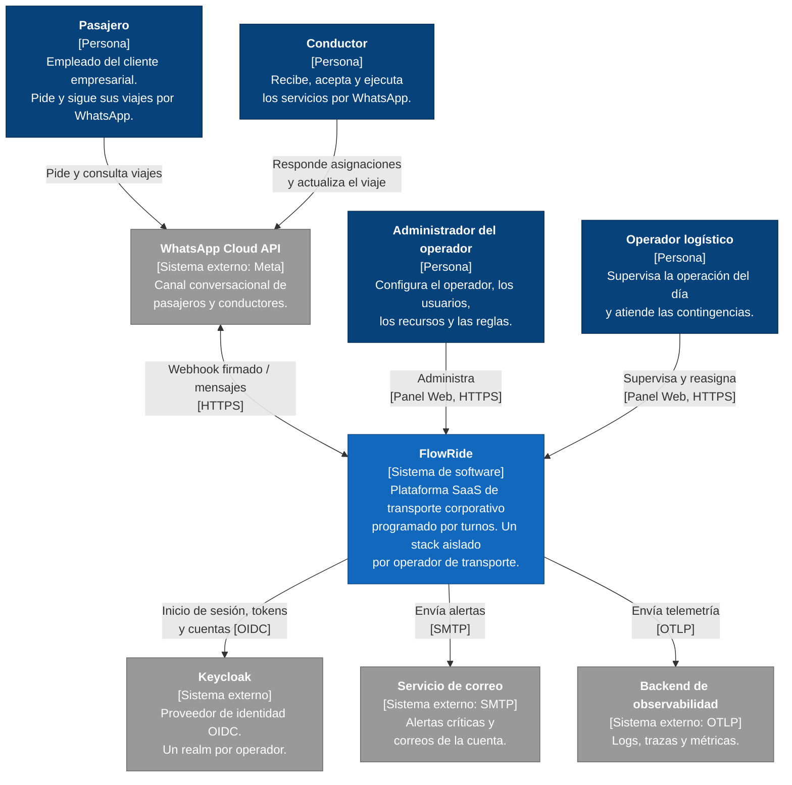
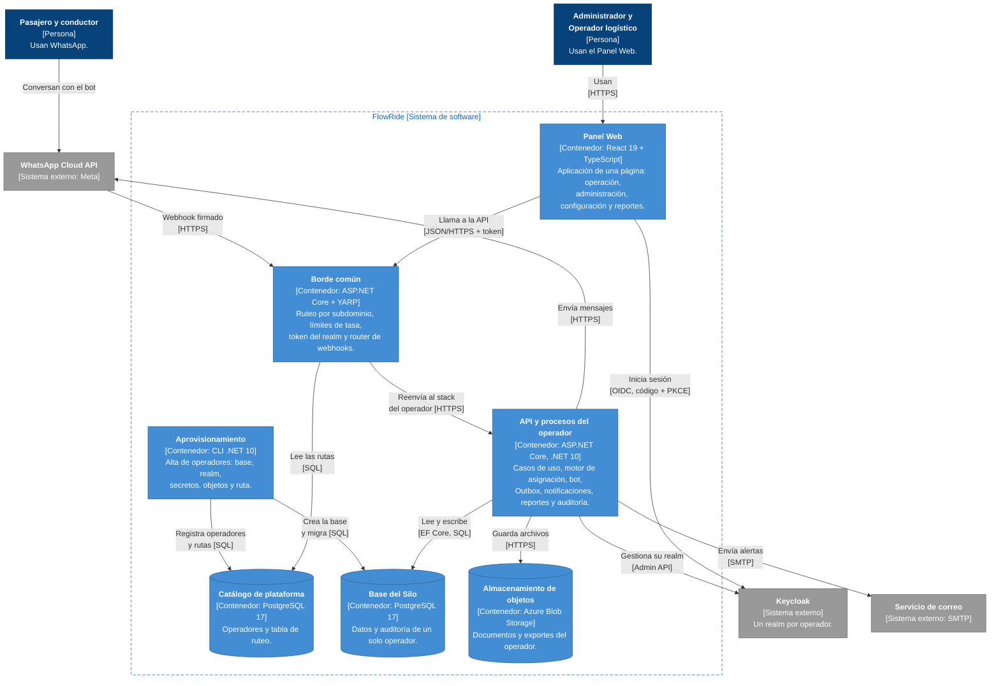

# Diseño de alto nivel (modelo C4, niveles 1 y 2)

**FlowRide** — Documento de Arquitectura de Software v3.1 (28-10-2026). La numeración de las secciones es la del DAS completo ([../DAS.md](../DAS.md)).

## 4. Modelo de contexto

El modelo de contexto delimita el sistema y muestra los actores y sistemas externos con los que interactúa, sin entrar en su estructura interna. FlowRide se despliega como una instancia (stack) por operador de transporte; a su alrededor interactúan los siguientes elementos:

| Elemento | Tipo | Interacción con FlowRide | Referencia |
| --- | --- | --- | --- |
| Pasajero | Persona (empleado del cliente empresarial) | Solicita transporte, consulta estado, recibe confirmaciones y califica al conductor, únicamente por WhatsApp. | RF-09, RF-15, RF-16, RF-54 |
| Conductor | Persona (nómina del operador o contrato exclusivo) | Recibe asignaciones, las acepta o rechaza y actualiza el estado del viaje por WhatsApp. | RF-17, RF-18 |
| Administrador del operador | Persona | Configura el tenant, los usuarios, los recursos y las reglas de asignación, y consulta reportes en el Panel Web. | RF-04, RF-05, RF-06, RF-21 |
| Operador logístico | Persona | Supervisa la operación, reasigna ante contingencias y atiende alertas en el Panel Web. | RF-12, RF-37, RF-39, RF-45 |
| Cliente empresarial (aerolínea, minera, hospital) | Organización | Contrata al operador; no usa FlowRide directamente. Se identifica con empresaId dentro de la base del operador. | Contexto v10, §3.2 |
| WhatsApp Business (Meta) | Sistema externo | Canal conversacional único de pasajero y conductor mediante webhooks. En el alcance académico se usa el número de prueba de Meta (WhatsApp Cloud API) detrás de `IWhatsAppGateway`. | ADR-0008, ADR-0012 |
| Proveedor de identidad OIDC/OAuth2 | Sistema externo | Autentica a los usuarios del Panel Web y emite los tokens; Keycloak con un realm por operador. | ADR-0003, ADR-0010 |
| Fuente de telemetría GPS | Sistema externo | Fuera del alcance de V1. Enviaría eventos de ubicación de los vehículos para monitoreo y detección de desviación de ETA. | ADR-0005 |
| Backend de observabilidad | Sistema externo | Recibe trazas, métricas y logs mediante OTLP. | ADR-0011 |
| Servicio de correo | Sistema externo | Entrega alertas críticas a los roles administrativos (`IEnviadorCorreo`) y los correos de la cuenta (definir o recuperar la contraseña, confirmar el correo), que envía el proveedor de identidad. En local, Mailpit. | ADR-0015 |

### 4.1 Diagrama de contexto (C4, nivel 1)

Forma parte del diseño de alto nivel. Muestra a FlowRide como una sola caja, las personas que lo usan y los sistemas externos con los que se integra. El cliente empresarial no aparece porque no usa FlowRide directamente, y la fuente de telemetría GPS tampoco, porque quedó fuera del alcance de V1 (ADR-0005).

> Imagen del diagrama: [01-contexto-c4.png](imagenes/01-contexto-c4.png)

Figura 1. Contexto de FlowRide (modelo C4, nivel 1). Azul oscuro: personas; azul: el sistema; gris: sistemas externos.

La sección 6.1 abre la caja de FlowRide en sus contenedores (nivel 2) y la sección 9.3.1 detalla los componentes de la API.

## 6.1 Diagrama de contenedores (C4, nivel 2)

Forma parte del diseño de alto nivel. Abre la caja de FlowRide del diagrama de contexto y muestra sus contenedores: las aplicaciones y los almacenes de datos que se despliegan por separado, con su tecnología y cómo se comunican. El borde, el catálogo y el aprovisionamiento son de la plataforma y los comparten todos los operadores; la API, la base del Silo y el almacenamiento de objetos se repiten, aislados, para cada operador (modelo Silo, ADR-0002).

> Imagen del diagrama: [02-contenedores-c4.png](imagenes/02-contenedores-c4.png)

Figura 2. Contenedores de FlowRide (modelo C4, nivel 2). Azul claro: contenedores (los cilindros son almacenes de datos); la línea punteada es el límite del sistema.

| Contenedor | Tecnología | Responsabilidad | ADR |
| --- | --- | --- | --- |
| Panel Web | React 19 + TypeScript, Vite, Mantine 8 | Interfaz del Administrador y del Operador logístico; sesión OIDC con PKCE y tokens solo en memoria. | ADR-0019 |
| Borde común | ASP.NET Core + YARP, 2 réplicas | Único punto de entrada: ruteo por subdominio, límites de tasa, cabeceras, validación del token del realm y router de webhooks de Meta. | ADR-0012 |
| Catálogo de plataforma | PostgreSQL 17 | Operadores registrados y tabla de ruteo del borde; sin datos operacionales. | ADR-0002, ADR-0012 |
| Aprovisionamiento | Aplicación de consola .NET 10 | Alta idempotente de operadores: base y rol, migraciones, realm, secretos, contenedor de objetos y ruta. | ADR-0010 |
| API y procesos del operador | ASP.NET Core, .NET 10 | Casos de uso, motor de asignación, bot de WhatsApp, Outbox, notificaciones, reportes y auditoría. | ADR-0001, ADR-0007, ADR-0009 |
| Base del Silo | PostgreSQL 17 | Fuente de verdad transaccional y auditoría encadenada de un solo operador. | ADR-0002, ADR-0004 |
| Almacenamiento de objetos | Azure Blob Storage (Azurite en local) | Documentos de conductores y exportes, un contenedor por operador. | ADR-0013 |
