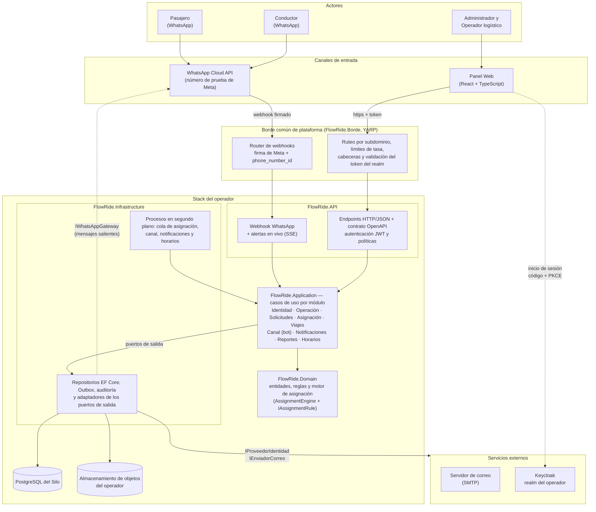

# Diseño detallado: diagrama de componentes

**FlowRide** — Documento de Arquitectura de Software v3.1 (28-10-2026). La numeración de las secciones es la del DAS completo ([../DAS.md](../DAS.md)).

## 9.3.1 Diagrama de componentes

El diagrama de componentes representa las piezas de software del sistema, sus responsabilidades y sus dependencias e interfaces. Le aporta al diseño una visión de cómo se reparte la funcionalidad y de qué componente depende cada flujo.

### 9.3.1.1 Backend FlowRide — instancia Silo del operador

Muestra los componentes de un stack de operador, el borde común por el que entra todo el tráfico, los actores que lo usan y los sistemas externos con los que se integra. Reemplaza el diagrama C4 del 09-09-2026, anterior a ADR-0008, ADR-0010, ADR-0012 y ADR-0019.

#### 9.3.1.1.1 Diagrama

> Imagen del diagrama: [03-componentes.png](imagenes/03-componentes.png)

Figura 3. Componentes de una instancia Silo de FlowRide detrás del borde común (estado al 22-10-2026).

#### 9.3.1.1.2 Documentación

| Componente | Responsabilidad | Relación con los drivers |
| --- | --- | --- |
| Borde común (FlowRide.Borde) | Único punto de entrada: ruteo por subdominio desde el catálogo, límites de tasa, cabeceras de seguridad, validación de que el token es del realm del operador y router de webhooks que valida la firma de Meta y reenvía por `phone_number_id`. | RF-14, RF-19; ADR-0012 |
| Panel Web | Interfaz del Administrador y del Operador logístico; tokens solo en memoria; cliente tipado desde el contrato OpenAPI. | RF-36, RF-37, RF-45; ADR-0019 |
| Endpoints HTTP/JSON | API REST del Panel Web con contrato OpenAPI; solo conocen puertos de entrada y DTO. | RF-01 a RF-54; ADR-0001 |
| Autenticación y autorización | Valida el JWT del realm, resuelve el usuario interno (activo) y aplica políticas por rol y de autenticación reciente para las acciones sensibles. | RF-01, RF-02, RF-25; ADR-0003 |
| Webhook WhatsApp y alertas en vivo | Recibe los mensajes (firma `X-Hub-Signature-256`, bandeja de entrada idempotente) y publica las alertas del panel por SSE. | RF-14, RF-45; ADR-0008, ADR-0015 |
| Casos de uso (Application) | Un caso de uso por operación, agrupados por módulo; confirman el cambio, su auditoría y su evento de Outbox en una transacción. | ADR-0001, ADR-0007 |
| Bot de WhatsApp (módulo Canal) | Máquina de estados conversacional de menú numerado para pasajero y conductor. | RF-15, RF-18; ADR-0008 |
| Motor de asignación (Domain) | Compone reglas eliminatorias, de prioridad, de puntuación y de desempate según la configuración versionada del operador; deja un decision log explicable. | RF-10, RF-11, RF-13, RF-21; ADR-0009 |
| Entidades y reglas de dominio | Solicitudes, asignaciones, viajes, turnos, recursos, calificaciones y fechas con zona horaria. | Restricción de modelado de dominio |
| Repositorios, Outbox y auditoría | Persistencia EF Core en el esquema `ops`; eventos de Outbox; auditoría con cadena de hash SHA-256 verificable. | RF-40, RF-52; ADR-0004, ADR-0007, ADR-0011 |
| Procesos en segundo plano | Cola de asignación (y vencimiento de asignaciones sin respuesta), canal WhatsApp (entrantes y salientes con reintentos), notificaciones (procesa la Outbox) y recálculo de horarios al iniciar. | RF-10, RF-16, RF-17, RF-35, RF-43, RF-44; ADR-0007, ADR-0015 |
| Adaptadores | Keycloak, WhatsApp Cloud API (o simulado), correo SMTP y almacenamiento de objetos detrás de puertos de Application. | ADR-0003, ADR-0008, ADR-0013, ADR-0015 |
| PostgreSQL del Silo | Fuente de verdad transaccional del operador. | RF-19; ADR-0002, ADR-0004 |
| Almacenamiento de objetos | Documentos del conductor y exportes del operador. | ADR-0013 |

La telemetría GPS y la detección de desviación de ETA (RF-55, RF-56) no aparecen porque quedaron fuera del alcance de V1 (ADR-0005).
