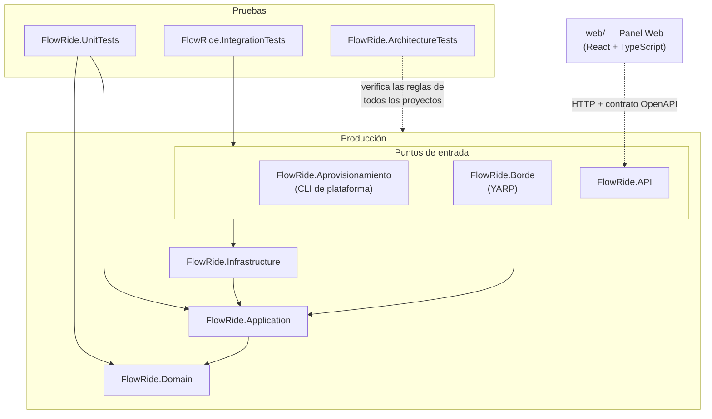
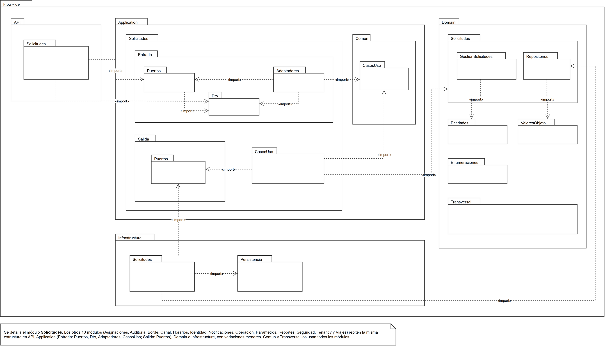

# Diseño detallado: diagrama de paquetes

**FlowRide** — Documento de Arquitectura de Software v3.1 (28-10-2026). La numeración de las secciones es la del DAS completo ([../DAS.md](../DAS.md)).

## 9.3.2 Diagrama de paquetes

El diagrama de paquetes muestra cómo se agrupan los elementos del software y las dependencias entre esos grupos. Le aporta al diseño el control de la dirección de las dependencias, que en FlowRide deben apuntar hacia el dominio.

### 9.3.2.1 Solución FlowRide (.NET 10)

Representa los proyectos de la solución y las referencias reales entre ellos (tomadas de los archivos `.csproj` al 22-10-2026). Reemplaza la figura de la versión 2.0, que mostraba la solución inicial de cinco proyectos.

#### 9.3.2.1.1 Diagrama

> Imagen del diagrama: [04-paquetes.png](imagenes/04-paquetes.png)

Figura 4. Paquetes de la solución FlowRide y sus dependencias. Las flechas apuntan hacia el paquete del que se depende. Una flecha que sale de un grupo vale para cada proyecto del grupo: API, Aprovisionamiento y Borde dependen de Infrastructure y de Application, e IntegrationTests de los tres. ArchitectureTests referencia todos los proyectos de producción para verificar sus reglas de dependencia.

#### 9.3.2.1.2 Documentación

| Paquete | Tipo de proyecto | Depende de | Responsabilidad |
| --- | --- | --- | --- |
| FlowRide.Domain | Biblioteca de clases | — | Modelo de dominio y motor de asignación; sin dependencias externas. |
| FlowRide.Application | Biblioteca de clases | FlowRide.Domain | Casos de uso, puertos de entrada y de salida, adaptadores de entrada. |
| FlowRide.Infrastructure | Biblioteca de clases | FlowRide.Application | Implementaciones de los puertos (persistencia, Keycloak, WhatsApp, correo, objetos), Outbox y procesos en segundo plano. |
| FlowRide.API | ASP.NET Core | FlowRide.Application, FlowRide.Infrastructure | Endpoints HTTP, autenticación y composición por inyección de dependencias. |
| FlowRide.Aprovisionamiento | Aplicación de consola | FlowRide.Application, FlowRide.Infrastructure | Alta de operadores (Silo), migraciones y rutas del borde. |
| FlowRide.Borde | ASP.NET Core con YARP | FlowRide.Application, FlowRide.Infrastructure | Borde común: ruteo, protección y router de webhooks. |
| FlowRide.UnitTests | xUnit | FlowRide.Domain, FlowRide.Application | Pruebas del dominio, el motor y los casos de uso con dobles en memoria. |
| FlowRide.ArchitectureTests | xUnit + ArchUnitNET | Todos los proyectos de producción | Reglas de dependencia entre capas y de los adaptadores. |
| FlowRide.IntegrationTests | xUnit + Testcontainers | FlowRide.API, FlowRide.Aprovisionamiento, FlowRide.Borde | Flujos completos con PostgreSQL, Keycloak, Mailpit y Azurite reales. |
| web/ | Vite + React + TypeScript | Contrato OpenAPI de FlowRide.API | Panel Web; pruebas con Vitest, Testing Library y axe. |

### 9.3.2.2 Espacio de nombres FlowRide (notación UML)

Detalla el diagrama anterior en notación UML de paquetes. Cada paquete es un espacio de nombres del código y se anida dentro de su padre (FlowRide › Application › Solicitudes › Entrada › Puertos); las flechas punteadas «import» indican qué espacio de nombres usa a cuál, según las directivas `using` del código. Se detalla el módulo Solicitudes; los demás módulos repiten la misma estructura.

#### 9.3.2.2.1 Diagrama

Figura 5. Paquetes del espacio de nombres FlowRide en notación UML, con el módulo Solicitudes como ejemplo. Las flechas «import» apuntan hacia el paquete que se usa.

#### 9.3.2.2.2 Documentación

| Paquete | Contenido | Importa |
| --- | --- | --- |
| API.Solicitudes | Endpoints HTTP del módulo (`SolicitudesEndpoints`). | Entrada.Puertos, Entrada.Dto |
| Application.Solicitudes.Entrada.Puertos | Puerto de entrada `ISolicitudesPuertoEntrada`. | Entrada.Dto |
| Application.Solicitudes.Entrada.Dto | Peticiones y respuestas del contrato HTTP. | — |
| Application.Solicitudes.Entrada.Adaptadores | Implementa el puerto de entrada: valida, convierte los DTO y llama a los casos de uso. | Entrada.Puertos, Entrada.Dto, Comun.CasosUso, Domain |
| Application.Solicitudes.CasosUso | Casos de uso del módulo (registrar, modificar, cancelar, consultar y buscar solicitudes). | Comun.CasosUso, Salida.Puertos, Domain |
| Application.Solicitudes.Salida.Puertos | Consultas de lectura que implementa la infraestructura (`IConsultasSolicitudes`). | Domain |
| Application.Comun.CasosUso | Interfaces `ICasoUsoConRetorno` e `ICasoUsoSinRetorno`, comunes a todos los módulos. | — |
| Domain.Solicitudes | Datos de las operaciones (GestionSolicitudes) y contratos de repositorio (Repositorios). | Entidades, ValoresObjeto, Transversal |
| Domain.Entidades, ValoresObjeto y Enumeraciones | Modelo de dominio compartido por los módulos. | — |
| Domain.Transversal | `FlowRideExcepcion`, usada por todas las capas. | — |
| Infrastructure.Solicitudes | Repositorios y consultas con EF Core (`SolicitudRepositorioAdaptador`, `ConsultasSolicitudesEf`). | Salida.Puertos, Domain.Solicitudes.Repositorios, Persistencia |
| Infrastructure.Persistencia | `FlowRideDbContext`, configuraciones, migraciones, unidad de trabajo y Outbox. | Domain |

El archivo editable del diagrama está en [drawio/04b-paquetes-uml.drawio](drawio/04b-paquetes-uml.drawio); la carpeta [drawio](drawio) tiene todos los diagramas en formato draw.io.
