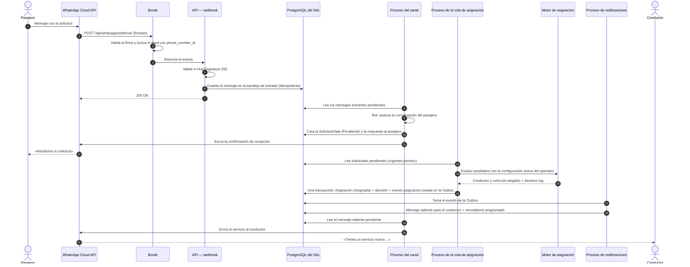
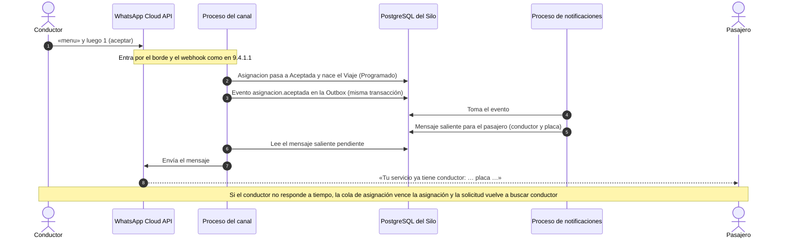
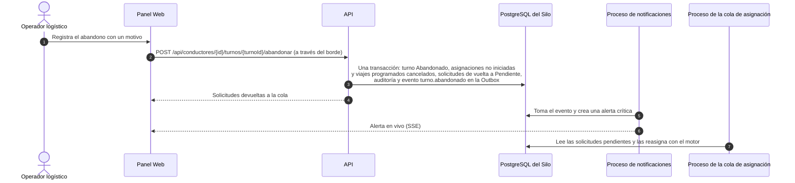
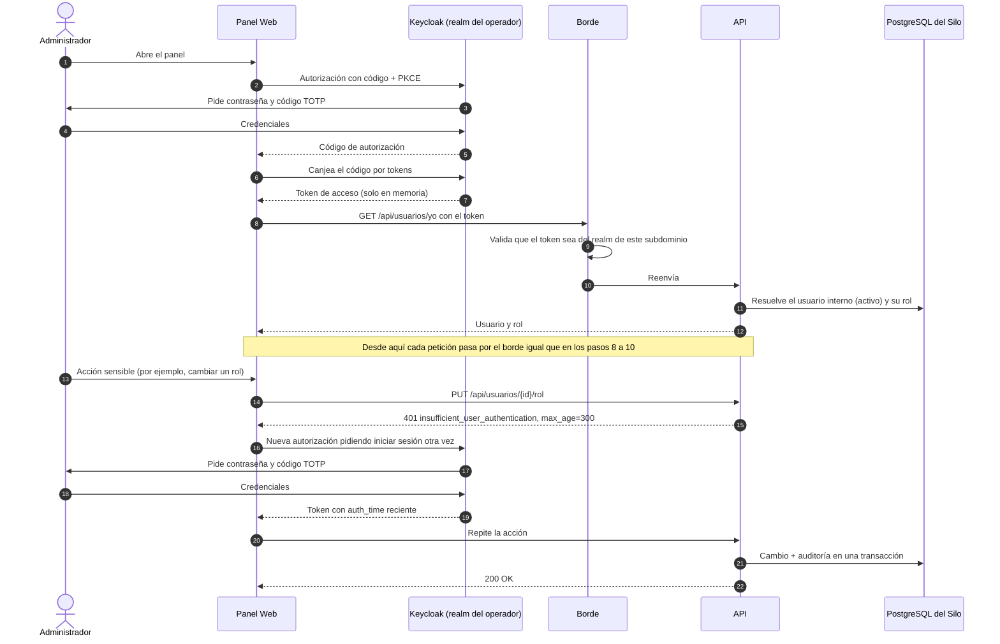
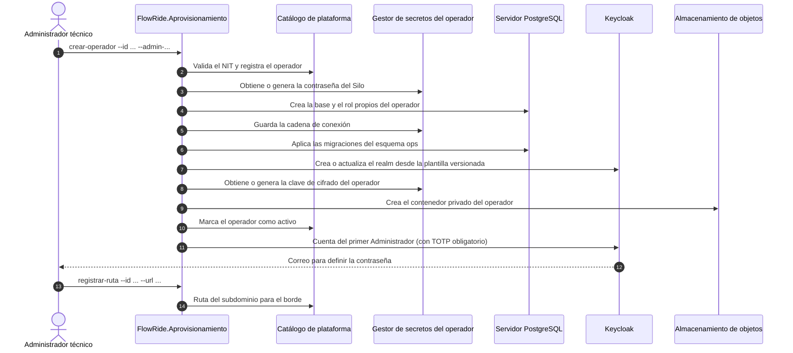

# Diseño detallado: diagramas de secuencia

**FlowRide** — Documento de Arquitectura de Software v3.1 (28-10-2026). La numeración de las secciones es la del DAS completo ([../DAS.md](../DAS.md)).

## 9.4.1 Diagrama de secuencia

El diagrama de secuencia muestra el intercambio de mensajes entre participantes ordenado en el tiempo para un escenario concreto. Le aporta al diseño la validación de responsabilidades y del orden de las interacciones.

El contexto v10 (Capa 4) identifica como flujos críticos la solicitud por WhatsApp, la asignación por reglas, el abandono de turno de un conductor y la detección de desviación de ETA. Se documentan los tres primeros (la asignación forma parte del primero) más la aceptación del conductor, el inicio de sesión con reautenticación y el alta de un operador. La desviación de ETA no se diagrama porque quedó fuera del alcance de V1 (ADR-0005).

### 9.4.1.1 Solicitud por WhatsApp hasta la asignación

Motivación: es el flujo central del negocio (RF-09, RF-10, RF-14, RF-15, RF-17). Muestra cómo la recepción se separa del procesamiento para no perder mensajes (PAS-DISP-01) y cómo la asignación y su aviso quedan en una sola transacción con la Outbox (ADR-0007).

#### 9.4.1.1.1 Diagrama

> Imagen del diagrama: [05-secuencia-solicitud-whatsapp-asignacion.png](imagenes/05-secuencia-solicitud-whatsapp-asignacion.png)

#### 9.4.1.1.2 Documentación

- La respuesta HTTP al webhook no espera el procesamiento: el mensaje se guarda primero y se procesa después. Si Meta reintenta, la bandeja de entrada descarta el duplicado.
- Los tres procesos en segundo plano (canal, cola de asignación y notificaciones) corren dentro del mismo stack y se comunican solo a través de la base del Silo; ninguno llama a otro directamente.
- Si dos réplicas intentan asignar la misma solicitud, la concurrencia optimista hace fallar a la segunda y nada se guarda (spike de doble asignación, sección 3).
- Si el motor no encuentra candidatos, la solicitud queda «Sin candidatos» y el evento `solicitud.sin_candidatos` genera una alerta en el Panel Web.

### 9.4.1.2 El conductor acepta y se avisa al pasajero

Motivación: cierra el flujo de la asignación (RF-16, RF-34). El pasajero recibe el nombre del conductor y la placa solo cuando el conductor acepta, no cuando el motor asigna, para no prometer un servicio que el conductor puede rechazar.

#### 9.4.1.2.1 Diagrama

> Imagen del diagrama: [06-secuencia-conductor-acepta.png](imagenes/06-secuencia-conductor-acepta.png)

#### 9.4.1.2.2 Documentación

- El Operador logístico puede aceptar o rechazar en nombre del conductor desde el Panel Web (`POST /api/asignaciones/{id}/aceptar` o `/rechazar`); el resto del flujo es el mismo.
- Un rechazo cierra la asignación y la solicitud vuelve a la cola; el motor no vuelve a proponer esa solicitud al conductor que la rechazó.

### 9.4.1.3 Abandono de turno de un conductor

Motivación: es la contingencia principal del caso ancla (RF-12, OPLOG-REND-01). Muestra que un abandono redistribuye los servicios sin interrumpir los viajes que ya están en curso.

#### 9.4.1.3.1 Diagrama

> Imagen del diagrama: [07-secuencia-abandono-de-turno.png](imagenes/07-secuencia-abandono-de-turno.png)

#### 9.4.1.3.2 Documentación

- Un viaje ya iniciado no se interrumpe: solo se cancelan las asignaciones que aún no comenzaron.
- La reasignación la hace el mismo motor con las mismas reglas; si no hay candidatos, el Operador logístico puede asignar manualmente (RF-39).

### 9.4.1.4 Inicio de sesión en el Panel Web y reautenticación

Motivación: muestra cómo se cumplen ADM-SEG-01 (revocación ≤ 60 s) y la protección de las acciones sensibles. El rol y el estado del usuario los decide FlowRide en cada petición, no el token.

#### 9.4.1.4.1 Diagrama

> Imagen del diagrama: [08-secuencia-inicio-sesion-reautenticacion.png](imagenes/08-secuencia-inicio-sesion-reautenticacion.png)

#### 9.4.1.4.2 Documentación

- Desactivar a un usuario deshabilita su cuenta en Keycloak, cierra sus sesiones y, sobre todo, hace que la API lo rechace en la siguiente petición aunque su token siga vigente (el usuario interno ya no está activo).
- Las acciones sensibles (gestión de usuarios, configuración del motor, parámetros) exigen que el inicio de sesión sea de los últimos 5 minutos (RFC 9470); el Administrador siempre usa doble factor.

### 9.4.1.5 Alta de un operador (aprovisionamiento del Silo)

Motivación: RF-03 y el riesgo principal del modelo Silo (OPLOG-SEG-02, ADM-SEG-02): que un operador nuevo quede aislado de los demás. El procedimiento es idempotente para poder repetirse si falla a mitad.

#### 9.4.1.5.1 Diagrama

> Imagen del diagrama: [09-secuencia-alta-de-operador.png](imagenes/09-secuencia-alta-de-operador.png)

#### 9.4.1.5.2 Documentación

- Cada paso reutiliza lo que ya existe (secretos, base, realm, contenedor), así que repetir el comando después de un fallo continúa donde quedó sin duplicar recursos.
- La herramienta es la única con permisos para crear bases y realms; la API del operador solo usa la cuenta de servicio de su propio realm.
