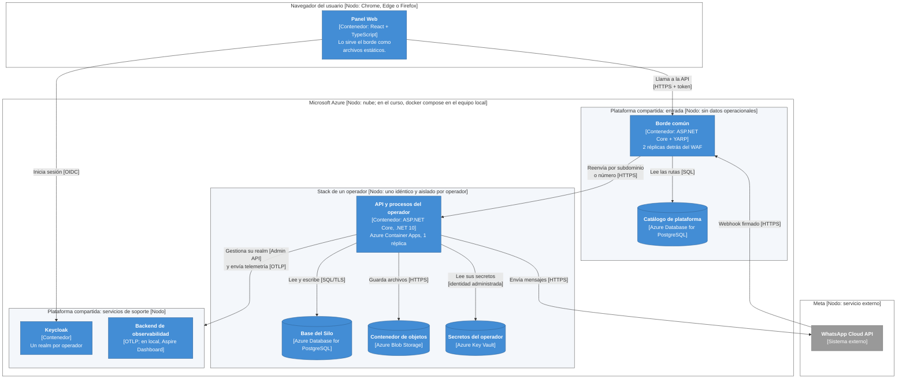

# Diseño detallado: diagrama de despliegue (notación C4)

**FlowRide** — Documento de Arquitectura de Software v3.1 (28-10-2026). La numeración de las secciones es la del DAS completo ([../DAS.md](../DAS.md)).

## 9.5.1 Diagrama de despliegue

El diagrama de despliegue representa los nodos, los artefactos desplegados en ellos y las conexiones entre nodos. Se presenta en notación C4 (diagrama de despliegue): cada nodo de infraestructura es una caja que contiene los contenedores del diagrama de nivel 2 (sección 6.1).

### 9.5.1.1 Diagrama

> Imagen del diagrama: [10-despliegue-c4.png](imagenes/10-despliegue-c4.png)

Figura 6. Despliegue de FlowRide en notación C4 (cajas blancas: nodos de infraestructura; azul claro: contenedores): un stack aislado por operador detrás de los componentes de plataforma compartidos (ADR-0002, ADR-0010, ADR-0012, ADR-0013, ADR-0014). Se dibuja un solo stack porque todos son idénticos; cada operador tiene el suyo, con su base, sus secretos y su almacenamiento, y solo comparten el borde, el catálogo, Keycloak (un realm por operador), el registro de imágenes y la observabilidad.

### 9.5.1.2 Documentación

La topología de despliegue definida en ADR-0010, ADR-0012, ADR-0013 y ADR-0014 se compone de un stack por operador y de componentes de plataforma compartidos sin datos operacionales:

| Nodo / recurso | Contenido | Réplicas y continuidad | ADR |
| --- | --- | --- | --- |
| Stack del operador: contenedor de aplicación | API ASP.NET Core y procesos en segundo plano (cola de asignación, canal WhatsApp, notificaciones, horarios). Stateless. | 1 réplica con health checks (/health/live, /health/ready) y reinicio automático (≤ 2 min); 2 réplicas como opción contractual. | ADR-0010 |
| Stack del operador: base de datos | PostgreSQL propia del operador. | Backups diarios más WAL/PITR si la plataforma lo ofrece; RPO ≤ 15 min, RTO ≤ 2 h. | ADR-0004, ADR-0010, ADR-0013 |
| Stack del operador: secretos | Key Vault del operador, accesible solo por la identidad administrada de su stack. | — | ADR-0014 |
| Stack del operador: almacenamiento de objetos | Contenedor de Blob Storage propio (backups, archivo, exportes, documentos). | Retención por ciclo de vida; backups 35 días con inmutabilidad. | ADR-0013 |
| Plataforma: borde | Gateway (YARP), WAF y router de webhooks. | 2 réplicas, sin estado. | ADR-0012 |
| Plataforma: catálogo | Base de plataforma con los operadores y la tabla de ruteo del borde; sin datos operacionales. | Backups diarios. | ADR-0002, ADR-0012 |
| Plataforma: identidad | Keycloak con un realm por operador. | 1 réplica; RTO ≤ 1 h. | ADR-0003, ADR-0010 |
| Plataforma: registro de contenedores | Azure Container Registry (Basic). | — | ADR-0010 |
| Plataforma: observabilidad | Backend que recibe OTLP. | — | ADR-0011 |

- Versionado: cada merge a main que pasa CI genera una imagen inmutable etiquetada con versión semántica y SHA; nunca se despliega latest y el rollback consiste en redesplegar la etiqueta anterior.

- Todos los operadores ejecutan la misma versión; el despliegue se hace por oleadas (primero un operador piloto) y fuera de la franja crítica 03:00–05:00.

- Orquestación: Azure Container Apps (o Docker Compose/systemd sobre una VM de Azure en la etapa del curso). Kubernetes no es requisito de V1.

- Entorno del curso: la demostración se hace en local con la misma topología. `docker compose` levanta PostgreSQL (catálogo y Silos), Keycloak, Mailpit (correo) y Azurite (objetos); el borde atiende `https://tenant-a.localhost:8443` con certificado de desarrollo; los secretos de cada operador viven en un almacén user-secrets propio; y el webhook de Meta llega por un túnel HTTPS (ngrok) hasta el borde o la API.
