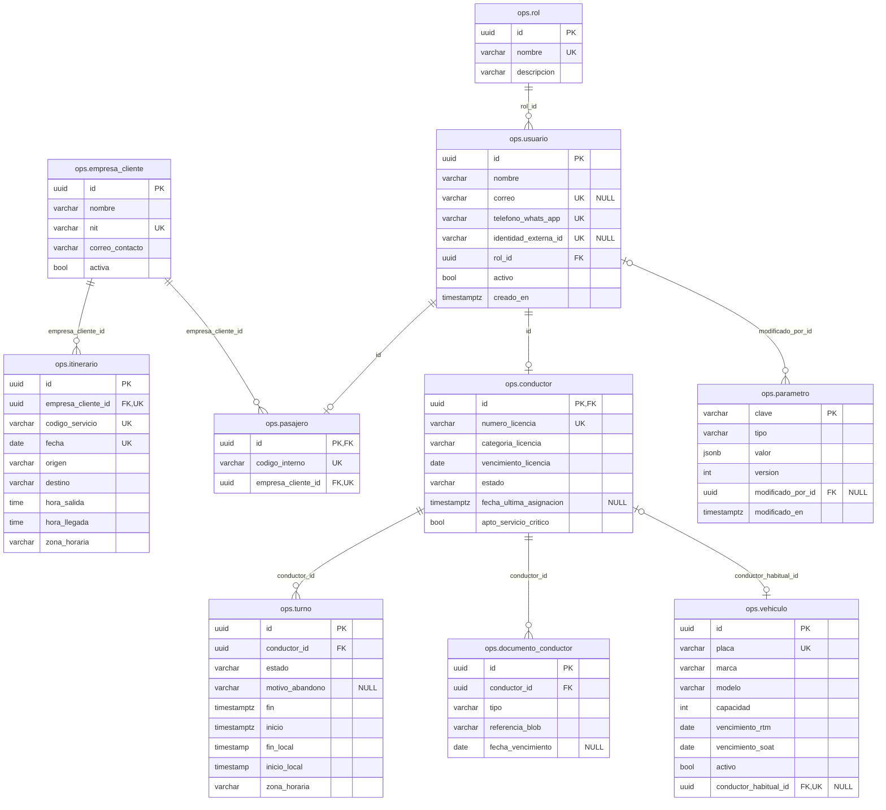
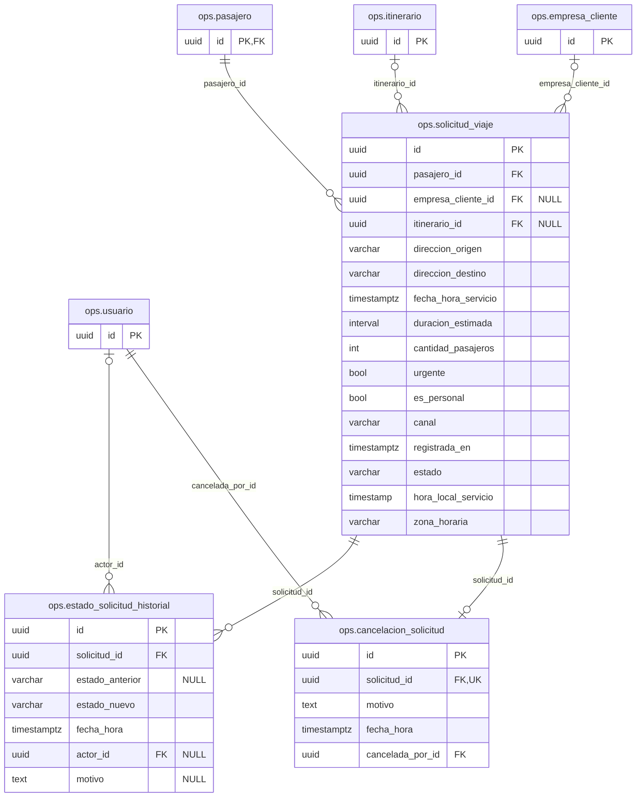
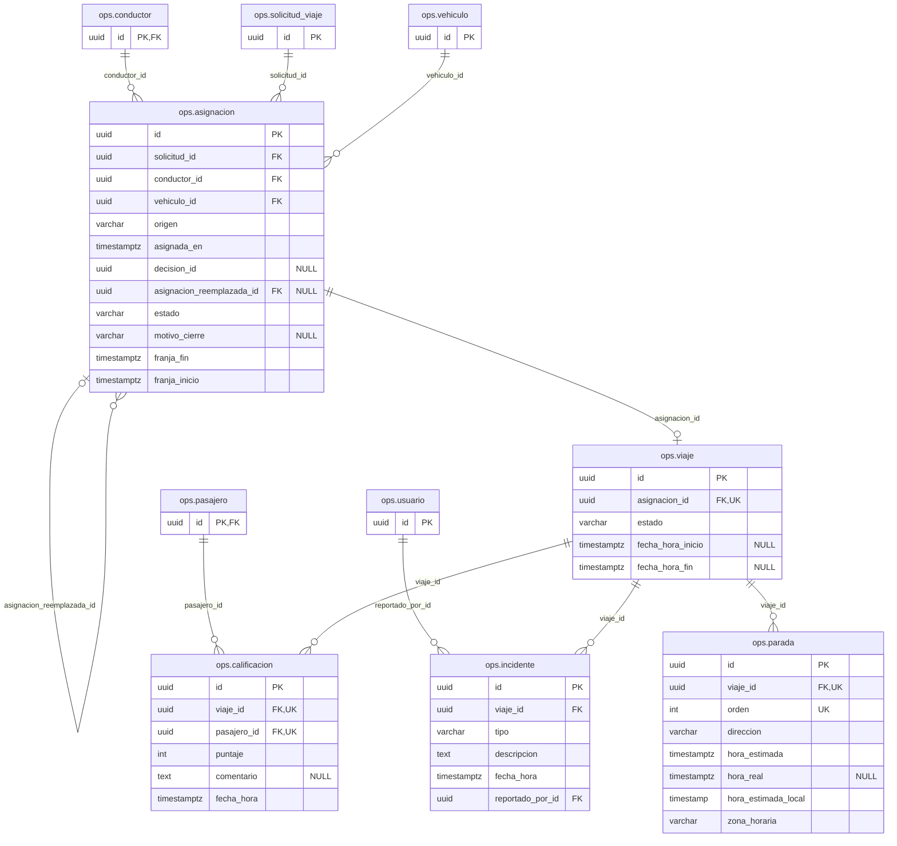
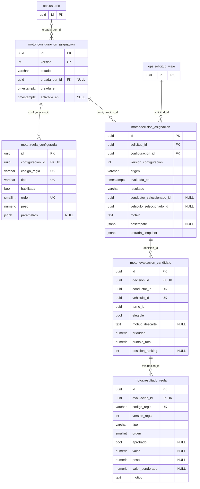
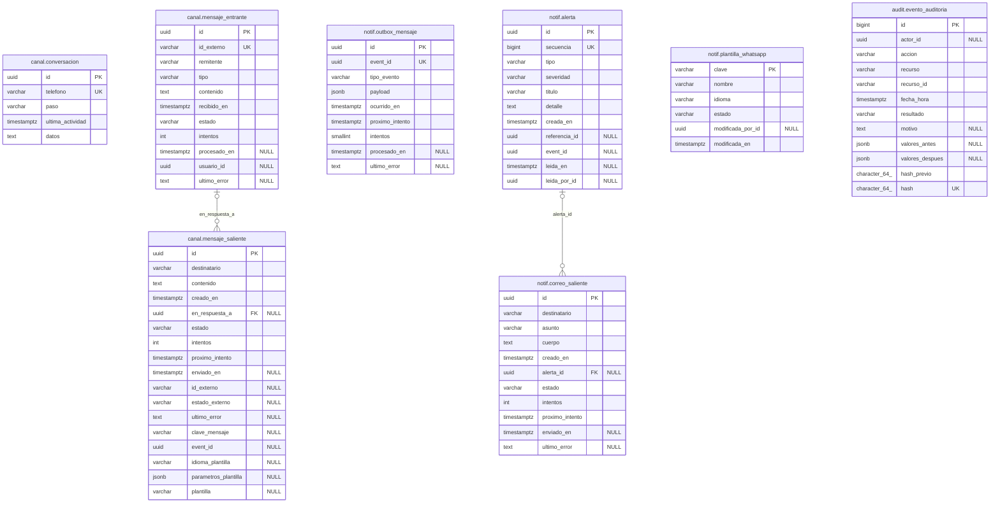
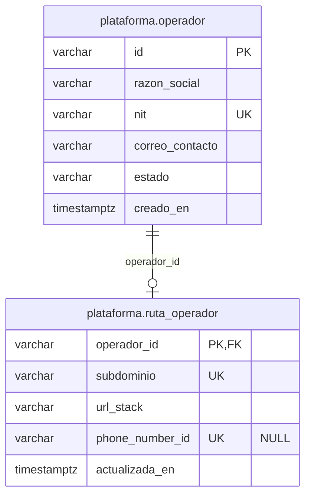

# Modelo entidad-relación de FlowRide

Modelo físico de las bases de datos de FlowRide **tal como están implementadas**. Se generó el 24-10-2026 leyendo el esquema real de PostgreSQL 17 (tablas, columnas, llaves primarias, llaves foráneas e índices únicos) después de aplicar todas las migraciones; reemplaza al modelo de diseño del 13-10-2026, anterior a la implementación.

- **Base del operador (Silo):** cada operador tiene su propia base con los esquemas `ops` (operación), `motor` (motor de asignación), `canal` (WhatsApp), `notif` (Outbox, alertas y plantillas) y `audit` (auditoría legal). Secciones 1 a 5.
- **Catálogo de plataforma:** una base aparte, compartida y sin datos operacionales. Sección 6.

## Convenciones

- **Marcas:** `PK` llave primaria, `FK` llave foránea, `UK` columna que forma parte de un índice único; `"NULL"` indica que la columna admite nulos.
- **Cardinalidad:** se deduce de cada llave foránea. `||` es obligatoria y `|o` opcional del lado del padre; `o{` son muchos y `o|` a lo sumo uno del lado del hijo (la columna es única, como en la herencia de `pasajero` y `conductor`, que comparten la llave con `usuario`).
- **Identificadores:** `uuid` generados por la aplicación (versión 7), salvo la auditoría (`bigint` creciente) y el catálogo (identificador del operador).
- **Fechas:** los instantes se guardan en UTC (`timestamptz`); los eventos futuros guardan además su hora local y su zona horaria (ADR-0020).
- **Concurrencia:** la columna de sistema `xmin` de PostgreSQL es el token de versión de las entidades que compiten (ADR-0007); por ser de sistema no aparece en los diagramas.
- **Restricciones `EXCLUDE`** (no se ven en el diagrama): un conductor no puede tener turnos que se traslapen, ni un conductor o un vehículo asignaciones vigentes que se traslapen en la misma franja; y solo puede haber una configuración del motor activa.
- **Referencias lógicas sin llave foránea** (a propósito):
  - `audit.evento_auditoria` (`actor_id`, `recurso_id`): la auditoría legal no depende de que el registro auditado siga existiendo.
  - `motor.decision_asignacion` y `motor.evaluacion_candidato` (`conductor_seleccionado_id`, `vehiculo_seleccionado_id`, `conductor_id`, `vehiculo_id`, `turno_id`) y `ops.asignacion.decision_id`: el registro de decisiones es una evidencia histórica e inmutable.
  - `notif.alerta` (`referencia_id`, `event_id`, `leida_por_id`), `notif.outbox_mensaje.event_id`, `notif.plantilla_whatsapp.modificada_por_id` y `canal.mensaje_entrante.usuario_id`: eventos y mensajes que pueden referirse a distintos tipos de registro o llegar antes de conocer al usuario.
  - `id_externo` de los mensajes, `ops.usuario.identidad_externa_id` y `plataforma.ruta_operador.phone_number_id` son identificadores de sistemas externos (Meta y Keycloak).
- Las tablas de una sección que referencian tablas de otra sección muestran esas tablas solo con su llave primaria.

## 1. Usuarios, clientes y recursos operativos

Usuarios del operador (con herencia TPT para pasajero y conductor), clientes empresariales, recursos del conductor (turnos, documentos, vehículo habitual), itinerarios y parámetros.

## 2. Solicitudes de viaje

La solicitud con su historial de estados y su cancelación. Las tablas de otras secciones aparecen solo con su llave.

## 3. Asignaciones y viajes

La asignación (que puede reemplazar a otra) y el viaje con sus paradas, incidentes y calificación. Las tablas de otras secciones aparecen solo con su llave.

## 4. Motor de asignación

Configuración versionada del motor con sus reglas y el registro de decisiones (decision log): cada decisión guarda los candidatos evaluados y el resultado de cada regla.

## 5. Canal WhatsApp, notificaciones y auditoría

Conversaciones y mensajes del bot, la Outbox de eventos, las alertas del Panel Web con sus correos, las plantillas de WhatsApp y la auditoría legal encadenada.

## 6. Catálogo de plataforma (base aparte)

Base compartida de la plataforma, fuera de los Silos y sin datos operacionales: los operadores registrados y la tabla de ruteo del borde.

